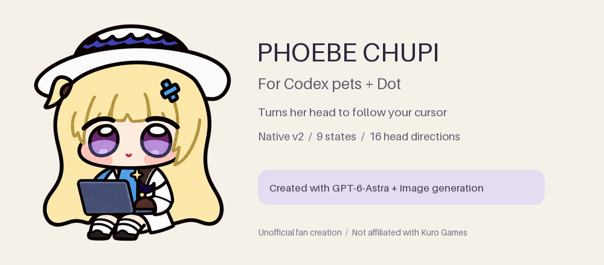

# Phoebe Chupi

**English** · [简体中文](README.zh-CN.md)

**Phoebe Chupi / 菲比啾比** is a coding companion for **Codex desktop and Dot**. She sits with her laptop, blinks while she works, and turns her head toward your cursor in Dot.

**9 animation states · 16 look directions · Transparent v2 sprites**

Made with **GPT-6-Astra** and the built-in image generation tools. Based on the community's Phoebe Chupi interpretation of Phoebe from *Wuthering Waves*.

## Get started

1. Download **[phoebe-chupi-v1.0.1.zip](https://github.com/RiomQAQ/phoebe-chupi-codex-pet/releases/download/v1.0.1/phoebe-chupi-v1.0.1.zip)** and extract it.
2. Put the `phoebe-chupi` folder inside your Codex `pets` directory:

   | Platform | Directory |
   | --- | --- |
   | macOS | `~/.codex/pets/` |
   | Windows | `%USERPROFILE%\.codex\pets\` |
   | Custom configuration | `<CODEX_HOME>/pets/` |

3. Open **Settings → Pets** or **Mini & Pets**, refresh the list, and select **Phoebe Chupi · Coding Companion**.

The folder contains two files: `pet.json` and `spritesheet.webp`. No plugin is required. For native import, upgrades, and troubleshooting, see the [installation guide](docs/INSTALL.md).

## See her in motion

| At her laptop | Working | Waiting for a reply |
| :---: | :---: | :---: |
|  |  |  |

| Following the cursor in Dot | A small seated hop |
| :---: | :---: |
|  |  |

The direction preview cycles through all sixteen poses. In Dot, the cursor chooses the pose. The app controls animation timing and task-state changes.

The remaining states cover carrying her laptop left or right, waving, asking for help, and checking a result. Browse [all states](previews/all-states.gif) or the [frame layout](docs/FORMAT.md#animation-states).

## Compatibility

| Surface | Status |
| --- | --- |
| Codex desktop on macOS | Installed and visually checked. |
| Codex Dot | Supports cursor-following head turns. |
| Windows desktop | Portable package provided; visual verification pending. |
| Web upload | The documented uploader accepts v1 sheets; use a v2-capable import flow for this package. |

This package uses a **1536 × 2288** v2 sheet. Your app must support custom v2 pets. See [installation and compatibility](docs/INSTALL.md#compatibility) for details.

## Explore the project

| Guide | What you can do |
| --- | --- |
| [Install and update](docs/INSTALL.md) | Import the pet, update an existing copy, or resolve display problems. |
| [Making a pet](docs/MAKING-OF.md) | Follow the workflow from references to individual frames and a finished package. |
| [Prompt examples](docs/PROMPTS.md) | Start with reusable character, motion, repair, and review prompts. |
| [Sprite format](docs/FORMAT.md) | Look up manifest fields, animation rows, directions, and timing. |
| [Review and validation](docs/REVIEW.md) | Inspect visual quality, reproduce file checks, and read the current results. |
| [Image archive](docs/IMAGE-GALLERY.md) | Browse 742 source images, studies, individual frames, and experiments. |

Every guide has a Chinese edition. The [documentation index](docs/README.md) includes sources, credits, and the v1.0.1 [hair-outline repair](docs/OUTLINE-REPAIR.md).

## Credits and license

Phoebe belongs to Kuro Games' *Wuthering Waves*. The community three-view reference is attributed to **蓝蓝铜离子**. See [credits](NOTICE.md) and [sources](docs/SOURCES.md).

Original scripts and documentation use the [MIT license](LICENSE). Artwork and references have [separate usage terms](ASSET-USAGE.md). This is an unofficial fan project, unaffiliated with Kuro Games or OpenAI.
