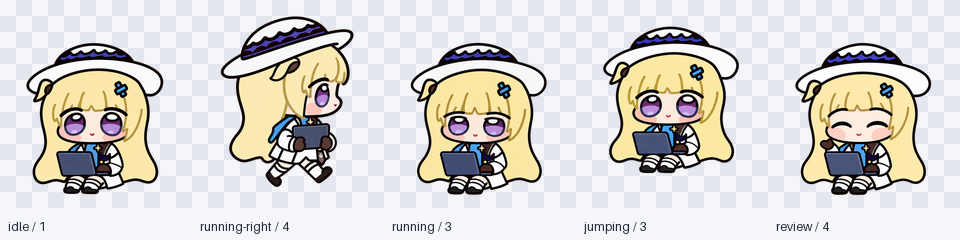

# Phoebe Chupi · 菲比啾比

**English** · [简体中文](README.zh-CN.md)

[](https://github.com/RiomQAQ/phoebe-chupi-codex-pet/releases "Release asset downloads across all versions")

**Phoebe Chupi / 菲比啾比** is a coding companion for **Codex desktop and Dot**. Wearing her signature wide white hat with a dark-purple ribbon, she sits with a blue-gray laptop on her knees—breathing softly and blinking while idle, typing away when your agent runs a task, looking up for help when a command fails, and turning her head to follow your cursor inside Codex Dot.


> **9 animation states · 16 cursor-following look directions · 1536 × 2288 transparent v2 sprite atlas**
>
> Inspired by the community's "Phoebe Chupi" chibi interpretation of Phoebe from *Wuthering Waves*, crafted frame by frame with **GPT-6-Astra** and built-in image generation tools.

---

## Character Anatomy & Visual Legend

To keep Phoebe Chupi crisp and unmistakable inside a **192 × 208** native cell, every frame follows a locked visual blueprint—including her asymmetric hair accessories across left/right walks and all 16 head turns:

```text
                ╭────────────────────────────────────╮
                │  Broad White Hat + Purple Ribbon   │  ← Crown area shifts naturally with head pitch
                ╰─────────────────┬──────────────────╯
     Ahoge Tuft & Blue Ribbon     │     Blue Cross Hair Clip
      (Always on viewer-left) ──► ( ◕ ‿ ◕ ) ◄── (Always on viewer-right; never flipped by mirroring)
                                  │
                          ┌───────┴───────┐
                          │ Blue-Gray Mac │  ← Open on her lap when seated; closed in her arms when walking
                          └───────────────┘
                   White Outfit · Dark Gloves · Striped Socks
```



*Above: Unscaled **192 × 208 native pixel stills** (`idle`, `running`, `jumping`, `running-right`, and `review`). Continuous dark outer contours paired with warm gold-brown inner hair lines keep her silhouette clean on both light and dark desktops.*

---

## See Her in Motion: How She Reacts to Your Coding Session

Codex switches Phoebe's animation automatically as your session progresses. Every motion is built around two physical anchors—seated with an open laptop, or walking with the same laptop closed in her arms:

### 1. Daily Companionship & Active Tasks

| At Her Laptop (`idle` · 6 frames) | Working (`running` · 6 frames) | Waiting for a Reply (`waiting` · 6 frames) |
| :---: | :---: | :---: |
|  |  |  |
| Rests her hands beside the open laptop with a gentle breathing rhythm and a full **half-closed → closed → open** blink cycle (6.6 s loop). | Leans in slightly and types across the keyboard while your agent executes commands or edits files. | Pauses her typing and tilts her head up toward you when the agent finishes a step or needs your input. |

### 2. Walking Across the Screen & Greeting You

| Carrying Laptop Right (`running-right` · 8 frames) | Carrying Laptop Left (`running-left` · 8 frames) | A Small Wave (`waving` · 4 frames) |
| :---: | :---: | :---: |
|  |  |  |
| Closes her laptop, hugs it against her chest, and trots to the right while keeping her blue clip on viewer-right. | Trots to the left with a dedicated left-facing gait—drawn separately rather than horizontally mirrored. | Raises one dark-gloved hand from her seated pose to wave hello when you open your workspace. |

### 3. Celebrations, Alerts & Code Review

| Seated Hop (`jumping` · 5 frames) | Asking for Help (`failed` · 8 frames) | Checking a Result (`review` · 6 frames) |
| :---: | :---: | :---: |
|  |  |  |
| Bounces upward with her open laptop (21 px peak lift) and lands squarely back on the exact seated baseline with 0 px landing offset. | Looks up with worried brows when a command errors out or hits a blocker, then takes a breath and recovers. | Leans closer to inspect the screen carefully while reviewing diffs, logs, or test outputs. |

### 4. Cursor Tracking in Dot & Seamless Transitions

| Following the Cursor in Dot (`look` · 16 poses) | Idle → Hop → Return (`idle-jump-idle`) |
| :---: | :---: |
|  |  |
| Sixteen discrete gaze poses arranged clockwise in `22.5°` steps starting from `000°` (up). Her torso and laptop stay anchored while her head, fringe, and eyes track your cursor. | Demonstrates how `idle` and `jumping` share the exact same seated registration—lifting off from idle and settling right back into her breathing loop. |

### 5. Appearance on Dark Desktops & Terminals

Every frame preserves clean native alpha edges without light halos or color spill, looking right at home on dark themes:

| Dark Theme · Idle & Blink | Dark Theme · Working | Dark Theme · 16 Head Turns |
| :---: | :---: | :---: |
|  |  |  |

> Want to inspect every single frame at once? Open the [complete 9-state animation](previews/all-states.gif), the [light contact sheet](previews/contact-sheet.png), the [dark contact sheet](previews/contact-sheet-dark.png), or the [sprite grid specification](docs/FORMAT.md#animation-states).

---

## Get Started in 3 Steps

The pet package requires no plugins—just two portable files: `pet.json` and `spritesheet.webp`.

1. **Download & extract**: Grab **[phoebe-chupi-v1.0.2.zip](https://github.com/RiomQAQ/phoebe-chupi-codex-pet/releases/download/v1.0.2/phoebe-chupi-v1.0.2.zip)** and unzip it.
2. **Copy into your Codex `pets` folder**: Place the `phoebe-chupi` directory inside your Codex `pets` path:

   ```text
   ~/.codex/pets/                      # macOS default (%USERPROFILE%\.codex\pets\ on Windows)
   └── phoebe-chupi/
       ├── pet.json                    # Portable 5-field v2 manifest
       └── spritesheet.webp            # 1536 × 2288 lossless transparent sprite atlas
   ```

3. **Select in Codex**: Open **Settings → Pets** (or **Mini & Pets**), refresh the list, and choose **Phoebe Chupi · Coding Companion**.

- **One-line CLI installation (from a repository checkout)**:
  - Copy locally: `python3 scripts/install.py --local`
  - Launch native URI import: `python3 scripts/install.py`
- For in-place upgrades that preserve your existing pet identity, or for display troubleshooting, see the [Installation & Update Guide](docs/INSTALL.md).

---

## Release Evolution & What's New in v1.0.2

| Release | Highlights | Details & Verification |
| --- | --- | --- |
| **v1.0.2** (Current) | **12 redrawn look poses for steadier cheek & face proportions** | Redraws twelve full head-turn frames (`022.5`, `045`, `067.5`, and `090` reuse the original drawings) to fix pinched cheeks on inward turns and apparent face growth when returning from upper-left gaze—without face pasting or local warping. All 57 standard animation frames across the first 9 rows remain **100% pixel-identical** to v1.0.1. See [Review Results](docs/REVIEW.md#current-results) and [v1.0.2 Look Repair Evidence](docs/look-repair-qa/README.md). |
| **v1.0.1** | **Lossless hair-outline color restoration** | Fixed an export cleanup rule in v1.0.0 that blended nearby blonde/white fill colors into semi-transparent dark contour lines, restoring exact RGB values across 88,948 visible pixels. See [Hair-Outline Repair](docs/OUTLINE-REPAIR.md). |
| **v1.0.0** | **Initial public release** | Complete 1536 × 2288 v2 atlas with 9 standard action rows (57 frames) and 16 Dot cursor-following poses. |

### Compatibility

| Surface | Status |
| --- | --- |
| **Codex desktop on macOS** | Custom v2 pet package; v1.0.2 local installation and app image readback verified byte-for-byte against the release. |
| **Codex Dot** | Sixteen cursor-following head poses (`22.5°` angular steps). |
| **Codex desktop on Windows** | Portable v2 package and `py scripts/install.py` helper provided (native Windows visual capture pending). |
| **Native URI import / upload** | Supported on app builds with custom v2 pet import; see [Installation & Compatibility](docs/INSTALL.md#compatibility). |

*Note: Because Dot selects from sixteen discrete drawings according to cursor angle, transitions across wider pose steps (such as `225° → 247.5°` and `270° → 292.5°`) remain visible as angular steps. Playback timing and state switching are controlled by the Codex app.*

---

## Explore the Documentation & Archive

Whether you want to see how a single community turnaround became a 73-frame sprite sheet or build your own Codex pet from scratch, every step is documented:

```text
📖 Documentation Map
├── Using the Pet
│   ├── Install & Update (docs/INSTALL.md) ────────── Local install, native URI import, in-place upgrades & FAQ
│   └── Image Archive (docs/IMAGE-GALLERY.md) ─────── 832 unique source images (1,447 working-file occurrences) across 7 stages
├── Making & Replicating the Workflow
│   ├── Making a Pet (docs/MAKING-OF.md) ──────────── End-to-end visual guide from references to final packaging
│   ├── Prompt Playbook (docs/PROMPTS.md) ─────────── Ready-to-use templates for anchors, frames, repairs & blind QA
│   ├── Sprite Format Spec (docs/FORMAT.md) ───────── 8×11 grid diagram, 5-field manifest, 16-angle compass & export rules
│   └── Sources & Studies (docs/SOURCES.md) ───────── Official lore, community turnaround, motion studies & packaging refs
└── Quality Assurance & Repair History
    ├── Review & Validation (docs/REVIEW.md) ──────── Frame inspection rules, blind A/B tests, v1.0.2 metrics & CI checks
    ├── v1.0.2 Look Repair Evidence (docs/look-repair-qa/) ─ Before/after boards, 3-reviewer blind logs & 1× browser checks
    └── v1.0.1 Outline Repair (docs/OUTLINE-REPAIR.md & docs/repair-qa/) ─ Pixel-level contour recovery & comparison boards
```

| Guide | What You'll Find Inside |
| --- | --- |
| **[Install and Update](docs/INSTALL.md)** | Local folder setup, native URI import, updating `spritesheet.webp` without losing your pet entry, and display troubleshooting. |
| **[Making a Pet](docs/MAKING-OF.md)** | Illustrated walkthrough covering reference breakdown, seated/carry master anchors, frame-by-frame editing, and solving common AI sprite pitfalls. |
| **[Prompt Examples](docs/PROMPTS.md)** | Seven battle-tested prompt templates with explanations of why each constraint (camera lock, sleeve-to-glove join, asymmetric clips) matters. |
| **[Sprite Format](docs/FORMAT.md)** | Visual **8 × 11 grid legend**, **16-direction compass diagram**, cell coordinate formulas, timing notes, and lossless export rules. |
| **[Review and Validation](docs/REVIEW.md)** | Native 1× inspection criteria, blind A/B direction testing protocol, v1.0.2 measurement tables, and automated Python validation. |
| **[Image Archive (832 Images)](docs/IMAGE-GALLERY.md)** | Full gallery of early concepts, standing studies, 489 seated production frames, 192 open-eye experiments, and head-turn refinements. |

Every guide has a matching Chinese edition (`*.zh-CN.md`), and you can also browse from the [Documentation Index](docs/README.md).

---

## Credits & License

- **Character & Visual References**: Phoebe belongs to Kuro Games' *Wuthering Waves*. The primary community three-view turnaround is attributed to **蓝蓝铜离子** (marked as Doubao AI-generated). Full attribution and study links are in [Credits](NOTICE.md) and [Sources](docs/SOURCES.md).
- **Code & Documentation License**: Original scripts, validation tests, and documentation are released under the [MIT License](LICENSE).
- **Artwork Usage Terms**: Project-generated sprite artwork, previews, and archived references follow separate [Artwork Usage Terms](ASSET-USAGE.md) (permitting personal, non-commercial installation, study, modification, and sharing with attribution). This is an unofficial fan project and is not affiliated with or endorsed by Kuro Games or OpenAI.
