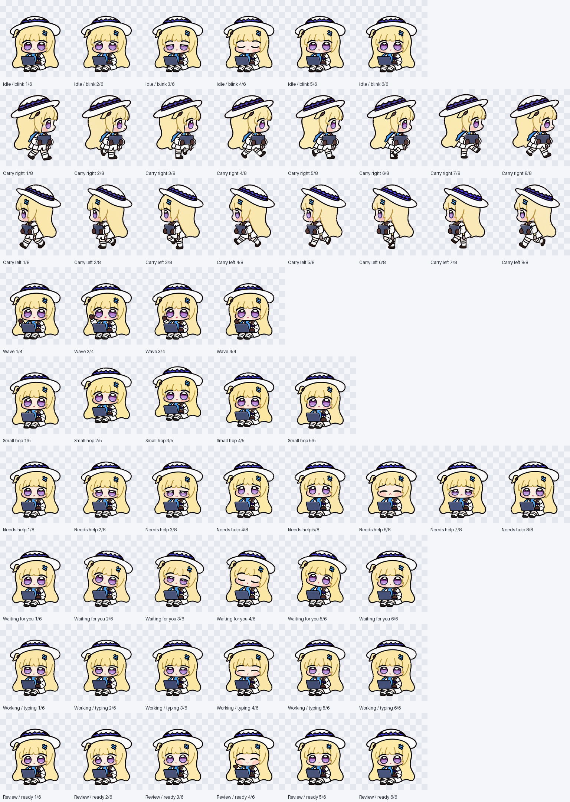
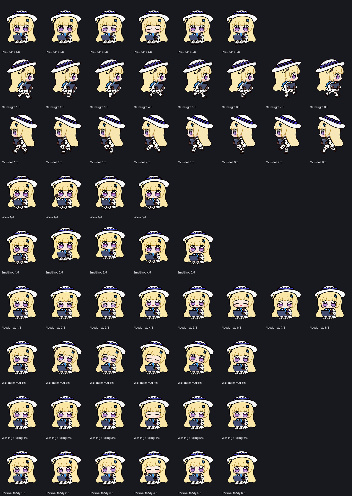

# Sprite Format Specification (v2 Atlas)

**English** · [简体中文](FORMAT.zh-CN.md) · [Documentation Index](README.md)

Phoebe Chupi uses the **Codex v2 static transparent sprite atlas** format. Note that `spritesheet.webp` is a **single-frame lossless RGBA image**, not an animated WebP; the Codex app animates the character at runtime by cropping cells from the grid according to task state or cursor angle.

---

## Package Structure & 5-Field Manifest

A portable v2 local pet package contains exactly two files and never embeds account IDs or machine-specific paths:

```text
phoebe-chupi/
├── pet.json           # Portable 5-field manifest (UTF-8 JSON)
└── spritesheet.webp   # 1536 × 2288 lossless RGBA WebP atlas
```

Full contents of `pets/phoebe-chupi/pet.json`:

```json
{
  "id": "phoebe-chupi",
  "displayName": "Phoebe Chupi · Coding Companion",
  "description": "Phoebe Chupi, seated with her laptop. For Codex pets and Dot, with blinking, small hops, and a head that follows your cursor. 菲比啾比·坐好了（眨眼版）。",
  "spriteVersionNumber": 2,
  "spritesheetPath": "spritesheet.webp"
}
```

| Field | Type / Value | Purpose |
| --- | --- | --- |
| `id` | `"phoebe-chupi"` | Local package identifier, matching the folder name. |
| `displayName` | String | Human-readable title displayed in Codex Settings and tooltips. |
| `description` | String | Bilingual summary of the pet's persona and capabilities. |
| `spriteVersionNumber` | `2` (integer) | Declares the 8-column × 11-row v2 grid layout (including the two Dot look rows). |
| `spritesheetPath` | `"spritesheet.webp"` | Atlas filename resolved relative to `pet.json`. |

The native import helper (`scripts/install.py`) reads the release tag from `VERSION` in the repository root and constructs the official import URI (see [Install Guide · Use Native Import](INSTALL.md#use-native-import)).

---

## Grid Dimensions & Visual Atlas Map

| Property | Value | Technical Notes |
| --- | --- | --- |
| **Image encoding** | Lossless WebP with 8-bit Alpha | Decoded RGBA pixels match `art/final/spritesheet.png` byte for byte. |
| **Atlas resolution** | **1536 × 2288 px** | Width `8 × 192 = 1536`, height `11 × 208 = 2288`. |
| **Grid layout** | **8 columns × 11 rows** (88 cells) | Zero-indexed rows `r ∈ [0, 10]` and columns `c ∈ [0, 7]`. |
| **Cell dimensions** | **192 × 208 px** | Cell `(r, c)` crops rectangle `(192c, 208r, 192(c+1), 208(r+1))`. |
| **Occupied cells** | **73 cells** | **57 standard animation frames** (rows 0–8) + **16 Dot look poses** (rows 9–10). |
| **Empty cells** | **15 cells** | Trailing unused cells on shorter rows must remain 100% transparent (`RGBA = 0,0,0,0`). |

### Complete 8-Column × 11-Row (1536 × 2288) Grid Legend

```text
       Col 0    Col 1    Col 2    Col 3    Col 4    Col 5    Col 6    Col 7
     +--------+--------+--------+--------+--------+--------+--------+--------+
Row 0| idle00 | idle01 | idle02 | idle03 | idle04 | idle05 |   ░░   |   ░░   | ← idle (6 frames + 2 empty)
     +--------+--------+--------+--------+--------+--------+--------+--------+
Row 1| right00| right01| right02| right03| right04| right05| right06| right07| ← running-right (8 frames)
     +--------+--------+--------+--------+--------+--------+--------+--------+
Row 2| left00 | left01 | left02 | left03 | left04 | left05 | left06 | left07 | ← running-left  (8 frames)
     +--------+--------+--------+--------+--------+--------+--------+--------+
Row 3| wave00 | wave01 | wave02 | wave03 |   ░░   |   ░░   |   ░░   |   ░░   | ← waving (4 frames + 4 empty)
     +--------+--------+--------+--------+--------+--------+--------+--------+
Row 4| jump00 | jump01 | jump02 | jump03 | jump04 |   ░░   |   ░░   |   ░░   | ← jumping (5 frames + 3 empty)
     +--------+--------+--------+--------+--------+--------+--------+--------+
Row 5| fail00 | fail01 | fail02 | fail03 | fail04 | fail05 | fail06 | fail07 | ← failed (8 frames)
     +--------+--------+--------+--------+--------+--------+--------+--------+
Row 6| wait00 | wait01 | wait02 | wait03 | wait04 | wait05 |   ░░   |   ░░   | ← waiting (6 frames + 2 empty)
     +--------+--------+--------+--------+--------+--------+--------+--------+
Row 7|  run00 |  run01 |  run02 |  run03 |  run04 |  run05 |   ░░   |   ░░   | ← running (6 frames + 2 empty)
     +--------+--------+--------+--------+--------+--------+--------+--------+
Row 8|  rev00 |  rev01 |  rev02 |  rev03 |  rev04 |  rev05 |   ░░   |   ░░   | ← review  (6 frames + 2 empty)
     +========+========+========+========+========+========+========+========+
Row 9| 000° ↑ |022.5°↗ | 045° ↗ |067.5°↗ | 090° → |112.5°↘ | 135° ↘ |157.5°↘ | ← Dot Look 000°–157.5° (8 cells)
     +--------+--------+--------+--------+--------+--------+--------+--------+
Row10| 180° ↓ |202.5°↙ | 225° ↙ |247.5°↙ | 270° ← |292.5°↖ | 315° ↖ |337.5°↖ | ← Dot Look 180°–337.5° (8 cells)
     +--------+--------+--------+--------+--------+--------+--------+--------+
     Legend: [xxx] = Occupied sprite cell (73 total; minimum 1 px transparent border on all 4 sides)
              ░░   = Unused cell kept strictly transparent (15 total; Alpha = 0 everywhere)
```

Machine-readable row definitions and preview frame durations live in [art/animation-layout.json](../art/animation-layout.json).

---

## Animation states

Rows 0 through 8 hold the nine standard desktop pet animations, filled left to right starting at column 0:

| Row | State Key | Frames | Empty Cells | Visual Behavior & Session Trigger |
| ---: | --- | ---: | ---: | --- |
| **0** | `idle` | 6 | `(0,6)..(0,7)` | **Seated breathing & blinking**: Rests her hands beside the open laptop and completes a half-closed → closed → open blink across frames 2–4. |
| **1** | `running-right` | 8 | None | **Carrying laptop right**: Hugs the closed laptop against her chest and walks right across an 8-frame gait loop. |
| **2** | `running-left` | 8 | None | **Carrying laptop left**: Dedicated 8-frame left-walking loop drawn without horizontal flipping so her hair clip and tuft stay on their true sides. |
| **3** | `waving` | 4 | `(3,4)..(3,7)` | **Seated greeting**: Waves one dark-gloved hand while seated with her laptop. |
| **4** | `jumping` | 5 | `(4,5)..(4,7)` | **Seated hop**: Bounces upward with her open laptop (21 px peak lift) and lands on frame 4 at the exact `idle` baseline. |
| **5** | `failed` | 8 | None | **Asking for help & recovering**: Looks up with worried brows when a task fails, then takes a breath and settles back into her seated pose. |
| **6** | `waiting` | 6 | `(6,6)..(6,7)` | **Waiting for a reply**: Stops typing and tilts her head up expectantly while waiting for user input. |
| **7** | `running` | 6 | `(7,6)..(7,7)` | **Working at the laptop**: Active task execution (distinct from `running-right`/`left` locomotion), typing across the keyboard. |
| **8** | `review` | 6 | `(8,6)..(8,7)` | **Checking the result**: Leans in toward the laptop screen to inspect code changes or test output. |

### Full-Frame Contact Sheets (Light vs Dark Background)

| Light Background Contact Sheet ([Open Full Image](../previews/contact-sheet.png)) | Dark Background Contact Sheet ([Open Full Image](../previews/contact-sheet-dark.png)) |
| :---: | :---: |
|  |  |

---

## Look directions

In Codex Dot, rows 9 and 10 provide **16 cursor-following head poses**. Phoebe's torso, feet, and laptop stay anchored in her seated pose while her head, fringe, hat crown, and eyes rotate toward the cursor.

### 16-Direction Clockwise Compass Legend

Angles use screen coordinates starting at **`000°` (screen-up)** and advancing **clockwise in `22.5°` steps**:

```text
                         000° (Up · R9,C0)
                   337.5°        │        022.5°
              315°    (R10,C7)   │   (R9,C1)    045°
            (R10,C6)     ↖       ↑       ↗     (R9,C2)
        292.5°             ╲     │     ╱             067.5°
       (R10,C5)              ╲   │   ╱              (R9,C3)
                              ╲  │  ╱
  270° (Left · R10,C4) ◄────── [Phoebe] ──────► 090° (Right · R9,C4)
                              ╱  │  ╲
       (R10,C3)              ╱   │   ╲              (R9,C5)
        247.5°             ╱     │     ╲             112.5°
            (R10,C2)     ↙       ↓       ↘     (R9,C6)
              225°    (R10,C1)   │   (R9,C7)    135°
                   202.5°        │        157.5°
                        180° (Down · R10,C0)
```


| Angle | Screen Direction | Row / Col | Exact Crop Path | Visual Gaze Cues |
| ---: | --- | :---: | --- | --- |
| `000` | Up | `9 / 0` | `art/frames/look/000.png` | Looks straight up with lifted gaze, compact chin, and raised brim. |
| `022.5` | Up-right (slight) | `9 / 1` | `art/frames/look/022.5.png` | Slight clockwise turn from straight-up toward upper-right. |
| `045` | Up-right (diagonal) | `9 / 2` | `art/frames/look/045.png` | Head and pupils angled clearly toward the upper-right corner. |
| `067.5` | Up-right (low) | `9 / 3` | `art/frames/look/067.5.png` | Approaches right profile while retaining a slight upward tilt. |
| `090` | Right | `9 / 4` | `art/frames/look/090.png` | Horizontal gaze to screen-right; viewer-right blue hair clip rotates nearer. |
| `112.5` | Down-right (high) | `9 / 5` | `art/frames/look/112.5.png` | Slight downward pitch from right toward lower-right. |
| `135` | Down-right (diagonal) | `9 / 6` | `art/frames/look/135.png` | Looks down-right; more of the white hat crown becomes visible. |
| `157.5` | Down-right (low) | `9 / 7` | `art/frames/look/157.5.png` | Transition pose approaching straight-down from the right. |
| `180` | Down | `10 / 0` | `art/frames/look/180.png` | Head pitched straight down; broad hat crown and lowered eyelids. |
| `202.5` | Down-left (low) | `10 / 1` | `art/frames/look/202.5.png` | Slight turn from straight-down toward lower-left. |
| `225` | Down-left (diagonal) | `10 / 2` | `art/frames/look/225.png` | Looks toward the lower-left corner while preserving accessory sides. |
| `247.5` | Down-left (high) | `10 / 3` | `art/frames/look/247.5.png` | Leftward turn with a gentle downward pitch. |
| `270` | Left | `10 / 4` | `art/frames/look/270.png` | Horizontal gaze to screen-left. |
| `292.5` | Up-left (low) | `10 / 5` | `art/frames/look/292.5.png` | Lifts gaze from screen-left toward the upper-left quadrant. |
| `315` | Up-left (diagonal) | `10 / 6` | `art/frames/look/315.png` | Looks toward the upper-left corner with balanced cheek width. |
| `337.5` | Up-left (high) | `10 / 7` | `art/frames/look/337.5.png` | Final clockwise step bridging smoothly back into `000°` (up). |

---

## Timing

- **Runtime scheduling belongs to the app**: Codex controls state transitions and frame durations at runtime. Neither `pet.json` nor `art/animation-layout.json` overrides the app's internal scheduler.
- **Preview GIF timing**:
  - The `idle` preview uses frame durations `[1680, 660, 660, 840, 840, 1920]` ms—a `6.6-second` breathing and blinking cycle matched to desktop build `26.1007.71326`.
  - The `look-loop.gif` preview displays each of the 16 poses for `200 ms` to demonstrate the full clockwise sweep; in Dot, the active pose is chosen live from your cursor position.

---

## Export & Registration Rules

When assembling high-resolution source drawings into the `1536 × 2288` atlas, the pipeline follows five rules (rules 1–2 govern production normalization and alpha handling during assembly, while `scripts/validate.py` and `scripts/audit_artwork.py` enforce the finished-artifact checks in rules 3–5 and `scripts/render_previews.py` derives the previews):

```text
❌ Wrong: Fitting each frame independently to its own opaque bounding box
   ┌──────────────┐    ┌──────────────┐
   │  ╭────────╮  │    │ ╭──────────╮ │  ← Raising a hand or tilting the hat changes the
   │  │ Bigger │  │ vs │ │ Shrunk   │ │    bounding box, making the body and laptop pulse
   └──┴────────┴──┘    └─┴──────────┴─┘    wildly in size from frame to frame!

✅ Right: Applying one shared camera viewport & scale across the entire state
   ┌──────────────┐    ┌──────────────┐
   │    ╭────╮    │    │   ╭────╮     │  ← Laptop base and feet stay locked to a shared
   │   ┌┴────┴┐   │ vs │  ┌┴────┴┐    │    baseline with >= 1 px transparent margin on all sides.
   └───┴──────┴───┘    └──┴──────┴────┘
```

1. **Shared viewport and scale**: Normalize accepted frames through a shared camera window rather than fitting each frame to its own visible bounds.
2. **Preserve clean native alpha and contour ink**: Keep the approved RGBA colors directly when native alpha edges are clean. Never run post-processing that averages nearby blonde/white fill colors into dark contour pixels (see the [v1.0.1 Hair-Outline Repair Guide](OUTLINE-REPAIR.md)).
3. **At least 1 px transparent border per cell**: Every occupied cell's nonzero-alpha bounding box must satisfy `x0 >= 1, y0 >= 1, x1 <= 191, y1 <= 207` so artwork never clips against cell borders.
4. **Strictly transparent unused cells**: All 15 unused cells must remain completely transparent (`alpha == 0`), and all 16 look cells in rows 9–10 must be populated.
5. **Lossless encoding & single-source derivation**: Encode `spritesheet.webp` losslessly, verify that its decoded RGBA bytes match `art/final/spritesheet.png` 100%, and derive all 73 crops (`art/frames/`) and animated previews (`previews/`) directly from the distributed WebP.
