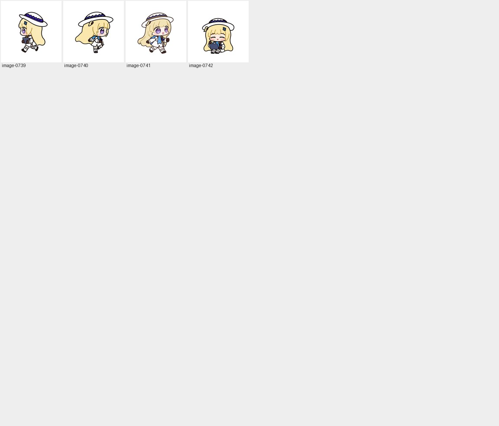

# 图片档案总览（832 张源图 / 1,447 个工作文件记录）

[English](IMAGE-GALLERY.md) · **简体中文** · [文档目录](README.zh-CN.md)

为了将菲比啾比（Phoebe Chupi）从早期概念草图到最终 `v1.0.2` 精灵整图的完整创作轨迹透明呈现，本档案库完整收录了 **832 张不同 SHA-256 的制作源图**，对应制作流程中的 **1,447 个工作文件实例**。

所有内容完全相同的重复副本在仓库中已做单实例去重合并，由 [`art/index.json`](../art/index.json) 统一维护每张图的唯一编号（`image-0001` ～ `image-0832`）、SHA-256 校验值、所属阶段以及全部原始工作路径映射。你也可以直接[下载完整仓库压缩包](https://github.com/RiomQAQ/phoebe-chupi-codex-pet/archive/refs/heads/main.zip)在本地离线翻阅。

---

## 1. 档案库分层结构图例

```text
+-----------------------------------------------------------------------------+
|  [第一层：历史制作源图档案 · 832 张唯一图像 / 22 个分册页面]                  |
|   ├─ 1. 早期造型探索 (6 张)          ──► 初始画风、头身比与特写试水          |
|   ├─ 2. 站姿身份研究 (37 张)         ──► 三视图拆解、站姿设定与比例校准      |
|   ├─ 3. 坐姿与动作制作 (489 张)      ──► 9 类动作序列帧、手部/电脑局部修整   |
|   ├─ 4. 未采用的睁眼试验 (192 张)    ──► 早期不眨眼呼吸方案的完整探索记录    |
|   ├─ 5. 角色情绪样张 (14 张)         ──► 等待、思考、求助、开心等高分辨样张  |
|   ├─ 6. 补充生成原图 (4 张)          ──► 关键母本的原始未裁切生成底图        |
|   └─ 7. 转头与脸型制作图 (99 张)     ──► v1.0.2 16 向转头重绘与 6 帧脸型精修 |
|                                                                             |
|  [第二层：当前发布成品与派生预览]                                            |
|   └─ pets/phoebe-chupi/spritesheet.webp + art/frames/ (73 格) + previews/   |
|                                                                             |
|  [第三层：版本快照与专项修复证据]                                            |
|   └─ art/approved/v1.0.2/ + art/releases/v1.0.0..v1.0.1 + art/repair/       |
+-----------------------------------------------------------------------------+
```

---

## 2. 七大制作阶段分册导航（共 22 页）

每个分册页面均提供**整页缩略总览图**、**150px 懒加载预览**、**可点击原图链接**以及根据原始生产路径提炼的**中英双语角色/状态/角度说明**（注：由于部分基准母本在多个阶段被复用为参考锚点，同一张源图可能出现在不止一个阶段目录中）：

<table>
  <tr>
    <td align="center" width="33%">
      <a href="gallery/early-concept-01.md"></a><br />
      <sub><b>1. 早期造型（6 张）</b><br /><a href="gallery/early-concept-01.md">进入分册</a></sub>
    </td>
    <td align="center" width="33%">
      <a href="gallery/standing-study-01.md"></a><br />
      <sub><b>2. 站姿研究（37 张）</b><br /><a href="gallery/standing-study-01.md">进入分册</a></sub>
    </td>
    <td align="center" width="33%">
      <a href="gallery/seated-production-01.md"></a><br />
      <sub><b>3. 坐姿制作（489 张 · 11 页）</b><br /><a href="gallery/seated-production-01.md">进入第 1 页</a></sub>
    </td>
  </tr>
  <tr>
    <td align="center" width="33%">
      <a href="gallery/awake-experiment-01.md"></a><br />
      <sub><b>4. 未采用的睁眼试验（192 张 · 4 页）</b><br /><a href="gallery/awake-experiment-01.md">进入第 1 页</a></sub>
    </td>
    <td align="center" width="33%">
      <a href="gallery/character-samples-01.md"></a><br />
      <sub><b>5. 角色样张（14 张）</b><br /><a href="gallery/character-samples-01.md">进入分册</a></sub>
    </td>
    <td align="center" width="33%">
      <a href="gallery/generation-originals-01.md"></a><br />
      <sub><b>6. 补充生成原图（4 张）</b><br /><a href="gallery/generation-originals-01.md">进入分册</a></sub>
    </td>
  </tr>
  <tr>
    <td align="center" colspan="3">
      <a href="gallery/look-face-repair-01.md"></a><br />
      <sub><b>7. 转头与脸型制作图（99 张 · 3 页）</b><br /><a href="gallery/look-face-repair-01.md">第 1 页</a> · <a href="gallery/look-face-repair-02.md">第 2 页</a> · <a href="gallery/look-face-repair-03.md">第 3 页</a></sub>
    </td>
  </tr>
</table>

| 阶段名称 | 收录数量 | 阶段内容简介 | 分册页面直达 |
| --- | ---: | --- | --- |
| **1. 早期造型** | 6 | 项目起步时的角色母本探索、特写与初次生成原图。 | [查看](gallery/early-concept-01.md) |
| **2. 站姿研究** | 37 | 社区三视图参考及正/侧/背切图、站姿身份设定稿与头身比探索。 | [查看](gallery/standing-study-01.md) |
| **3. 坐姿制作** | 489 | 坐姿工作母本、抱电脑行走母本，以及 9 类动作与早期 16 向转头的全量生成稿、局部手部/电脑修复稿与归一化过程帧。 | [第 1 页](gallery/seated-production-01.md) · [第 2 页](gallery/seated-production-02.md) · [第 3 页](gallery/seated-production-03.md) · [第 4 页](gallery/seated-production-04.md) · [第 5 页](gallery/seated-production-05.md) · [第 6 页](gallery/seated-production-06.md) · [第 7 页](gallery/seated-production-07.md) · [第 8 页](gallery/seated-production-08.md) · [第 9 页](gallery/seated-production-09.md) · [第 10 页](gallery/seated-production-10.md) · [第 11 页](gallery/seated-production-11.md) |
| **4. 未采用的睁眼试验** | 192 | 早期围绕“全程睁眼不眨眼”方案生成的全套状态候选与网格切图（最终版改为自然眨眼循环）。 | [第 1 页](gallery/awake-experiment-01.md) · [第 2 页](gallery/awake-experiment-02.md) · [第 3 页](gallery/awake-experiment-03.md) · [第 4 页](gallery/awake-experiment-04.md) |
| **5. 角色样张** | 14 | 等待、思考、求助、开心等日常状态的高分辨率独立样张与多轮候选对比。 | [查看](gallery/character-samples-01.md) |
| **6. 补充生成原图** | 4 | 核心姿势母本与情绪样张的 `1254 × 1254` 原始生成底图。 | [查看](gallery/generation-originals-01.md) |
| **7. 转头与脸型制作图** | 99 | `v1.0.2` 针对 Dot 16 向转头姿态的多轮重绘、淘汰候选（如比例失调或贴脸废案）以及最新 6 帧脸颊/回正精修原图。 | [第 1 页](gallery/look-face-repair-01.md) · [第 2 页](gallery/look-face-repair-02.md) · [第 3 页](gallery/look-face-repair-03.md) |

> **使用与版权提示**：档案中的图片用于记录完整的 AI 辅助制作与筛选过程，并非全部进入最终安装的动画包。其中保留原署名的社区三视图（`image-0011`）及其三张正/侧/背裁剪图（`image-0012` ～ `image-0014`）属于第三方参考资料，适用[图片使用说明](../ASSET-USAGE.md#中文)。

---

## 3. 当前发布成品与预览入口

如果你只需要查看或使用当前 `v1.0.2` 正式版的美术资产，可直接访问以下目录：

| 资产类别 | 快速入口 | 说明 |
| --- | --- | --- |
| **坐姿和抱电脑基准** | [角色基准图 (`art/canonical/`)](../art/canonical) | 含正/侧/背参考裁剪、站姿设定、坐姿母本、抱电脑母本与十字四向基准。 |
| **发布整图（1536 × 2288）** | [无损 WebP](../pets/phoebe-chupi/spritesheet.webp) · [接受基准 PNG](../art/final/spritesheet.png) | 解码后的 RGBA 像素 100% 相等，包含 73 个有效格与 15 个全透明格。 |
| **当前 73 个单格切图** | [原像素裁剪帧 (`art/frames/`)](../art/frames) | 从最终整图无损切出的 `192 × 208` 单帧 PNG（前 9 行 57 帧 + `look/` 16 帧）。 |
| **动作和转头方向总览** | [浅色动作总览](../previews/contact-sheet.png) · [深色动作总览](../previews/contact-sheet-dark.png) · [方向总览](../previews/directions.png) | 一张图看齐 9 类标准动作或 16 个顺时针转头角度。 |
| **浅深背景动态播放** | [全部动作合成 GIF](../previews/all-states.gif) · [小跳衔接 GIF](../previews/idle-jump-idle.gif) · [深色背景循环 (`previews/dark/`)](../previews/dark) | 按客户端实测节奏渲染的浅色与深色背景 GIF 动图。 |
| **原生尺寸静帧** | [五种核心状态静帧 (`five-states.png`)](../previews/stills/five-states.png) | 未经缩放的 `192 × 208` 原生 1× 像素展示。 |

---

## 4. 历史修复与版本快照台账

- **v1.0.2 转头重绘与脸型细化证据**：收录在 [`art/approved/v1.0.2/`](../art/approved/v1.0.2)、[`art/repair/v1.0.2/`](../art/repair/v1.0.2) 及 [转头修复检查记录](look-repair-qa/README.zh-CN.md) 中；其新增的 90 张制作源图已并入上方第 7 分册（使总源图数从 `v1.0.1` 的 742 张扩展为 **832 张**）。
- **v1.0.1 头发描线无损修复证据**：包含[清理前原像素整图](../art/repair/v1.0.1/source-before-cleanup.png)、[最近邻放大修复对照](../art/repair/v1.0.1/before-after.png)和 [11 行浅深背景逐帧复查图板](../art/repair/v1.0.1/review-boards)，这些诊断板与重新渲染的预览图独立存放在修复目录中。
- **历史发布版本快照**：[`art/releases/v1.0.0`](../art/releases/v1.0.0) 与 [`art/releases/v1.0.1`](../art/releases/v1.0.1) 完整保留了早期整图与裁剪帧；它们与当前版本的关系详见[头发描线修复复盘](OUTLINE-REPAIR.zh-CN.md)与[审查与校验指南](REVIEW.zh-CN.md)。
