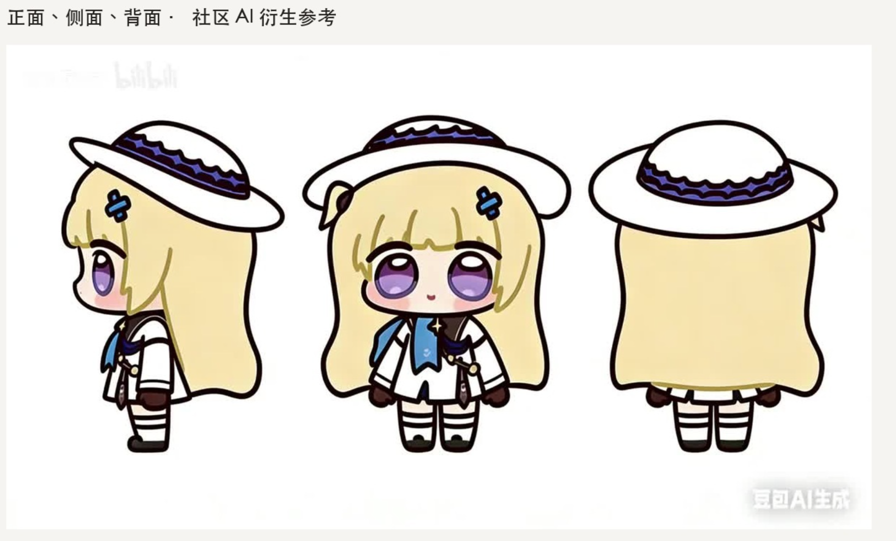
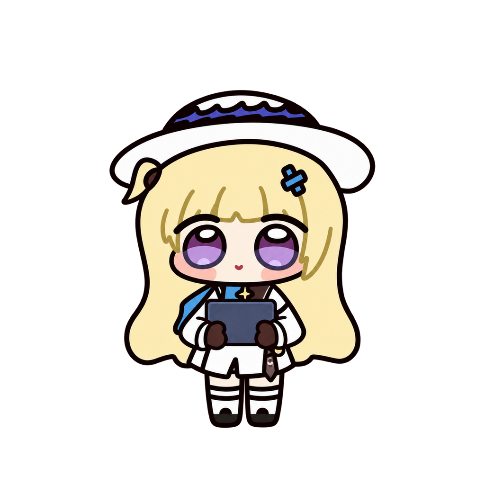
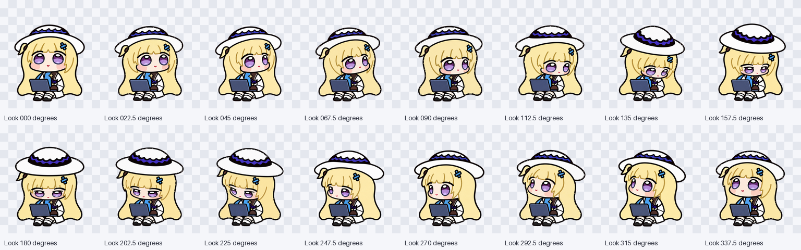
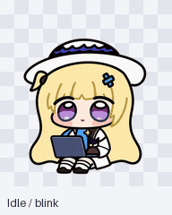

# 菲比啾比是怎样一帧帧做出来的

[English](MAKING-OF.md) · [中文首页](../README.zh-CN.md) · [全部图片](IMAGE-GALLERY.md)

这份记录介绍参考怎么选、图片怎么生成、比例和动作怎么查、哪些方案被退回，以及最后为什么保留现在这一版。

**制作署名：GPT-6-Astra 辅助制作与审查。** 资料整理、角色和动作设计、提示词、逐帧审查、打包及文档由 GPT-6-Astra 辅助完成；图片由内置图像生成功能生成、编辑。用户选择造型参考，并在看过实际效果后确定保留眨眼版。

## 1. 先确认做的是哪个菲比

目标是社区二创的「菲比啾比」，不能直接套用官方成年比例，也不能只画一个金发白帽的通用 Q 版角色。早期试作的造型不够接近，用户随后提供了正面、侧面、背面的参考，要求以这张图为底。

这张三视图因此成为主要造型依据。它来自蓝蓝铜离子的社区投稿，标有豆包 AI 生成，属于二创参考，不能称为官方设定。官方资料用于确认角色身份、配色和主要配饰；社区表情包与 B 站投稿用于理解「啾比」的表情和动作。各来源的用途、署名和未确认之处见 [SOURCES.md](SOURCES.md)。

找参考时需要区分：谁创造了形象，谁转发了图片，哪张是用户选定的造型依据，哪段视频只是提供情绪或动作灵感。只看到静态画面时，不补写成自己没有观察到的完整动画。

## 2. 固定造型，再扩展动作

如果每个动作都重新描述一次角色，很容易变成几套相似但不一致的画风。因此先固定以下特征：

| 特征 | 审查要求 |
| --- | --- |
| 轮廓 | 白色宽帽檐、圆帽顶、深紫色帽带、浅金长发、紧凑的 Q 版身体。 |
| 脸和眼睛 | 圆脸、紫色分层大眼、稳定的眉眼间距、小嘴和克制的腮红。 |
| 不对称配饰 | 蓝发夹在观看者右侧，呆毛和蓝布在观看者左侧。 |
| 衣服 | 白外套、深色手套、金色星形细节、条纹腿部和深色鞋。 |
| 电脑 | 只有一台蓝灰色电脑，屏盖、转轴、键盘和手的位置能对得上。 |
| 画面 | 深色清晰轮廓、柔和简洁的色块，小尺寸仍看得清。 |
| 比例 | 头身、脸宽、帽子大小遵循同一基准，不能某个动作突然长下巴或缩头。 |

然后确定两张基准：**坐着使用打开的电脑**，以及**站着抱合上的电脑**。主要状态共用坐姿，移动时使用抱电脑姿势。这样换动作时，观众知道她仍带着同一件东西。

| 坐姿基准 | 抱电脑基准 |
| :---: | :---: |
|  |  |

新帧继续引用基准图，必要时加相邻合格帧。不能把一张已经跑偏的失败图当成下一帧的新标准。

## 3. 动作要符合写代码时的使用情境

用户指出，有些动作虽然能动，但不像这个角色，也不符合 Codex 的使用人群。因此动作设计回到日常陪伴：安静工作、抬头等回复、检查结果、遇到问题时委屈一下，再恢复过来。

9 个状态先规划好，再逐帧制作：

- 待机：坐着呼吸和眨眼。
- 工作：注意力在电脑上，手和表情轻微变化。
- 等待：抬头、歪头，等用户回应。
- 检查：看结果，略微点头或满意地笑。
- 失败／求助：短暂失落后恢复，不能一直睡着或难受。
- 挥手：坐着轻轻打招呼，只挥一只手。
- 小跳：电脑跟着一起动，最后回到原位。
- 左右移动：合上电脑抱走，两个方向分别画。

这些是画面的表达目标。具体什么时候播放哪一个状态，仍由应用决定，不能靠精灵图设置任意状态机。

## 4. 一帧一帧生成和修改

图片通过图像生成功能逐帧生成、编辑，不是用程序重画角色，也不是把一张图拉伸成所有动作。高分辨率原图、候选稿和修改稿都保留。

每帧的步骤是：

1. 带上对应的基准图，必要时带上一张相邻合格帧。
2. 写清状态、帧位置、这次允许改变的动作，以及必须不变的造型。
3. 生成透明背景、单个角色的图片，不加标签、面板和无关物体。
4. 同时看原尺寸与缩小后的效果。
5. 手、眼睛、比例、配饰或电脑出现问题时，针对问题修改。
6. 把候选图与采用图都留下，说明为什么退回候选图。

原制作过程用并行任务收集资料、生成候选图。并行能提速，但不能替代共用基准和最终审查。角色锁定、跨状态比较、统一排版和选定发布版仍需集中判断。

标准动作共 57 帧，稳定后再制作 16 个视线姿态。可复用的提示词见 [PROMPTS.md](PROMPTS.md)。

## 5. 怎样修复画错的地方

很多问题只看单张不明显，连起来就能发现。档案中保留失败稿，方便对照。

| 问题 | 为什么不行 | 修复方式 |
| --- | --- | --- |
| 多一只手、手套或袖子 | 缩小后轮廓仍然不合理。 | 对照手臂起点，局部修改并重新数清双手。 |
| 多一道眉毛或脸部线条 | 表情变样，眼睛像画坏了。 | 维持基准脸型，清掉重复线。 |
| 电脑出现两层键盘或屏盖 | 看起来像两台电脑叠在一起。 | 重新确认一个转轴、一块键盘和一组屏盖。 |
| 帽子、头突然缩小 | 同一角色在不同状态像换了比例。 | 带基准图修比例，修不好就退回。 |
| 下巴膨胀、脸宽改变 | 偏离用户选定的社区造型。 | 比较眉眼和脸部位置，不能只看整体边界。 |
| 发夹换边 | 不对称特征被镜像。 | 单独生成对应方向，不直接翻转另一侧。 |
| 文件叫向右，画面却像向左 | 命名正确不等于人看得懂。 | 去掉标签盲看，再修改头和眼神的方向提示。 |
| 中性视线也上下跳 | 看视线时像在滑动或蹦。 | 造型确认后，根据实际测量对齐位置。 |

修完还要同时对照基准、前后帧，以及另一个使用同一坐姿的状态，避免只修好局部却破坏整体。

## 6. 缩到小格子时，怎样避免忽大忽小

高分辨率原图最后要进入 192 × 208 的格子。所有帧共用缩放和取景基准，不能每帧按不透明边界单独撑满。否则抬一次手、歪一次头，都可能把角色整体缩小。

处理顺序是：保留原图，检查透明度，按统一基准缩小，做有依据的位置修正，在浅色和深色背景上看边缘，再拼图和编码。边缘去色溢在最终验收前统一处理，避免多次处理造成各帧边缘不一致。

仓库同时提供高分辨率工作帧，以及从发布 WebP 原尺寸裁出的 73 张最终帧图。前者解释怎么画出来，后者展示应用实际收到的像素。

## 7. 16 个视线方向怎么做

在 Codex 的 Dot 里，这组姿态让她跟着鼠标转头，使用效果已确认。视线扩展不是全身转台。头和眼神可以表达方向，身体、电脑和落点应当稳定；也不能为了表示方向，在原本的紫色眼睛里随意新增白瞳孔。

先确定上 `000`、右 `090`、下 `180`、左 `270` 四个方向，再按顺时针每 22.5° 补齐。左右均指观看者看到的屏幕方向。

审查时检查方向顺序、相邻姿态、`337.5 → 000` 接缝、小尺寸可读性、深色背景，以及电脑和身体有没有跟着漂。再把方向标签藏起来，判断图到底看向哪里。

最终方向盲测由 3 名 AI 审查者参与，14 组水平或垂直对比经多数判定通过。方法和结果见 [REVIEW.md](REVIEW.md)。

## 8. 需要连起来看，也要按实际速度看

单张好看，不代表循环好看。每行都要看前后帧、首尾接缝，小跳要看起跳和落地，再看回到坐姿是否自然。

早期模板预览比实际应用的待机节奏快。核对本机桌面版本后，发现待机帧时长放大了 6 倍，整个循环为 6.6 秒。快速 GIF 里很短的半闭眼，在实际浮窗里就更容易被注意到。

后来的试验让眼睛更常保持睁开，并略微收紧统一取景。用户看过后觉得少了灵性，要求恢复之前有眼睛动作的版本。因此本次安装包保留眨眼，包括半闭眼和闭眼过渡；睁眼试验标注为已回退，只保留在档案。

## 9. 怎样确认发布文件没有装错

最终母版是透明的 1536 × 2288 PNG，发布为无损 WebP，解码后的 RGBA 像素一致。清单明确写 v2，只引用本地 WebP。

校验脚本检查清单字段、尺寸、透明通道、73 个有效格、15 个空白格、格子边距、73 张最终裁剪图与原图的一致性、742 张档案的哈希和解码情况。还检查图片元数据、公开文本中的常见隐私标记，以及安装文件校验值。

小安装包只放两个文件。上传后还要下载公开地址核对哈希，避免本地看的是一版、发布的却是另一版。

文件检查见 [validation.json](validation.json)，画面审查和修改决定见 [production-review.json](production-review.json)。

## 10. 最终结果与仍然存在的问题

| 结果 | 说明 |
| --- | --- |
| 动作完整 | 57 张动作帧，16 张视线姿态。 |
| v2 结构正确 | 8 列 11 行，每格 192 × 208。 |
| 无损发布 | PNG 与 WebP 的 RGBA 像素一致。 |
| 小跳回到原位 | 原审查采用透明度阈值测量，最高离地 21 px，落地偏移 0 px。 |
| 视线基本稳定 | 同一测量方法记录的横向中心最大偏移 3.5 px，宽度比最大 1.0625。 |
| 方向盲测通过 | 14 组对比通过最终多数判定。 |
| 表情按用户选择保留 | 睁眼试验退回，使用有眨眼变化的版本。 |
| 图片档案完整 | 742 张不同源图片，索引对应 1,290 个工作文件实例。 |

`045` 和 `067.5` 较相似，`225 → 247.5` 变化较大，半闭眼被停留显示时仍可能被注意到。小尺寸画面放大后也会变柔和。这些问题没有因为校验通过就消失，文档明确保留。Dot 中已能使用并跟随鼠标转头；Windows 尚未逐帧验收。

档案收录早期造型、站姿试作、坐姿制作、失败稿、后续角色感样张和睁眼试验。制作记录引用到、但位于主工作目录之外的 4 张生成原图也已找回。私人应用截图、账号上传记录和整套第三方下载资料不公开。

## 11. 用这套方法制作另一只宠物

先选一个造型基准，规划完整状态，再开始大量生成。把不对称特征写清，别让失败稿变成新标准。可以并行画候选，但每张都要回到同一套基准审查。比例认可后再测量、对齐，编码后重新看一遍。

发布时把安装文件和制作档案分开，说明真正验收过的范围与不足，保留来源署名，把第三方角色权利与代码许可分开。清理元数据，核对公开下载。失败稿和回退方案也值得留下，下一次修改才能知道为什么当时没有选它。
