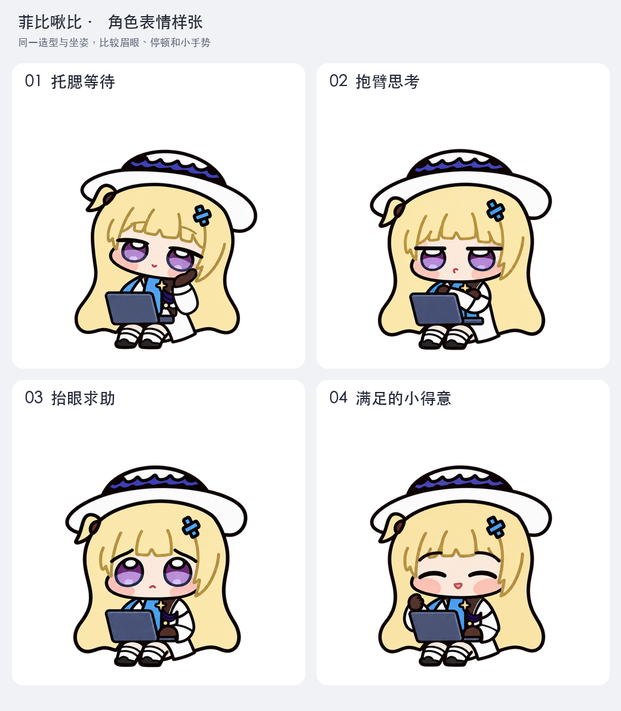

# 宠物制作全流程（从参考考据到 v2 精灵整图）

[English](MAKING-OF.md) · **简体中文** · [返回文档目录](README.zh-CN.md)

这份指南完整记录了 **菲比啾比（Phoebe Chupi）** 是如何从一张社区 Q 版三视图出发，一步步建立角色母本、设计 9 类日常与任务动作、攻克 Dot 16 向转头的透视跳变，最终拼合为 **1536 × 2288** 无损 v2 精灵整图的。

项目使用 **GPT-6-Astra** 与内置图像生成功能完成逐帧绘制与局部修整，经过统一取景框归一化拼合后，由仓库内的 Python 脚本完成预览渲染、像素级校验和发布打包。如果你也想为 Codex 制作一只自定义桌面宠物，可以直接复用这套方法。

---

## 全链路制作流程图例

```text
阶段 1：参考与拆解         阶段 2：建立角色母本            阶段 3：衍生 73 张动作与转头帧
┌──────────────────────┐   ┌───────────────────────────┐   ┌───────────────────────────────┐
│ 社区三视图 + 官方设定│──►│ 站姿设定图 (固定头身/配色)│──►│ 前 9 行：57 张标准动作帧      │
│ 正 / 侧 / 背去背切图 │   │ 坐姿母本 (展开笔记本工作) │   │ 后 2 行：先十字四向 → 16 转头 │
└──────────────────────┘   │ 抱电脑母本 (合上电脑移动) │   └───────────────┬───────────────┘
                           └───────────────────────────┘                   │
                                                                           ▼
阶段 6：校验与发布打包     阶段 5：多轮盲审与实机复查      阶段 4：统一取景与无损拼图
┌──────────────────────┐   ┌───────────────────────────┐   ┌───────────────────────────────┐
│ validate.py 像素守卫 │◄──│ 1× 原生尺寸浅/深背景检查  │◄──│ 共用相机窗口缩放到 192 × 208  │
│ 回归测试 + ZIP 打包  │   │ 三方无标签 A/B 方向盲审   │   │ 保留原生透明度，拼成 8×11 整图│
└──────────────────────┘   └───────────────────────────┘   └───────────────────────────────┘
```

---

## 1. 确定造型参考与三视图拆解

在动笔画任何一帧动画之前，第一步是用**正面、侧面、背面**三个正交视角把角色的立体轮廓固定下来：

- **原作角色依据**：对照库洛游戏《鸣潮》官方菲比资料，锁定浅金长发、宽檐白帽、深紫帽带、分层紫色瞳孔、白衣深色手套与条纹长袜的核心配色。
- **Q 版造型依据**：采用署名为 **蓝蓝铜离子** 的社区三视图作为圆润 Q 版比例与二头身轮廓的主要参考（完整出处见 [参考来源](SOURCES.zh-CN.md)）。


为了让图像生成工具在后续步骤里专注参考单一角度，我们先把三视图拆解成三张去背独立视角图：

| 正面轮廓参考 | 左侧面轮廓参考 | 背面发量与帽带参考 |
| :---: | :---: | :---: |
|  |  |  |
| 锁定小圆脸、眉眼间距、白帽宽度与胸前金色装饰。 | 锁定帽檐前探幅度、侧脸短下巴与高腰裙摆弧度。 | 锁定脑后深紫蝴蝶结帽带与浅金长发的垂落层次。 |

---

## 2. 建立站姿设定与两张核心姿势母本

如果直接拿着三视图去生成几十张动作帧，AI 很容易在每一帧里画出不同款式的笔记本电脑或忽高忽低的坐姿。因此我们先从三视图提炼出一张**站姿身份基准图**，再衍生出全套动画赖以对齐的**两张姿势母本（Master Anchors）**：

| 1. 站姿身份设定图 | 2. 坐姿工作母本（展开电脑） | 3. 移动抱持母本（合上电脑） |
| :---: | :---: | :---: |
|  |  |  |
| 把三视图转化为统一的深色外轮廓与金棕发丝内线画风。 | 用于 `idle`、`waving`、`jumping`、`failed`、`waiting`、`running`、`review` 及 16 向 `look`。 | 用于 `running-right` 与 `running-left` 两个抱电脑行走循环。 |

在后续生成的每一帧中，以下六项视觉特征都必须严格向母本对齐：

| 部位 | 锁定规则（不可随帧漂移） |
| --- | --- |
| **整体轮廓** | 宽白帽檐、深紫帽带、浅金长发与紧凑的二头身比例。 |
| **五官比例** | 圆润脸颊、分层紫瞳、稳定的眉距与短小下巴。 |
| **不对称配饰** | **蓝色十字发夹永远在观看者右侧**；**呆毛与蓝布饰永远在观看者左侧**（左右转身时绝不水平镜像）。 |
| **服装细节** | 白色上衣、深色手套、金色领饰、条纹腿袜与深色圆头鞋。 |
| **笔记本电脑** | 蓝灰色机身；展开时只有**一层屏盖、一处铰链、一套键盘**，双手搭放位置符合人体结构。 |
| **线条与上色** | 连续的深色外轮廓线 + 头发内部的金棕色发丝线 + 克制干净的平涂阴影。 |

---

## 3. 规划九类日常动作与表情样张

围绕 Codex 的 [九类标准动作行](FORMAT.zh-CN.md#动作行)，我们把菲比的一天设计成一套连贯的编码陪伴故事：安静陪你（`idle`）→ 挥手问好（`waving`）→ 认真敲代码（`running`）→ 停手等你回复（`waiting`）→ 凑近检查结果（`review`）→ 遇到报错委屈求助（`failed`）→ 开心小跳庆祝（`jumping`）→ 合上电脑左右跑动（`running-right` / `running-left`）。

在正式量产序列帧前，先制作表情样张验证不同情绪下的神态辨识度：



- **统一坐姿基线**：所有坐姿状态共享完全相同的身体、双脚与电脑位置，这样从 `idle` 切换到 `jumping`、`waiting` 或 `running` 时不会发生瞬移。
- **眨眼节奏设计**：最终版 `idle` 采用包含**半闭眼 → 闭眼 → 睁眼**的自然眨眼循环；早期尝试过的“全程睁眼呼吸”方案共有 192 张成稿，也完整保留在 [图片档案 · 未采用的睁眼试验](gallery/awake-experiment-01.md) 中供对照。

---

## 4. 逐帧生成与常见 AI 缺陷精修

制作序列帧时，**每次只生成或修改一帧**，绝不要求模型一次画出整张多格精灵表（多格直出极易导致格子错位和比例失控）：

1. **输入双参考**：同时附上对应的**姿势母本**（保证角色不走形）和**上一张已通过的相邻帧**（仅用于判断动作步幅）。
2. **明确单步变化**：在提示词中写清当前状态、第几帧、具体哪只手或哪个表情发生变化，其余部位明确要求锁定（模板见 [提示词实战手册](PROMPTS.zh-CN.md)）。
3. **1× 原生尺寸与原图双检**：每次生成后，既放大检查线条细节，也缩回 **192 × 208** 原生尺寸观察整体可读性。
4. **隔离失败废稿**：候选图与正式采用图分开存放，绝不拿一张比例已经变形的失败稿作为下一帧的垫图。

在 800 多张源图的迭代过程中，我们总结了 AI 画 Q 版精灵最常出现的 6 类缺陷及针对性修法：

| 高频生成缺陷 | 原因分析 | 针对性修复手段 |
| --- | --- | --- |
| **多出一只手套、手臂或袖口** | 敲键盘或挥手时，模型容易把原位置的手残留下来形成“三只手”。 | 在修图提示词中明确点出多余手套的位置，对照坐姿母本恢复为“一侧袖口只连一只手”。 |
| **眉毛重影或脸部多出杂线** | 半闭眼或歪头过渡帧中，旧眼眶线未擦净。 | 附上母本面部，指定擦除多余线条并恢复标准紫瞳与单条眉线。 |
| **电脑长出两层屏盖或双排键盘** | 坐姿小跳或俯视角度下，透视变化诱发双层结构。 | 强制约束“一台蓝灰色笔记本：单一顶盖、单一转轴、单一键盘面”。 |
| **头、帽子或下巴忽然放大/拉长** | 抬头或侧转回正时，模型倾向于把正脸画满画布。 | 以笔记本电脑宽度为固定标尺，从比例正确的端点帧重新生成完整中间帧。 |
| **左右行走时发夹与呆毛换边** | 直接对右行图做水平翻转，或模型混淆了左右侧。 | `running-left` 全程独立绘制，提示词显式锁死“观看者右侧蓝发夹、左侧呆毛”。 |
| **文件名标着向右看，实际眼神向左** | 模型对角度数字不敏感，或眼白高光方向画反。 | 采用无标签 A/B 盲审筛出方向感模棱两可的帧，强化鼻尖、帽檐与瞳孔的朝向线索。 |

---

## 5. 制作 Dot 16 向转头姿态与 v1.0.2 脸型精修

Codex Dot 需要 16 个离散的转头方向（从正上 `000°` 顺时针每步 `22.5°` 到 `337.5°`）。如果从 `000°` 一路顺着画到 `337.5°`，累积误差会让最后一帧接不回第一帧。因此我们采用了**“先锁十字正方向、再插值中间角”**的分治策略：

### 第一步：先锁定 `000° / 090° / 180° / 270°` 十字四向基准


先确保正上、正右、正下、正左四个方向在不看文字标签的情况下一眼可辨，且坐姿身体、双脚与电脑位置纹丝不动。

### 第二步：按 22.5° 补齐其余 12 个方向


以固定的笔记本电脑为视觉参照物，逐格检查脸颊宽度、眼距、远侧眼睛的透视压缩以及眼睛到下巴的距离，确保它们随角度平滑过渡，而不是把全身转过去。

### 第三步：v1.0.2 针对脸颊过窄与左上回正放大的专项重绘

在早期版本中，当头部从左上方（`270° → 292.5° → 315° → 337.5° → 000°`）转回正面或从低头转回待机时，部分角度的脸颊显得偏瘦，而转回正面时又显得整张脸突然变大。

为此，**v1.0.2** 使用内置图像生成工具**完整重画了 12 张转头帧**（`022.5`、`045`、`067.5`、`090` 四张右上/正右方向表现良好，沿用原画），并对 `000`、`157.5`、`247.5`、`292.5`、`315`、`337.5` 六个关键角度做了针对性的脸型收拢——全程生成完整角色帧，**绝不靠裁剪贴脸或局部液化拉伸**：


---

## 6. 统一取景归一化、原生透明度保护与拼图

拿到高分辨率单帧原画后，不能直接按每张图自己的非透明像素框（Bounding Box）裁切撑满格子——否则角色一抬手或一歪帽檐，身体就会在格子里忽大忽小。

- **共用虚拟相机窗口**：在拼图归一化阶段，对同一套姿势的所有帧应用统一的取景框与缩放系数，把角色稳稳对齐在 **192 × 208** 格子的同一基线上，并在四周留出至少 `1 px` 的全透明安全边距（成品边距与空白格由 `scripts/validate.py` 自动核验）。
- **原生透明度与描线保护**：在浅色和深色双背景下核查半透明抗锯齿边缘。只要生成原图的透明边缘干净，就**原样保留其 RGBA 数值**，绝不运行“用邻近金发或白帽颜色去平均描线边缘”的清理算法——我们在 `v1.0.0` 中曾因此踩坑导致头发描线出现浅色斑段，并在 `v1.0.1` 中完成了 88,948 个像素的无损恢复（详见 [头发描线修复记录](OUTLINE-REPAIR.zh-CN.md)）。
- **前 9 行像素冻结守卫**：拼成 **1536 × 2288**（73 个有效格 + 15 个全透明格）并导出无损 WebP 后，`scripts/audit_artwork.py` 会强制校验前 9 行共 57 张标准动作帧与 `v1.0.1` 的 RGBA 像素 **100% 相同**，确保修改转头姿态时绝不波及已有动作。

---

## 7. 多维度审查：1× 播放、三方盲审与已知特性

尺寸合规不等于画面好看，PNG 与 WebP 一致也查不出两者共有的画风瑕疵。因此每次修订都要经过三道人工与盲审关卡（详见 [审查与校验指南](REVIEW.zh-CN.md)）：

1. **原生 192 × 208 尺寸浅/深背景逐帧检视**：重点看循环首尾相接处、`idle → jumping → idle` 起落是否零偏移，以及 `270° → 337.5° → 000°` 正反向单步切换时的脸部体积感。
2. **三方独立无标签 A/B 方向盲审**：隐去所有文件名和角度标签，把 14 组水平/垂直方向配对打乱顺序交给 3 名相互隔离的审查者独立判断视线方向，`v1.0.2` 全部 14 组均以严格多数通过（见 [转头修复检查记录](look-repair-qa/README.zh-CN.md#方向盲审)）。
3. **实事求是记录离散帧边界**：由于 Dot 从 16 张静态图中按角度选帧，`045` 与 `067.5` 视觉上仍较接近，而 `225 → 247.5` 与 `270 → 292.5` 的姿态跨度仍比紧邻帧更明显。把这些客观表现如实写进文档，方便使用者与后续维护者参考。

---

## 8. 自动化校验与发布打包

在仓库根目录下使用 Python 3.10+ 即可一键复现全部预览渲染、合规校验、单元测试与发布打包：

```sh
# 1. 安装轻量依赖（Pillow）
python3 -m pip install -r requirements.txt

# 2. 从发布的无损 WebP 派生全套 GIF、总览图与静帧
python3 scripts/render_previews.py

# 3. 运行整图结构、像素一致性、832 张源图哈希、EXIF 与隐私标记全面校验
python3 scripts/validate.py --report docs/validation.json

# 4. 运行批准基准与 v1.0.1 描线恢复回归测试
python3 -m unittest discover -s tests

# 5. 在 dist/ 下生成双文件安装 ZIP、完整美术档案 ZIP 与 SHA256SUMS.txt
python3 scripts/package.py
```

- 如需额外导出 MP4 视频预览（需本机已安装 FFmpeg），可执行 `python3 scripts/render_previews.py --mp4`。
- 每次有意更新美术画面时，需先将审查通过的新整图存入 `art/approved/<版本>/spritesheet.png`，同步更新 [art/approved-runtime.json](../art/approved-runtime.json) 与根目录 `CHECKSUMS.sha256`，保留旧版本快照与回归测试，并在发布后下载公开附件做最终哈希核对。

---

## 9. 浏览 832 张制作源图档案

从最初的 6 张早期草图、37 张站姿探索、489 张坐姿动作迭代、192 张未采用的睁眼方案，到 99 张转头与脸型修正稿，全部 **832 张去重源图**（对应 **1,447 个工作文件记录**）均已整理进 [图片档案](IMAGE-GALLERY.zh-CN.md)，点击即可按阶段翻阅每一张原画的来龙去脉。
