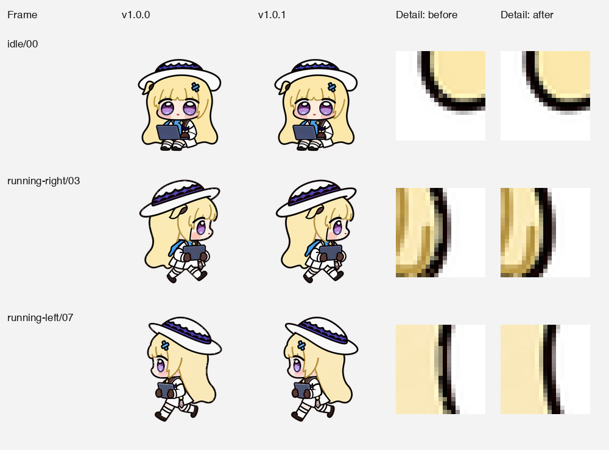
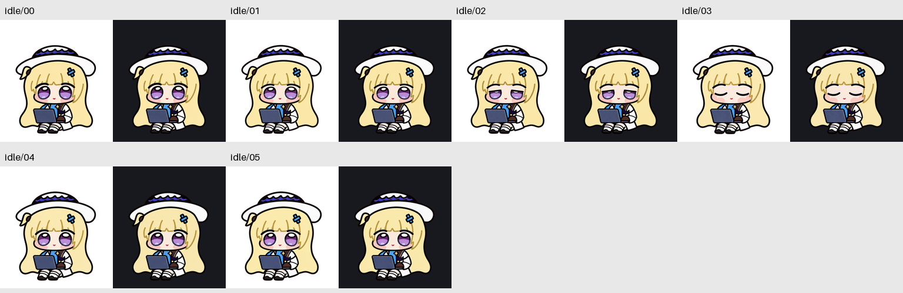

# Hair-Outline Repair Postmortem (v1.0.1)

**English** · [简体中文](OUTLINE-REPAIR.zh-CN.md) · [Documentation](README.md)

> **Status: Fixed in v1.0.1 and permanently guarded by `validate.py` and the `unittest` regression suite.**
>
> During the initial `v1.0.0` export, an edge-cleanup pass treated some **semi-transparent dark outer contour pixels** as color spill and averaged nearby pale-blonde hair or white hat fills into their RGB channels—leaving pale patches along Phoebe Chupi's hair outline.

---

## 1. Root Cause: How Dark Contours Turned Pale—and Why Automated Checks Missed It

Along the outer boundary of a transparent 2D sprite, anti-aliased contour pixels have partial opacity (`0 < Alpha < 255`). Before writing out the `v1.0.0` PNG and WebP files, the export pipeline ran an edge-cleanup rule that failed as follows:

```text
[Approved Pre-Cleanup Source (source-before-cleanup.png)]
  Anti-aliased contour pixel: RGB = (0, 0, 0) dark ink, Alpha = 140 (semi-transparent)
         │
         ▼  ❌ v1.0.0 edge-cleanup rule misfires:
            Treats semi-transparent dark ink as "fringe spill" and averages in
            neighboring opaque pale-blonde hair colors
         │
[Corrupted Export (v1.0.0 PNG & WebP)]
  Same pixel coordinate becomes: RGB = (100, 95, 74) pale tan, Alpha = 140 (alpha unchanged!)
         │
         ├─► Structural validator (dimensions / margins / alpha bbox) ──► PASSED (alpha unchanged)
         └─► Format equality check (decoded PNG == decoded WebP)       ──► PASSED (both had the bug!)
```

- **Exact deterministic reproduction**: Replaying that edge rule on the saved pre-cleanup frames ([`art/repair/v1.0.1/source-before-cleanup.png`](../art/repair/v1.0.1/source-before-cleanup.png)) reproduced the distributed `v1.0.0` pixels byte-for-byte.
- **Blast radius**: The local installation, cloud copy, and public `v1.0.0` release archive all contained the same affected artwork.

---

## 2. Lossless Restoration & Pixel-Level Evidence

Because the defect was introduced only at the final post-processing step and the approved pre-cleanup source remained intact, `v1.0.1` required no AI redrawing, resizing, or blur filtering:

1. **Recover approved pre-cleanup pixels**: Read the frozen [`art/repair/v1.0.1/source-before-cleanup.png`](../art/repair/v1.0.1/source-before-cleanup.png) master directly.
2. **Preserve 100% of alpha and placement**: All 73 occupied cells retain the exact alpha channel, pose registration, blinking cadence, proportions, and Dot direction layout of `v1.0.0`—**only the washed-out RGB values were restored**.
3. **Keep intentional inner hair lines**: Gold/brown internal hair lines are part of the character design and retain their original colors.

<p align="center">
  
</p>

The detail crops above use **nearest-neighbor enlargement** so individual pixels remain sharp. Three explicit cell coordinates (zero-based `(x, y)` within each `192 × 208` cell) are locked into `tests/` as permanent regression cases:

| Frame | Cell Pixel `(x, y)` | Damaged v1.0.0 RGB (blonde spill) | Restored v1.0.1 RGB (dark contour ink) |
| --- | :---: | :---: | :---: |
| `idle/00` | `(37, 180)` | `(100, 95, 74)` | `(0, 0, 0)` |
| `running-right/03` | `(155, 73)` | `(141, 135, 108)` | `(7, 0, 0)` |
| `running-left/07` | `(138, 108)` | `(148, 140, 113)` | `(8, 1, 0)` |

---

## 3. Verification Summary

<p align="center">
  
</p>

| Check | v1.0.1 Result |
| --- | --- |
| **Source comparison** | All **73 occupied cells** match the approved pre-cleanup visible pixels with **zero mismatches**. |
| **Color restoration** | **88,948 visible RGB pixels** restored to their exact source values. |
| **Dark-ink guard** | **263,885 dark-ink source pixels** audited with **zero mismatches**. |
| **Geometry & alpha** | Alpha channel and pose placement are 100% identical to `v1.0.0`. |
| **Visual inspection** | All 73 frames reviewed on light and dark backgrounds across all nine loops, the hop transition, and sixteen looks, plus an independent all-frame audit. |
| **Blind direction QA** | Three independent AI reviewers classified unlabeled A/B pairs; all 14 majority comparisons passed. |
| **Regression tests** | The damaged `v1.0.0` artifact is guaranteed to fail; the restored artifact passes. |

Related evidence records:
- Per-frame machine-readable restoration report: [`docs/outline-restoration.json`](outline-restoration.json)
- Full `v1.0.1` QA index: [Outline-Repair Review Evidence](repair-qa/README.md)
- Light/dark row review boards: [`art/repair/v1.0.1/review-boards/`](../art/repair/v1.0.1/review-boards)
- Current `v1.0.2` review guide: [Review and Validation Guide](REVIEW.md) (note: rows 0–8 in `v1.0.2` preserve these exact restored `v1.0.1` RGBA pixels)
- Issue tracker record: [Issue #1](https://github.com/RiomQAQ/phoebe-chupi-codex-pet/issues/1)

---

## 4. Reproduce the Repair Locally

You can deterministically rebuild the historical `v1.0.1` restoration from the frozen pre-cleanup source into an isolated directory, then run the regression suite (which audits `v1.0.1`) and current workspace checks:

```sh
python3 -m pip install -r requirements.txt

# 1. Reconstruct the historical v1.0.1 restoration into an isolated output directory
python3 scripts/restore_outlines.py --build --output-dir output/outline-restore-v1.0.1

# 2. Run the regression tests (including v1.0.1 outline checks) and current v1.0.2 workspace validation/previews/packaging
python3 -m unittest discover -s tests
python3 scripts/validate.py --report docs/validation.json
python3 scripts/render_previews.py
python3 scripts/package.py
```

- `--build` reads the frozen [pre-cleanup source](../art/repair/v1.0.1/source-before-cleanup.png) and exports the restored `v1.0.1` atlas into the specified new output directory without redrawing, resizing, or neighbor-color averaging, leaving the current installed package and `v1.0.2` runtime files untouched (while `validate.py`, `render_previews.py`, and `package.py` operate on the current `v1.0.2` runtime and also audit the frozen `v1.0.1` snapshot).
- Both the damaged [`v1.0.0` snapshot](../art/releases/v1.0.0) and the restored [`v1.0.1` snapshot](../art/releases/v1.0.1) remain archived in the repository for comparison and regression testing.
- **Lasting takeaway**: Future exports must preserve clean native alpha and verify contour colors directly against the approved source; `PNG == WebP` equality verifies lossless encoding, not source-color fidelity.
