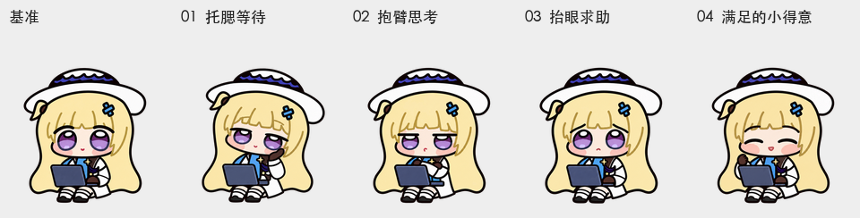

# 审查与校验指南

[English](REVIEW.md) · **简体中文** · [文档目录](README.zh-CN.md)

在制作桌面宠物精灵整图时，**“结构脚本跑通”不等于“画面没有穿帮”**，而**“PNG 与 WebP 像素相等”也查不出两者共同包含的画风错误**。因此，菲比啾比将**单帧画面检查**、**连贯动作检查**、**三方无标签方向盲审**和**自动化文件像素守卫**拆成四道彼此独立的关卡：造型以姿势母本为准，发布验收以最终 `spritesheet.webp` 为准。

```text
+-----------------------------------------------------------------------------+
|  关卡 1：原生 192 × 208 逐帧体检（浅色 + 深色双背景，核查五官/配饰/电脑/描线）  |
|     │                                                                       |
|     ▼                                                                       |
|  关卡 2：连贯动作与跨状态衔接（9 类循环首尾 + idle→jumping→idle + 16 向环视） |
|     │                                                                       |
|     ▼                                                                       |
|  关卡 3：三方独立无标签 A/B 盲审（隐去文件名与角度，14 组水平/垂直严格多数）  |
|     │                                                                       |
|     ▼                                                                       |
|  关卡 4：validate.py + unittest 像素守卫（锁定基准哈希、前 9 行冻结、隐私扫描）|
+-----------------------------------------------------------------------------+
```

---

## 逐帧检查

全部 73 个有效格都必须在**浅色背景**和**深色背景**下各看一遍。检查时务必先按原生 **192 × 208**（1×）尺寸观察整体比例与轮廓可读性，定位具体像素瑕疵时再放大局部：

<p align="center">
  
</p>

| 检查项 | 通过标准 |
| --- | --- |
| **角色一致性** | 脸型、宽檐白帽、金发轮廓、服装层次和二头身比例符合坐姿/抱电脑母本。 |
| **不对称配饰** | 蓝色十字发夹始终保持在**观看者右侧**，呆毛和蓝布饰始终保持在**观看者左侧**。 |
| **肢体连接** | 只有预期的两只手和两条手臂，深色手套与白色袖口连接清楚，无重影手。 |
| **面部细节** | 分层紫色眼睛、眉毛、短下巴和嘴部线条一致，没有残留重影杂线。 |
| **笔记本电脑** | 只有一层屏盖、一处铰链、一套键盘，双手搭放或抱持的位置符合结构。 |
| **外轮廓与发丝** | 深色外轮廓线连续不断裂；头发内部的金棕色发丝线保留原色，不被洗浅。 |
| **透明度与边距** | 四周留出至少 `1 px` 透明边距；无不透明底色块、裁边、杂色光晕或内部透明破洞。 |
| **基准位置对齐** | 在应当静止的姿态中，坐姿身体、笔记本电脑和地面接触点保持稳定不漂移。 |

任何修改过的单帧，都必须同时对比**姿势母本**、**左右相邻帧**以及**共用同一套坐姿的其他状态**；完成取景归一化与无损 WebP 编码后还需复检一次。

---

## 检查完整动作

- **九类循环首尾衔接**：按预期播放速度逐一查看 9 类标准动作，重点观察最后一帧接回第 0 帧时是否顺滑。
- **小跳起落归位**：查看 `idle → jumping → idle` 的起跳蓄力、电脑跟随抬升（最高 21 px）以及落地后是否零偏移回到待机坐姿。
- **跨状态神态统一**：把工作（`running`）、等待（`waiting`）、检查（`review`）和求助（`failed`）的表情连起来看，确认始终是同一个菲比啾比。
- **左右移动对照**：对比 `running-right` 与 `running-left` 的头身比例、步幅节奏与配饰左右位置。
- **16 向转头环视**：连续播放 16 个转头方向及 `337.5° → 000°` 首尾闭合处，把“身体与电脑是否漂移”和“头部与眼神是否平滑转动”分开观察。

检查时可配合仓库提供的[全部动作合成预览](../previews/all-states.gif)、[小跳衔接预览](../previews/idle-jump-idle.gif)、[16 向转头循环](../previews/look-loop.gif)和[深色背景预览目录](../previews/dark)。需要注意 GIF 受限于 256 色调色板；核查真实边缘颜色与半透明像素时，应以 [最终 PNG](../art/final/spritesheet.png) 与 [73 张原像素裁剪帧](../art/frames) 为准。

---

## 方向审查

为了防止审查者被文件名（如 `090.png`、`270.png`）带偏，方向检查采用**“先看顺序总览、再做无标签 A/B 盲审”**的双轨流程：

<p align="center">
  
</p>

1. **构建 14 组对称配对**：包含 7 组水平方向对比（左 vs 右）与 7 组垂直方向对比（上 vs 下），其中四个正方向（`000`、`090`、`180`、`270`）为必须全票清楚通过的核心项。
2. **完全去标签盲化**：隐藏所有文件名、角度编号与标准答案，随机打乱每组内 `A / B` 左右排列顺序。
3. **三方独立作答**：由 **3 名相互隔离的独立审查者**仅凭画面判断 `A` 和 `B` 各自看向屏幕哪个方向（左/右或上/下）并写明视觉依据，允许回答“不确定”。
4. **先存档后开奖**：在揭晓答案表之前完整保存三份独立盲审记录，再按每张图的**严格多数（至少 2/3 一致正确）**汇总结果。
5. **连续环路复核**：任何存在分歧或把握度偏低的姿态，都要放回 16 向连续转头循环中复查，再决定保留或重绘。

`v1.0.2` 由 3 名审查者分别重新完成全新一轮独立 A/B 盲审，**全部 14 组对比均按严格多数通过**。三份独立答卷、答案对照表与校验脚本输出完整保存在[转头修复检查记录](look-repair-qa/README.zh-CN.md)中；`v1.0.1` 的历史盲审记录继续保留在[历史检查记录](repair-qa/README.zh-CN.md)中。

---

## 当前结果

以下结果对应当前发布的 **v1.0.2** 无损 `spritesheet.webp`，其 SHA-256 为 `c00941ef64ce87b76b60f84da2f5dd0045147ad82017cccf349d2a21330106c6`。[转头修复检查记录](look-repair-qa/README.zh-CN.md)完整保存了质量门禁输出、方向盲审详情和浏览器检查范围。

| 检查维度 | v1.0.2 实测结果 |
| --- | --- |
| **整图布局** | `1536 × 2288`（8 列 × 11 行，单格 `192 × 208`）；**73 个有效格**，**15 个全透明格**。 |
| **导出一致性** | `art/final/spritesheet.png` 与无损 `spritesheet.webp` 解码后的 RGBA 像素 100% 相同。 |
| **单格裁剪帧** | `art/frames/` 下的 73 张裁剪图均与整图对应格子逐像素一致。 |
| **认可基准比对** | 发布图片的像素与经过审查的 `v1.0.2` PNG 基准（`art/approved/v1.0.2/spritesheet.png`）完全一致。 |
| **标准动作冻结** | 前九行的 **57 张标准动作帧（含待机眨眼）** 与 `v1.0.1` 的 RGBA 像素 **0 差异**。 |
| **转头姿态重绘** | 使用内置图像工具完整重画 **12 张转头帧**；`022.5`、`045`、`067.5`、`090` 四帧沿用原画；完整保留原有帽子设计。 |
| **方向盲审对比** | 3 名审查者独立完成全新无标签 A/B 比较，**14 组全部按严格多数通过**。 |
| **质量门禁报告** | 宠物质量检查报告（[`pet-quality.json`](look-repair-qa/pet-quality.json)）通过，保留已人工复核的方向步进与连贯性提示。 |
| **坐姿小跳测量** | 最高抬升 **21 px**，落地偏移 **0 px**。 |
| **转头位置稳定性** | 横向中心最大偏移 **3.0 px**，宽度比最大 **1.0859375**。 |
| **浏览器逐帧检查** | 在原生 `192 × 208`（1×）尺寸下逐帧正反向对比新旧图，并以连续截图抽查播放（范围见下文）。 |
| **本机安装与回读** | 本机文件与当前启用的应用宠物条目已更新，应用回读保存图片的 RGBA 像素与发布版一致。 |
| **源图档案规模** | **832 张不同 SHA-256 源图**，对应 **1,447 个工作文件实例**。 |

<p align="center">
  
</p>

### 测量口径与审查说明

1. **最新一轮 6 帧脸型细化**：覆盖 `000`、`157.5`、`247.5`、`292.5`、`315`、`337.5` 六个角度，专门解决脸颊过窄以及从左上注视姿态转回正面时脸部显得变大的问题。每张都由图像生成工具直接输出完整连接的角色帧，没有粘贴脸部或做局部液化变形。
2. **两种边界框测量口径**：动作幅度测量采用 `alpha > 16` 的可见像素边界；而 [`docs/validation.json`](validation.json) 中的原始边界（`alpha_bbox`）包含所有非零透明像素（`alpha > 0`），阅读数据时请注意不要混用这两种口径。此外，位置偏移和像素差异数字只用于定位需要肉眼检查的过渡帧，单靠数字本身不能证明脸型自然或动作流畅。
3. **浏览器 1× 抽查范围**：当前浏览器检查在 `1×` 原生尺寸下正向、反向逐帧核对了 `270 → 292.5 → 315 → 337.5 → 000` 关键回正区段，并配合 `2×` 诊断视图辅助定位。由于自动播放是通过连续截图抽查的，因此它属于抽样静帧核查而非连续视频录制审查。早期候选稿中明显的“整张脸突然变大”在原生尺寸下已不再明显，但离散角度之间的姿态跳变仍然可见（`v1.0.1` 已在 macOS 桌面端和原生 Dot 中完成实机检查）。
4. **应用安装回读验证**：[安装验证记录](look-repair-qa/installation-verification.json)确认本机文件与当前启用的应用宠物条目均已更新到 `v1.0.2`。应用回读导出的是 PNG，其解码后的 RGBA 像素与发布的 WebP 完全一致；原有宠物条目、启用状态和全部 57 张标准动作帧均完整保留。

---

## 已知限制

我们实事求是地记录当前版本在视觉与跨平台验证上的客观边界：

- **`045` 与 `067.5` 角度接近**：这两个右上过渡姿态在 `192 × 208` 原生尺寸下视觉差异较小。
- **局部离散姿态跨度较明显**：`225 → 247.5` 和 `270 → 292.5` 的姿态变化幅度比其他相邻帧更明显——其中 `270 → 292.5` 带有可见的抬头动作，而 `292.5 → 315` 中远侧眼睛的张开变化也较明显。
- **Dot 16 帧离散步进特性**：由于 Dot 从 16 张静态画面中按角度选帧，鼠标快速环绕时转头会呈现可见的角度步进，而非连续骨骼插值。
- **减弱动态效果下的眨眼停留**：待机眨眼包含半闭眼和闭眼帧；如果系统开启了“减弱动态效果”或受应用调度时序影响，画面可能会在某个眨眼姿态短暂停留。
- **待补充的平台实机画面**：`v1.0.2` 的原生 Dot 实机检查与 Windows 桌面端画面检查仍待后续完成（早期方向反馈保存在[已关闭的 Issue #2](https://github.com/RiomQAQ/phoebe-chupi-codex-pet/issues/2)）。

> **历史修复复盘提示**：[头发描线修复记录](OUTLINE-REPAIR.zh-CN.md)详细说明了 `v1.0.0` 的边缘清理失误与 `v1.0.1` 的无损修正（恢复 **88,948 个可见像素**的 RGB，并核对 **263,885 个深色描线像素**零差异）。请注意这些数字属于保存在 [`art/releases/v1.0.1`](../art/releases/v1.0.1) 中的历史修复统计，不是 `v1.0.2` 新重绘转头帧的像素数量。那次修复留下的重要工程教训依然适用：**如果 PNG 与 WebP 在导出前就已经共享了同一个画面错误，仅靠比对两种格式是否相等是无法发现问题的。**

---

## 运行文件校验

安装仓库依赖后，使用 Python 3.10+ 即可在本地运行全套校验与回归测试：

```sh
python3 scripts/validate.py --report docs/validation.json
python3 -m unittest discover -s tests
```

- **`scripts/validate.py` 检查范围**：核对 5 字段 `pet.json` 清单、静态 v2 WebP 整图尺寸与通道、73 个有效格与 15 个全透明格、至少 `1 px` 安全边距、PNG/WebP 解码像素一致性、73 张最终裁剪帧、批准基准原图一致性、832 张源图哈希、全部图像解码与干净元数据（无未审查 EXIF/XMP/注释）、公开文本隐私标记扫描、文件大小上限以及 `CHECKSUMS.sha256` 发布校验值。
- **双层像素守卫（`scripts/audit_artwork.py`）**：
  1. 读取 [`art/approved-runtime.json`](../art/approved-runtime.json)，校验 [`art/approved/v1.0.2/spritesheet.png`](../art/approved/v1.0.2/spritesheet.png) 的 SHA-256，并将整张图的 RGBA 像素与运行时 `spritesheet.webp` 逐像素比对；
  2. 将前 9 行固定锁死到 `v1.0.1` PNG（[`art/releases/v1.0.1/spritesheet.png`](../art/releases/v1.0.1/spritesheet.png)），保护全部 57 张标准动作帧及前 9 行的透明格不被意外改动。
- **回归测试（`tests/`）**：继续保留对受损 `v1.0.0` 整图及三处典型头发描线像素的负向回归拦截，同时验证当前 `v1.0.2` 基准与冻结标准行。每当有意修改美术画面时，必须先建立经过人工审查的新基准与校验值，同时保留历史快照与回归测试。

---

## 发布检查表

在打标签发布任何新版本前，请逐项确认：

- [ ] 在浅色和深色背景下检查所有改动帧、相邻帧、完整循环和跨状态衔接。
- [ ] 修改任何 Dot 转头姿态后，重新执行 3 人独立无标签 A/B 方向盲审。
- [ ] 直接从准备发布的同一份 `spritesheet.webp` 重新生成全部预览图与裁剪帧。
- [ ] 更新源图映射记录、校验值（`CHECKSUMS.sha256`）和中英文双语文档。
- [ ] 核对署名信息、图像元数据以及公开文件中的隐私标记扫描结果。
- [ ] 运行 `scripts/validate.py` 与 `unittest` 回归测试，检查 `dist/` 安装包内容。
- [ ] 保持根目录 `VERSION`、安装脚本导入图片地址和 Git 版本标签完全一致。
- [ ] 确认发布提交的 GitHub Actions CI 通过，并下载公开 Release 附件比对 SHA-256。
