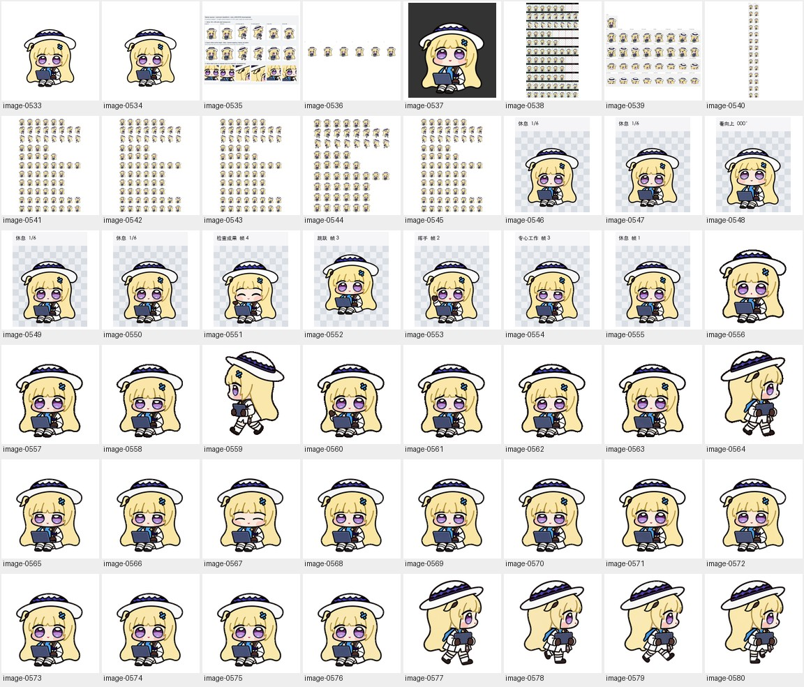
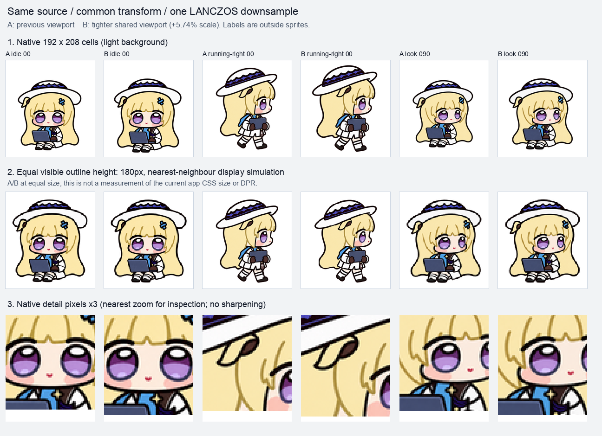
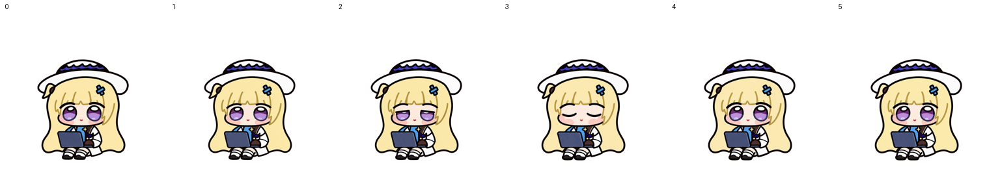
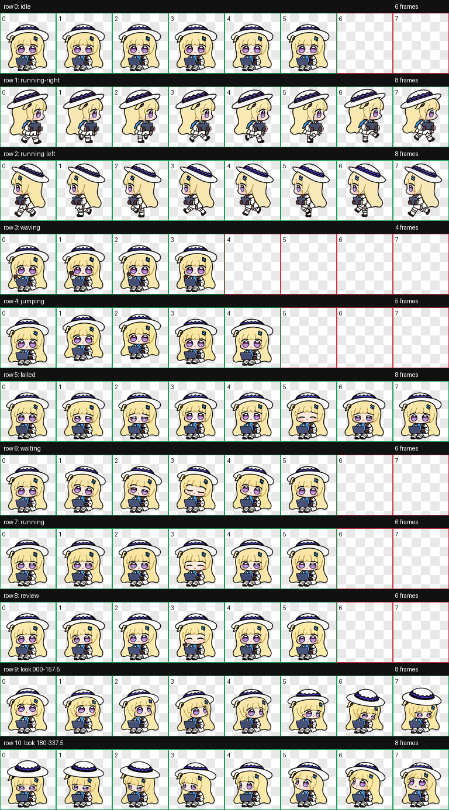
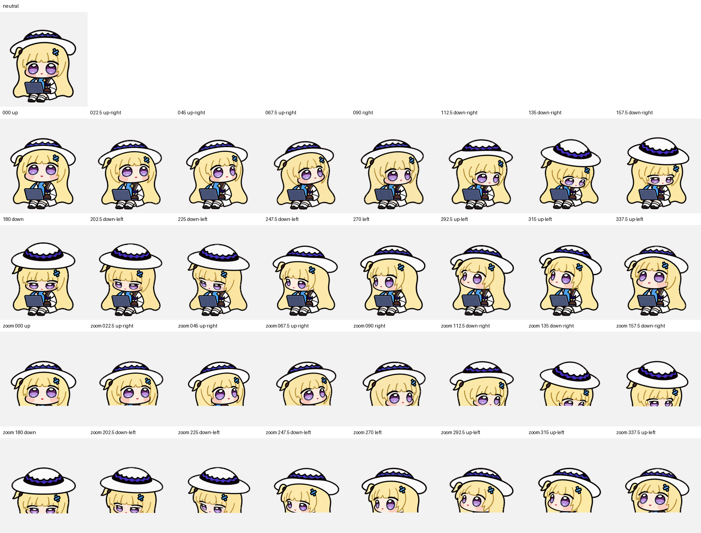
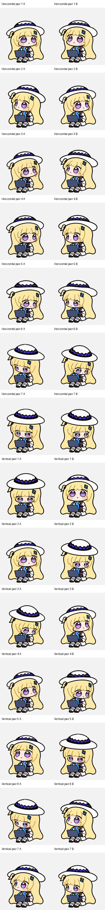
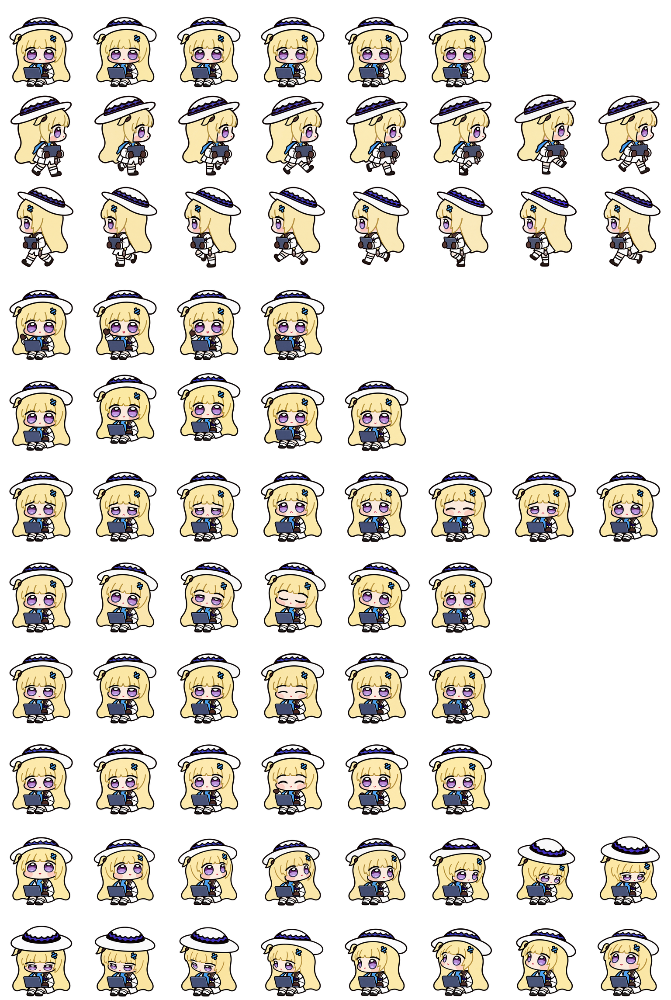
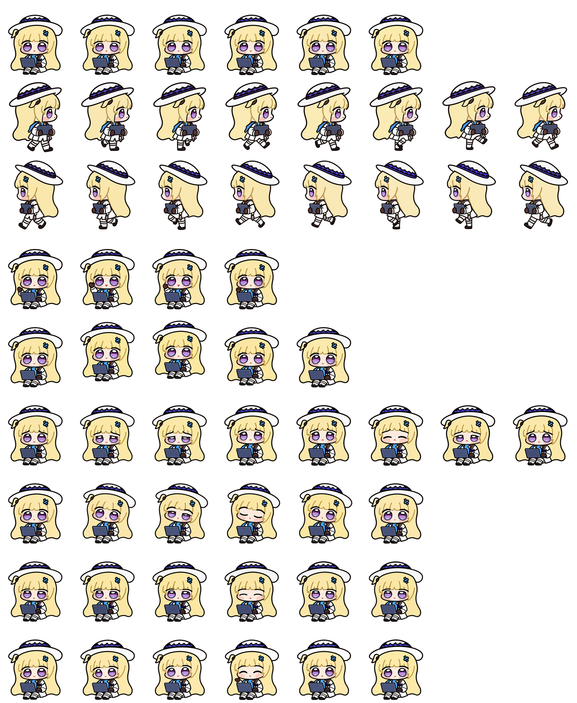

# Open-eye study / 睁眼试验 · 1

[Archive](../IMAGE-GALLERY.md) · [中文目录](../IMAGE-GALLERY.zh-CN.md)

Open a thumbnail to view the original. Image IDs map to `art/index.json`.

点击缩略图查看原图，图片编号可在 `art/index.json` 中查找。

| Image / 图片 | Record / 记录 |
| --- | --- |
|  | **image-0533** · 1254 × 1254 Unused eye-expression study / 未采用的眼部表情试验 [Full image / 查看原图](../../art/archive/awake-experiment/0001-idle03.png) |
|  | **image-0534** · 1254 × 1254 Unused eye-expression study / 未采用的眼部表情试验 [Full image / 查看原图](../../art/archive/awake-experiment/0002-idle02.png) |
|  | **image-0535** · 1296 × 940 Unused eye-expression study / 未采用的眼部表情试验 [Full image / 查看原图](../../art/archive/awake-experiment/0003-clarity-comparison.png) |
|  | **image-0536** · 1536 × 280 Unused eye-expression study / 未采用的眼部表情试验 [Full image / 查看原图](../../art/archive/awake-experiment/0004-idle-source-before.png) |
|  | **image-0537** · 576 × 624 Unused eye-expression study / 未采用的眼部表情试验 [Full image / 查看原图](../../art/archive/awake-experiment/0005-look000-foot-check.png) |
|  | **image-0538** · 768 × 1386 Unused eye-expression study / 未采用的眼部表情试验 [Full image / 查看原图](../../art/archive/awake-experiment/0006-contact-extended.png) |
|  | **image-0539** · 1536 × 1170 Unused eye-expression study / 未采用的眼部表情试验 [Full image / 查看原图](../../art/archive/awake-experiment/0007-direction-sheet.png) |
|  | **image-0540** · 384 × 3304 Unused eye-expression study / 未采用的眼部表情试验 [Full image / 查看原图](../../art/archive/awake-experiment/0008-blind-direction-pairs.png) |
|  | **image-0541** · 1536 × 2288 Unused eye-expression study / 未采用的眼部表情试验 [Full image / 查看原图](../../art/archive/awake-experiment/0009-spritesheet-before-despill.png) |
|  | **image-0542** · 1536 × 2288 Unused eye-expression study / 未采用的眼部表情试验 [Full image / 查看原图](../../art/archive/awake-experiment/0010-spritesheet-extended.png) |
|  | **image-0543** · 1536 × 2288 Unused eye-expression study / 未采用的眼部表情试验 [Full image / 查看原图](../../art/archive/awake-experiment/0011-spritesheet.webp) |
|  | **image-0544** · 1536 × 1872 Unused eye-expression study / 未采用的眼部表情试验 [Full image / 查看原图](../../art/archive/awake-experiment/0012-spritesheet-standard.png) |
|  | **image-0545** · 1536 × 2288 Unused eye-expression study / 未采用的眼部表情试验 [Full image / 查看原图](../../art/archive/awake-experiment/0013-cloud-readback.png) |
|  | **image-0546** · 192 × 244 Unused eye-expression study / 未采用的眼部表情试验 [Full image / 查看原图](../../art/archive/awake-experiment/0014-idle-jump-idle.gif) |
|  | **image-0547** · 192 × 244 Unused eye-expression study / 未采用的眼部表情试验 [Full image / 查看原图](../../art/archive/awake-experiment/0015-all-states.gif) |
|  | **image-0548** · 192 × 244 Unused eye-expression study / 未采用的眼部表情试验 [Full image / 查看原图](../../art/archive/awake-experiment/0016-look-loop.gif) |
|  | **image-0549** · 192 × 244 Unused eye-expression study / 未采用的眼部表情试验 [Full image / 查看原图](../../art/archive/awake-experiment/0017-idle-jump-idle.gif) |
|  | **image-0550** · 192 × 244 Unused eye-expression study / 未采用的眼部表情试验 [Full image / 查看原图](../../art/archive/awake-experiment/0018-all-states.gif) |
|  | **image-0551** · 192 × 244 Unused eye-expression study / 未采用的眼部表情试验 [Full image / 查看原图](../../art/archive/awake-experiment/0019-review-03.png) |
|  | **image-0552** · 192 × 244 Unused eye-expression study / 未采用的眼部表情试验 [Full image / 查看原图](../../art/archive/awake-experiment/0020-jumping-02.png) |
|  | **image-0553** · 192 × 244 Unused eye-expression study / 未采用的眼部表情试验 [Full image / 查看原图](../../art/archive/awake-experiment/0021-waving-01.png) |
|  | **image-0554** · 192 × 244 Unused eye-expression study / 未采用的眼部表情试验 [Full image / 查看原图](../../art/archive/awake-experiment/0022-running-02.png) |
|  | **image-0555** · 192 × 244 Unused eye-expression study / 未采用的眼部表情试验 [Full image / 查看原图](../../art/archive/awake-experiment/0023-idle-00.png) |
|  | **image-0556** · 192 × 208 Unused eye-expression study / 未采用的眼部表情试验 [Full image / 查看原图](../../art/archive/awake-experiment/0024-waiting.gif) |
|  | **image-0557** · 192 × 208 Unused eye-expression study / 未采用的眼部表情试验 [Full image / 查看原图](../../art/archive/awake-experiment/0025-jumping.gif) |
|  | **image-0558** · 192 × 208 Unused eye-expression study / 未采用的眼部表情试验 [Full image / 查看原图](../../art/archive/awake-experiment/0026-running.gif) |
|  | **image-0559** · 192 × 208 Unused eye-expression study / 未采用的眼部表情试验 [Full image / 查看原图](../../art/archive/awake-experiment/0027-running-left.gif) |
|  | **image-0560** · 192 × 208 Unused eye-expression study / 未采用的眼部表情试验 [Full image / 查看原图](../../art/archive/awake-experiment/0028-waving.gif) |
|  | **image-0561** · 192 × 208 Unused eye-expression study / 未采用的眼部表情试验 [Full image / 查看原图](../../art/archive/awake-experiment/0029-failed.gif) |
|  | **image-0562** · 192 × 208 Unused eye-expression study / 未采用的眼部表情试验 [Full image / 查看原图](../../art/archive/awake-experiment/0030-review.gif) |
|  | **image-0563** · 192 × 208 Unused eye-expression study / 未采用的眼部表情试验 [Full image / 查看原图](../../art/archive/awake-experiment/0031-idle.gif) |
|  | **image-0564** · 192 × 208 Unused eye-expression study / 未采用的眼部表情试验 [Full image / 查看原图](../../art/archive/awake-experiment/0032-running-right.gif) |
|  | **image-0565** · 192 × 208 Unused eye-expression study / 未采用的眼部表情试验 [Full image / 查看原图](../../art/archive/awake-experiment/0033-00.png) |
|  | **image-0566** · 192 × 208 Unused eye-expression study / 未采用的眼部表情试验 [Full image / 查看原图](../../art/archive/awake-experiment/0034-01.png) |
|  | **image-0567** · 192 × 208 Unused eye-expression study / 未采用的眼部表情试验 [Full image / 查看原图](../../art/archive/awake-experiment/0035-03.png) |
|  | **image-0568** · 192 × 208 Unused eye-expression study / 未采用的眼部表情试验 [Full image / 查看原图](../../art/archive/awake-experiment/0036-02.png) |
|  | **image-0569** · 192 × 208 Unused eye-expression study / 未采用的眼部表情试验 [Full image / 查看原图](../../art/archive/awake-experiment/0037-05.png) |
|  | **image-0570** · 192 × 208 Unused eye-expression study / 未采用的眼部表情试验 [Full image / 查看原图](../../art/archive/awake-experiment/0038-04.png) |
|  | **image-0571** · 192 × 208 Unused eye-expression study / 未采用的眼部表情试验 [Full image / 查看原图](../../art/archive/awake-experiment/0039-00.png) |
|  | **image-0572** · 192 × 208 Unused eye-expression study / 未采用的眼部表情试验 [Full image / 查看原图](../../art/archive/awake-experiment/0040-01.png) |
|  | **image-0573** · 192 × 208 Unused eye-expression study / 未采用的眼部表情试验 [Full image / 查看原图](../../art/archive/awake-experiment/0041-03.png) |
|  | **image-0574** · 192 × 208 Unused eye-expression study / 未采用的眼部表情试验 [Full image / 查看原图](../../art/archive/awake-experiment/0042-02.png) |
|  | **image-0575** · 192 × 208 Unused eye-expression study / 未采用的眼部表情试验 [Full image / 查看原图](../../art/archive/awake-experiment/0043-05.png) |
|  | **image-0576** · 192 × 208 Unused eye-expression study / 未采用的眼部表情试验 [Full image / 查看原图](../../art/archive/awake-experiment/0044-04.png) |
|  | **image-0577** · 192 × 208 Unused eye-expression study / 未采用的眼部表情试验 [Full image / 查看原图](../../art/archive/awake-experiment/0045-00.png) |
|  | **image-0578** · 192 × 208 Unused eye-expression study / 未采用的眼部表情试验 [Full image / 查看原图](../../art/archive/awake-experiment/0046-01.png) |
|  | **image-0579** · 192 × 208 Unused eye-expression study / 未采用的眼部表情试验 [Full image / 查看原图](../../art/archive/awake-experiment/0047-03.png) |
|  | **image-0580** · 192 × 208 Unused eye-expression study / 未采用的眼部表情试验 [Full image / 查看原图](../../art/archive/awake-experiment/0048-02.png) |
