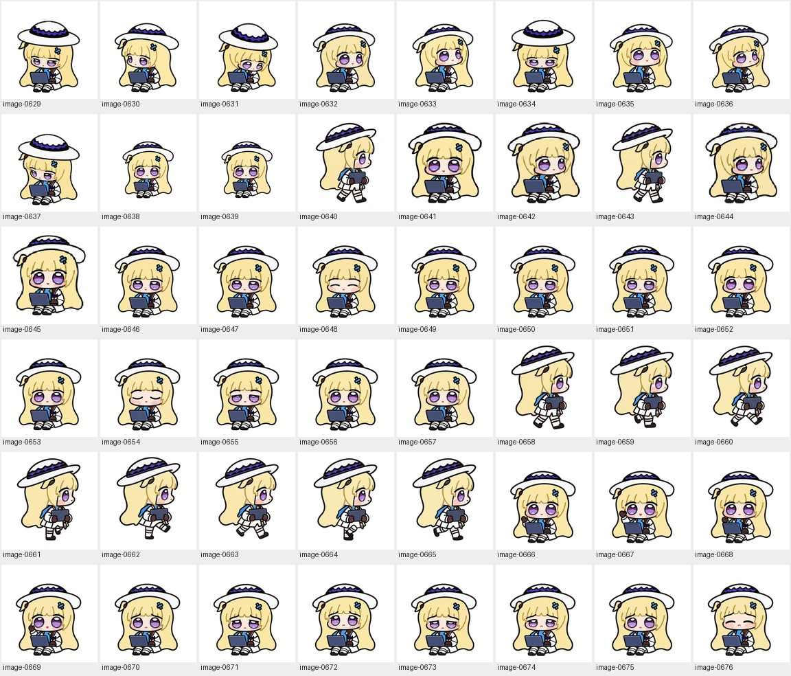

# Unused open-eye study / 未采用的睁眼试验 · 3

[Archive / 英文总览](../IMAGE-GALLERY.md) · [中文目录](../IMAGE-GALLERY.zh-CN.md) · [← Prev / 上一页](awake-experiment-02.md) · [Next / 下一页 →](awake-experiment-04.md)

> **Page 3 of 4 / 第 3 页（共 4 页）** · **48 images on this page / 本页共收录 48 张源图**
>
> - **EN**: Complete archive of the earlier non-blinking ('always awake') idle and state experiments, preserved for comparison after adopting the natural blinking cycle.
> - **ZH**: 早期围绕“全程睁眼不眨眼”方案生成的全套状态候选与切片归档；最终发布版改为更自然的眨眼呼吸循环，本分册完整保留供对照。

Click any thumbnail or **Full image / 查看原图** link to inspect the uncompressed source file. Image IDs (`image-XXXX`) map directly to [`art/index.json`](../../art/index.json).

点击任意缩略图或「**Full image / 查看原图**」即可查看未压缩原图；图片编号（`image-XXXX`）与 [`art/index.json`](../../art/index.json) 一一对应。

| Preview / 缩略预览 | Archive Record & Provenance / 档案记录与来源路径 |
| :---: | --- |
|  | **image-0629** · `192 × 208` · PNG (39 KB) Rolled-back open-eye experiment (Dot 16-angle head-turn study) / 未采用的“全程睁眼”试验稿（Dot 16 向转头朝向研究） Primary working path / 原始工作路径: `production-v4-awake/previews/final/frames-from-final/look/202.5.png` [Full image / 查看原图](../../art/archive/awake-experiment/0097-202.5.png) |
|  | **image-0630** · `192 × 208` · PNG (36 KB) Rolled-back open-eye experiment (Dot 16-angle head-turn study) / 未采用的“全程睁眼”试验稿（Dot 16 向转头朝向研究） Primary working path / 原始工作路径: `production-v4-awake/previews/final/frames-from-final/look/247.5.png` [Full image / 查看原图](../../art/archive/awake-experiment/0098-247.5.png) |
|  | **image-0631** · `192 × 208` · PNG (38 KB) Rolled-back open-eye experiment (Dot 16-angle head-turn study) / 未采用的“全程睁眼”试验稿（Dot 16 向转头朝向研究） Primary working path / 原始工作路径: `production-v4-awake/previews/final/frames-from-final/look/135.png` [Full image / 查看原图](../../art/archive/awake-experiment/0099-135.png) |
|  | **image-0632** · `192 × 208` · PNG (39 KB) Rolled-back open-eye experiment (Dot 16-angle head-turn study) / 未采用的“全程睁眼”试验稿（Dot 16 向转头朝向研究） Primary working path / 原始工作路径: `production-v4-awake/previews/final/frames-from-final/look/090.png` [Full image / 查看原图](../../art/archive/awake-experiment/0100-090.png) |
|  | **image-0633** · `192 × 208` · PNG (38 KB) Rolled-back open-eye experiment (Dot 16-angle head-turn study) / 未采用的“全程睁眼”试验稿（Dot 16 向转头朝向研究） Primary working path / 原始工作路径: `production-v4-awake/previews/final/frames-from-final/look/045.png` [Full image / 查看原图](../../art/archive/awake-experiment/0101-045.png) |
|  | **image-0634** · `192 × 208` · PNG (40 KB) Rolled-back open-eye experiment (Dot 16-angle head-turn study) / 未采用的“全程睁眼”试验稿（Dot 16 向转头朝向研究） Primary working path / 原始工作路径: `production-v4-awake/previews/final/frames-from-final/look/180.png` [Full image / 查看原图](../../art/archive/awake-experiment/0102-180.png) |
|  | **image-0635** · `192 × 208` · PNG (40 KB) Rolled-back open-eye experiment (Dot 16-angle head-turn study) / 未采用的“全程睁眼”试验稿（Dot 16 向转头朝向研究） Primary working path / 原始工作路径: `production-v4-awake/previews/final/frames-from-final/look/022.5.png` [Full image / 查看原图](../../art/archive/awake-experiment/0103-022.5.png) |
|  | **image-0636** · `192 × 208` · PNG (38 KB) Rolled-back open-eye experiment (Dot 16-angle head-turn study) / 未采用的“全程睁眼”试验稿（Dot 16 向转头朝向研究） Primary working path / 原始工作路径: `production-v4-awake/previews/final/frames-from-final/look/067.5.png` [Full image / 查看原图](../../art/archive/awake-experiment/0104-067.5.png) |
|  | **image-0637** · `192 × 208` · PNG (39 KB) Rolled-back open-eye experiment (Dot 16-angle head-turn study) / 未采用的“全程睁眼”试验稿（Dot 16 向转头朝向研究） Primary working path / 原始工作路径: `production-v4-awake/previews/final/frames-from-final/look/225.png` [Full image / 查看原图](../../art/archive/awake-experiment/0105-225.png) |
|  | **image-0638** · `1024 × 1024` · PNG (425 KB) Unused open-eye study for Idle & blink (`idle`) / 未采用睁眼方案：待机与眨眼（`idle`） 试验帧 Primary working path / 原始工作路径: `production-v4-awake/raw-frames/idle/03.png` [Full image / 查看原图](../../art/archive/awake-experiment/0106-03.png) |
|  | **image-0639** · `1024 × 1024` · PNG (420 KB) Unused open-eye study for Idle & blink (`idle`) / 未采用睁眼方案：待机与眨眼（`idle`） 试验帧 Primary working path / 原始工作路径: `production-v4-awake/raw-frames/idle/02.png` [Full image / 查看原图](../../art/archive/awake-experiment/0107-02.png) |
|  | **image-0640** · `192 × 208` · PNG (39 KB) Rolled-back open-eye experiment (QA comparison & alignment check) / 未采用的“全程睁眼”试验稿（质量复查与对齐检验图） Primary working path / 原始工作路径: `production-v4-awake/qa/clarity-assets/equal-running-right-candidate.png` [Full image / 查看原图](../../art/archive/awake-experiment/0108-equal-running-right-candidate.png) |
|  | **image-0641** · `192 × 208` · PNG (42 KB) Rolled-back open-eye experiment (QA comparison & alignment check) / 未采用的“全程睁眼”试验稿（质量复查与对齐检验图） Primary working path / 原始工作路径: `production-v4-awake/qa/clarity-assets/equal-idle-candidate.png` [Full image / 查看原图](../../art/archive/awake-experiment/0109-equal-idle-candidate.png) |
|  | **image-0642** · `192 × 208` · PNG (41 KB) Rolled-back open-eye experiment (Dot 16-angle head-turn study) / 未采用的“全程睁眼”试验稿（Dot 16 向转头朝向研究） Primary working path / 原始工作路径: `production-v4-awake/qa/clarity-assets/equal-look-candidate.png` [Full image / 查看原图](../../art/archive/awake-experiment/0110-equal-look-candidate.png) |
|  | **image-0643** · `192 × 208` · PNG (39 KB) Rolled-back open-eye experiment (QA comparison & alignment check) / 未采用的“全程睁眼”试验稿（质量复查与对齐检验图） Primary working path / 原始工作路径: `production-v4-awake/qa/clarity-assets/equal-running-right-old.png` [Full image / 查看原图](../../art/archive/awake-experiment/0111-equal-running-right-old.png) |
|  | **image-0644** · `192 × 208` · PNG (38 KB) Rolled-back open-eye experiment (Dot 16-angle head-turn study) / 未采用的“全程睁眼”试验稿（Dot 16 向转头朝向研究） Primary working path / 原始工作路径: `production-v4-awake/qa/clarity-assets/equal-look-old.png` [Full image / 查看原图](../../art/archive/awake-experiment/0112-equal-look-old.png) |
|  | **image-0645** · `192 × 208` · PNG (39 KB) Rolled-back open-eye experiment (QA comparison & alignment check) / 未采用的“全程睁眼”试验稿（质量复查与对齐检验图） Primary working path / 原始工作路径: `production-v4-awake/qa/clarity-assets/equal-idle-old.png` [Full image / 查看原图](../../art/archive/awake-experiment/0113-equal-idle-old.png) |
|  | **image-0646** · `192 × 208` · PNG (40 KB) Unused open-eye study for Working / typing (`running`) / 未采用睁眼方案：专注敲代码（`running`） 试验帧 Primary working path / 原始工作路径: `production-v4-awake/frames/running/00.png` (+2 aliases / 处复用) [Full image / 查看原图](../../art/archive/awake-experiment/0114-00.png) |
|  | **image-0647** · `192 × 208` · PNG (40 KB) Unused open-eye study for Working / typing (`running`) / 未采用睁眼方案：专注敲代码（`running`） 试验帧 Primary working path / 原始工作路径: `production-v4-awake/frames/running/01.png` (+2 aliases / 处复用) [Full image / 查看原图](../../art/archive/awake-experiment/0115-01.png) |
|  | **image-0648** · `192 × 208` · PNG (40 KB) Unused open-eye study for Working / typing (`running`) / 未采用睁眼方案：专注敲代码（`running`） 试验帧 Primary working path / 原始工作路径: `production-v4-awake/frames/running/03.png` (+2 aliases / 处复用) [Full image / 查看原图](../../art/archive/awake-experiment/0116-03.png) |
|  | **image-0649** · `192 × 208` · PNG (40 KB) Unused open-eye study for Working / typing (`running`) / 未采用睁眼方案：专注敲代码（`running`） 试验帧 Primary working path / 原始工作路径: `production-v4-awake/frames/running/02.png` (+2 aliases / 处复用) [Full image / 查看原图](../../art/archive/awake-experiment/0117-02.png) |
|  | **image-0650** · `192 × 208` · PNG (40 KB) Unused open-eye study for Working / typing (`running`) / 未采用睁眼方案：专注敲代码（`running`） 试验帧 Primary working path / 原始工作路径: `production-v4-awake/frames/running/05.png` (+2 aliases / 处复用) [Full image / 查看原图](../../art/archive/awake-experiment/0118-05.png) |
|  | **image-0651** · `192 × 208` · PNG (40 KB) Unused open-eye study for Working / typing (`running`) / 未采用睁眼方案：专注敲代码（`running`） 试验帧 Primary working path / 原始工作路径: `production-v4-awake/frames/running/04.png` (+2 aliases / 处复用) [Full image / 查看原图](../../art/archive/awake-experiment/0119-04.png) |
|  | **image-0652** · `192 × 208` · PNG (40 KB) Unused open-eye study for Idle & blink (`idle`) / 未采用睁眼方案：待机与眨眼（`idle`） 试验帧 Primary working path / 原始工作路径: `production-v4-awake/frames/idle/00.png` (+2 aliases / 处复用) [Full image / 查看原图](../../art/archive/awake-experiment/0120-00.png) |
|  | **image-0653** · `192 × 208` · PNG (41 KB) Unused open-eye study for Idle & blink (`idle`) / 未采用睁眼方案：待机与眨眼（`idle`） 试验帧 Primary working path / 原始工作路径: `production-v4-awake/frames/idle/01.png` (+2 aliases / 处复用) [Full image / 查看原图](../../art/archive/awake-experiment/0121-01.png) |
|  | **image-0654** · `192 × 208` · PNG (40 KB) Unused open-eye study for Idle & blink (`idle`) / 未采用睁眼方案：待机与眨眼（`idle`） 试验帧 Primary working path / 原始工作路径: `production-v4-awake/qa/clarity-assembly-trial/frames/idle/03.png` (+1 alias / 处复用) [Full image / 查看原图](../../art/archive/awake-experiment/0122-03.png) |
|  | **image-0655** · `192 × 208` · PNG (40 KB) Unused open-eye study for Idle & blink (`idle`) / 未采用睁眼方案：待机与眨眼（`idle`） 试验帧 Primary working path / 原始工作路径: `production-v4-awake/qa/clarity-assembly-trial/frames/idle/02.png` (+1 alias / 处复用) [Full image / 查看原图](../../art/archive/awake-experiment/0123-02.png) |
|  | **image-0656** · `192 × 208` · PNG (41 KB) Unused open-eye study for Idle & blink (`idle`) / 未采用睁眼方案：待机与眨眼（`idle`） 试验帧 Primary working path / 原始工作路径: `production-v4-awake/frames/idle/05.png` (+2 aliases / 处复用) [Full image / 查看原图](../../art/archive/awake-experiment/0124-05.png) |
|  | **image-0657** · `192 × 208` · PNG (41 KB) Unused open-eye study for Idle & blink (`idle`) / 未采用睁眼方案：待机与眨眼（`idle`） 试验帧 Primary working path / 原始工作路径: `production-v4-awake/frames/idle/04.png` (+2 aliases / 处复用) [Full image / 查看原图](../../art/archive/awake-experiment/0125-04.png) |
|  | **image-0658** · `192 × 208` · PNG (42 KB) Unused open-eye study for Carry laptop right (`running-right`) / 未采用睁眼方案：抱电脑向右走（`running-right`） 试验帧 Primary working path / 原始工作路径: `production-v4-awake/frames/running-right/00.png` (+2 aliases / 处复用) [Full image / 查看原图](../../art/archive/awake-experiment/0126-00.png) |
|  | **image-0659** · `192 × 208` · PNG (41 KB) Unused open-eye study for Carry laptop right (`running-right`) / 未采用睁眼方案：抱电脑向右走（`running-right`） 试验帧 Primary working path / 原始工作路径: `production-v4-awake/frames/running-right/01.png` (+2 aliases / 处复用) [Full image / 查看原图](../../art/archive/awake-experiment/0127-01.png) |
|  | **image-0660** · `192 × 208` · PNG (41 KB) Unused open-eye study for Carry laptop right (`running-right`) / 未采用睁眼方案：抱电脑向右走（`running-right`） 试验帧 Primary working path / 原始工作路径: `production-v4-awake/frames/running-right/03.png` (+2 aliases / 处复用) [Full image / 查看原图](../../art/archive/awake-experiment/0128-03.png) |
|  | **image-0661** · `192 × 208` · PNG (41 KB) Unused open-eye study for Carry laptop right (`running-right`) / 未采用睁眼方案：抱电脑向右走（`running-right`） 试验帧 Primary working path / 原始工作路径: `production-v4-awake/frames/running-right/02.png` (+2 aliases / 处复用) [Full image / 查看原图](../../art/archive/awake-experiment/0129-02.png) |
|  | **image-0662** · `192 × 208` · PNG (41 KB) Unused open-eye study for Carry laptop right (`running-right`) / 未采用睁眼方案：抱电脑向右走（`running-right`） 试验帧 Primary working path / 原始工作路径: `production-v4-awake/frames/running-right/06.png` (+2 aliases / 处复用) [Full image / 查看原图](../../art/archive/awake-experiment/0130-06.png) |
|  | **image-0663** · `192 × 208` · PNG (41 KB) Unused open-eye study for Carry laptop right (`running-right`) / 未采用睁眼方案：抱电脑向右走（`running-right`） 试验帧 Primary working path / 原始工作路径: `production-v4-awake/frames/running-right/07.png` (+2 aliases / 处复用) [Full image / 查看原图](../../art/archive/awake-experiment/0131-07.png) |
|  | **image-0664** · `192 × 208` · PNG (41 KB) Unused open-eye study for Carry laptop right (`running-right`) / 未采用睁眼方案：抱电脑向右走（`running-right`） 试验帧 Primary working path / 原始工作路径: `production-v4-awake/frames/running-right/05.png` (+2 aliases / 处复用) [Full image / 查看原图](../../art/archive/awake-experiment/0132-05.png) |
|  | **image-0665** · `192 × 208` · PNG (41 KB) Unused open-eye study for Carry laptop right (`running-right`) / 未采用睁眼方案：抱电脑向右走（`running-right`） 试验帧 Primary working path / 原始工作路径: `production-v4-awake/frames/running-right/04.png` (+2 aliases / 处复用) [Full image / 查看原图](../../art/archive/awake-experiment/0133-04.png) |
|  | **image-0666** · `192 × 208` · PNG (42 KB) Unused open-eye study for Seated wave (`waving`) / 未采用睁眼方案：坐姿挥手（`waving`） 试验帧 Primary working path / 原始工作路径: `production-v4-awake/frames/waving/00.png` (+2 aliases / 处复用) [Full image / 查看原图](../../art/archive/awake-experiment/0134-00.png) |
|  | **image-0667** · `192 × 208` · PNG (42 KB) Unused open-eye study for Seated wave (`waving`) / 未采用睁眼方案：坐姿挥手（`waving`） 试验帧 Primary working path / 原始工作路径: `production-v4-awake/frames/waving/01.png` (+2 aliases / 处复用) [Full image / 查看原图](../../art/archive/awake-experiment/0135-01.png) |
|  | **image-0668** · `192 × 208` · PNG (42 KB) Unused open-eye study for Seated wave (`waving`) / 未采用睁眼方案：坐姿挥手（`waving`） 试验帧 Primary working path / 原始工作路径: `production-v4-awake/frames/waving/03.png` (+2 aliases / 处复用) [Full image / 查看原图](../../art/archive/awake-experiment/0136-03.png) |
|  | **image-0669** · `192 × 208` · PNG (42 KB) Unused open-eye study for Seated wave (`waving`) / 未采用睁眼方案：坐姿挥手（`waving`） 试验帧 Primary working path / 原始工作路径: `production-v4-awake/frames/waving/02.png` (+2 aliases / 处复用) [Full image / 查看原图](../../art/archive/awake-experiment/0137-02.png) |
|  | **image-0670** · `192 × 208` · PNG (41 KB) Unused open-eye study for Needs help / recovery (`failed`) / 未采用睁眼方案：报错委屈求助（`failed`） 试验帧 Primary working path / 原始工作路径: `production-v4-awake/frames/failed/00.png` (+2 aliases / 处复用) [Full image / 查看原图](../../art/archive/awake-experiment/0138-00.png) |
|  | **image-0671** · `192 × 208` · PNG (41 KB) Unused open-eye study for Needs help / recovery (`failed`) / 未采用睁眼方案：报错委屈求助（`failed`） 试验帧 Primary working path / 原始工作路径: `production-v4-awake/frames/failed/01.png` (+2 aliases / 处复用) [Full image / 查看原图](../../art/archive/awake-experiment/0139-01.png) |
|  | **image-0672** · `192 × 208` · PNG (41 KB) Unused open-eye study for Needs help / recovery (`failed`) / 未采用睁眼方案：报错委屈求助（`failed`） 试验帧 Primary working path / 原始工作路径: `production-v4-awake/frames/failed/03.png` (+2 aliases / 处复用) [Full image / 查看原图](../../art/archive/awake-experiment/0140-03.png) |
|  | **image-0673** · `192 × 208` · PNG (41 KB) Unused open-eye study for Needs help / recovery (`failed`) / 未采用睁眼方案：报错委屈求助（`failed`） 试验帧 Primary working path / 原始工作路径: `production-v4-awake/frames/failed/02.png` (+2 aliases / 处复用) [Full image / 查看原图](../../art/archive/awake-experiment/0141-02.png) |
|  | **image-0674** · `192 × 208` · PNG (42 KB) Unused open-eye study for Needs help / recovery (`failed`) / 未采用睁眼方案：报错委屈求助（`failed`） 试验帧 Primary working path / 原始工作路径: `production-v4-awake/frames/failed/06.png` (+2 aliases / 处复用) [Full image / 查看原图](../../art/archive/awake-experiment/0142-06.png) |
|  | **image-0675** · `192 × 208` · PNG (41 KB) Unused open-eye study for Needs help / recovery (`failed`) / 未采用睁眼方案：报错委屈求助（`failed`） 试验帧 Primary working path / 原始工作路径: `production-v4-awake/frames/failed/07.png` (+2 aliases / 处复用) [Full image / 查看原图](../../art/archive/awake-experiment/0143-07.png) |
|  | **image-0676** · `192 × 208` · PNG (40 KB) Unused open-eye study for Needs help / recovery (`failed`) / 未采用睁眼方案：报错委屈求助（`failed`） 试验帧 Primary working path / 原始工作路径: `production-v4-awake/frames/failed/05.png` (+2 aliases / 处复用) [Full image / 查看原图](../../art/archive/awake-experiment/0144-05.png) |

---

[Archive / 英文总览](../IMAGE-GALLERY.md) · [中文目录](../IMAGE-GALLERY.zh-CN.md) · [← Prev / 上一页](awake-experiment-02.md) · [Next / 下一页 →](awake-experiment-04.md)
