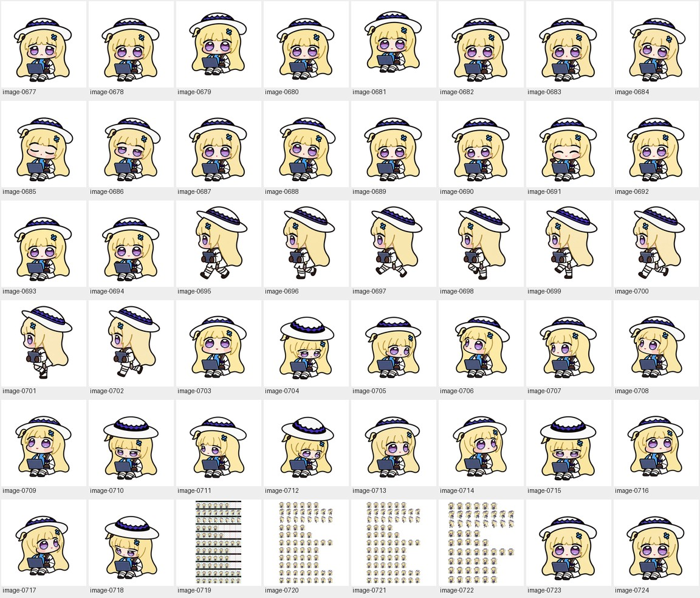
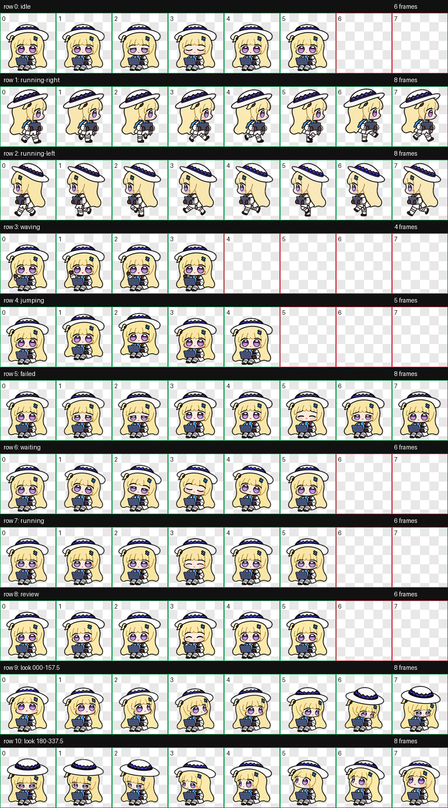
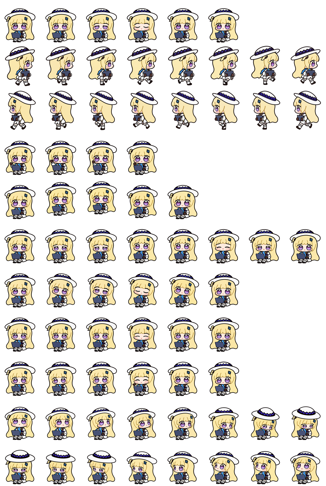
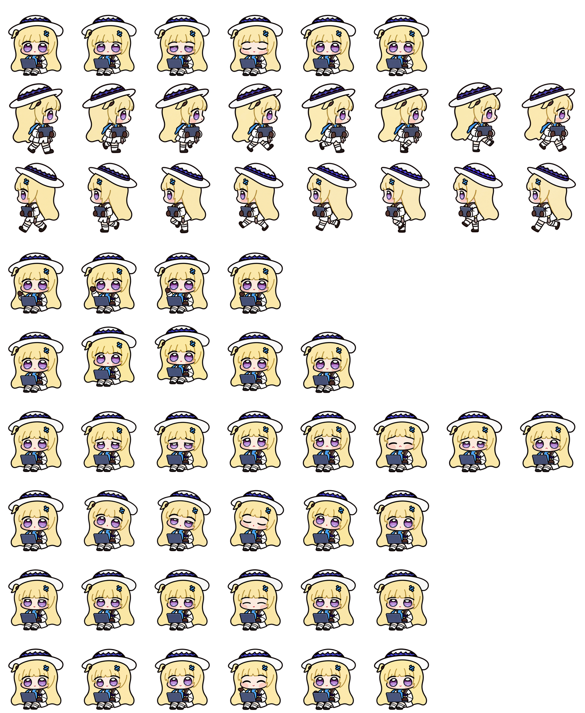

# Unused open-eye study / 未采用的睁眼试验 · 4

[Archive / 英文总览](../IMAGE-GALLERY.md) · [中文目录](../IMAGE-GALLERY.zh-CN.md) · [← Prev / 上一页](awake-experiment-03.md)

> **Page 4 of 4 / 第 4 页（共 4 页）** · **48 images on this page / 本页共收录 48 张源图**
>
> - **EN**: Complete archive of the earlier non-blinking ('always awake') idle and state experiments, preserved for comparison after adopting the natural blinking cycle.
> - **ZH**: 早期围绕“全程睁眼不眨眼”方案生成的全套状态候选与切片归档；最终发布版改为更自然的眨眼呼吸循环，本分册完整保留供对照。

Click any thumbnail or **Full image / 查看原图** link to inspect the uncompressed source file. Image IDs (`image-XXXX`) map directly to [`art/index.json`](../../art/index.json).

点击任意缩略图或「**Full image / 查看原图**」即可查看未压缩原图；图片编号（`image-XXXX`）与 [`art/index.json`](../../art/index.json) 一一对应。

| Preview / 缩略预览 | Archive Record & Provenance / 档案记录与来源路径 |
| :---: | --- |
|  | **image-0677** · `192 × 208` · PNG (42 KB) Unused open-eye study for Needs help / recovery (`failed`) / 未采用睁眼方案：报错委屈求助（`failed`） 试验帧 Primary working path / 原始工作路径: `production-v4-awake/frames/failed/04.png` (+2 aliases / 处复用) [Full image / 查看原图](../../art/archive/awake-experiment/0145-04.png) |
|  | **image-0678** · `192 × 208` · PNG (41 KB) Unused open-eye study for Seated small hop (`jumping`) / 未采用睁眼方案：坐姿小跳（`jumping`） 试验帧 Primary working path / 原始工作路径: `production-v4-awake/frames/jumping/00.png` (+2 aliases / 处复用) [Full image / 查看原图](../../art/archive/awake-experiment/0146-00.png) |
|  | **image-0679** · `192 × 208` · PNG (41 KB) Unused open-eye study for Seated small hop (`jumping`) / 未采用睁眼方案：坐姿小跳（`jumping`） 试验帧 Primary working path / 原始工作路径: `production-v4-awake/frames/jumping/01.png` (+2 aliases / 处复用) [Full image / 查看原图](../../art/archive/awake-experiment/0147-01.png) |
|  | **image-0680** · `192 × 208` · PNG (40 KB) Unused open-eye study for Seated small hop (`jumping`) / 未采用睁眼方案：坐姿小跳（`jumping`） 试验帧 Primary working path / 原始工作路径: `production-v4-awake/frames/jumping/03.png` (+2 aliases / 处复用) [Full image / 查看原图](../../art/archive/awake-experiment/0148-03.png) |
|  | **image-0681** · `192 × 208` · PNG (40 KB) Unused open-eye study for Seated small hop (`jumping`) / 未采用睁眼方案：坐姿小跳（`jumping`） 试验帧 Primary working path / 原始工作路径: `production-v4-awake/frames/jumping/02.png` (+2 aliases / 处复用) [Full image / 查看原图](../../art/archive/awake-experiment/0149-02.png) |
|  | **image-0682** · `192 × 208` · PNG (41 KB) Unused open-eye study for Seated small hop (`jumping`) / 未采用睁眼方案：坐姿小跳（`jumping`） 试验帧 Primary working path / 原始工作路径: `production-v4-awake/frames/jumping/04.png` (+2 aliases / 处复用) [Full image / 查看原图](../../art/archive/awake-experiment/0150-04.png) |
|  | **image-0683** · `192 × 208` · PNG (42 KB) Unused open-eye study for Waiting for reply (`waiting`) / 未采用睁眼方案：等待回复（`waiting`） 试验帧 Primary working path / 原始工作路径: `production-v4-awake/frames/waiting/00.png` (+2 aliases / 处复用) [Full image / 查看原图](../../art/archive/awake-experiment/0151-00.png) |
|  | **image-0684** · `192 × 208` · PNG (40 KB) Unused open-eye study for Waiting for reply (`waiting`) / 未采用睁眼方案：等待回复（`waiting`） 试验帧 Primary working path / 原始工作路径: `production-v4-awake/frames/waiting/01.png` (+2 aliases / 处复用) [Full image / 查看原图](../../art/archive/awake-experiment/0152-01.png) |
|  | **image-0685** · `192 × 208` · PNG (39 KB) Unused open-eye study for Waiting for reply (`waiting`) / 未采用睁眼方案：等待回复（`waiting`） 试验帧 Primary working path / 原始工作路径: `production-v4-awake/frames/waiting/03.png` (+2 aliases / 处复用) [Full image / 查看原图](../../art/archive/awake-experiment/0153-03.png) |
|  | **image-0686** · `192 × 208` · PNG (41 KB) Unused open-eye study for Waiting for reply (`waiting`) / 未采用睁眼方案：等待回复（`waiting`） 试验帧 Primary working path / 原始工作路径: `production-v4-awake/frames/waiting/02.png` (+2 aliases / 处复用) [Full image / 查看原图](../../art/archive/awake-experiment/0154-02.png) |
|  | **image-0687** · `192 × 208` · PNG (42 KB) Unused open-eye study for Waiting for reply (`waiting`) / 未采用睁眼方案：等待回复（`waiting`） 试验帧 Primary working path / 原始工作路径: `production-v4-awake/frames/waiting/05.png` (+2 aliases / 处复用) [Full image / 查看原图](../../art/archive/awake-experiment/0155-05.png) |
|  | **image-0688** · `192 × 208` · PNG (41 KB) Unused open-eye study for Waiting for reply (`waiting`) / 未采用睁眼方案：等待回复（`waiting`） 试验帧 Primary working path / 原始工作路径: `production-v4-awake/frames/waiting/04.png` (+2 aliases / 处复用) [Full image / 查看原图](../../art/archive/awake-experiment/0156-04.png) |
|  | **image-0689** · `192 × 208` · PNG (39 KB) Unused open-eye study for Reviewing output (`review`) / 未采用睁眼方案：检查结果（`review`） 试验帧 Primary working path / 原始工作路径: `production-v4-awake/frames/review/00.png` (+2 aliases / 处复用) [Full image / 查看原图](../../art/archive/awake-experiment/0157-00.png) |
|  | **image-0690** · `192 × 208` · PNG (39 KB) Unused open-eye study for Reviewing output (`review`) / 未采用睁眼方案：检查结果（`review`） 试验帧 Primary working path / 原始工作路径: `production-v4-awake/frames/review/01.png` (+2 aliases / 处复用) [Full image / 查看原图](../../art/archive/awake-experiment/0158-01.png) |
|  | **image-0691** · `192 × 208` · PNG (39 KB) Unused open-eye study for Reviewing output (`review`) / 未采用睁眼方案：检查结果（`review`） 试验帧 Primary working path / 原始工作路径: `production-v4-awake/frames/review/03.png` (+2 aliases / 处复用) [Full image / 查看原图](../../art/archive/awake-experiment/0159-03.png) |
|  | **image-0692** · `192 × 208` · PNG (39 KB) Unused open-eye study for Reviewing output (`review`) / 未采用睁眼方案：检查结果（`review`） 试验帧 Primary working path / 原始工作路径: `production-v4-awake/frames/review/02.png` (+2 aliases / 处复用) [Full image / 查看原图](../../art/archive/awake-experiment/0160-02.png) |
|  | **image-0693** · `192 × 208` · PNG (40 KB) Unused open-eye study for Reviewing output (`review`) / 未采用睁眼方案：检查结果（`review`） 试验帧 Primary working path / 原始工作路径: `production-v4-awake/frames/review/05.png` (+2 aliases / 处复用) [Full image / 查看原图](../../art/archive/awake-experiment/0161-05.png) |
|  | **image-0694** · `192 × 208` · PNG (40 KB) Unused open-eye study for Reviewing output (`review`) / 未采用睁眼方案：检查结果（`review`） 试验帧 Primary working path / 原始工作路径: `production-v4-awake/frames/review/04.png` (+2 aliases / 处复用) [Full image / 查看原图](../../art/archive/awake-experiment/0162-04.png) |
|  | **image-0695** · `192 × 208` · PNG (38 KB) Unused open-eye study for Carry laptop left (`running-left`) / 未采用睁眼方案：抱电脑向左走（`running-left`） 试验帧 Primary working path / 原始工作路径: `production-v4-awake/frames/running-left/00.png` (+2 aliases / 处复用) [Full image / 查看原图](../../art/archive/awake-experiment/0163-00.png) |
|  | **image-0696** · `192 × 208` · PNG (37 KB) Unused open-eye study for Carry laptop left (`running-left`) / 未采用睁眼方案：抱电脑向左走（`running-left`） 试验帧 Primary working path / 原始工作路径: `production-v4-awake/frames/running-left/01.png` (+2 aliases / 处复用) [Full image / 查看原图](../../art/archive/awake-experiment/0164-01.png) |
|  | **image-0697** · `192 × 208` · PNG (37 KB) Unused open-eye study for Carry laptop left (`running-left`) / 未采用睁眼方案：抱电脑向左走（`running-left`） 试验帧 Primary working path / 原始工作路径: `production-v4-awake/frames/running-left/03.png` (+2 aliases / 处复用) [Full image / 查看原图](../../art/archive/awake-experiment/0165-03.png) |
|  | **image-0698** · `192 × 208` · PNG (37 KB) Unused open-eye study for Carry laptop left (`running-left`) / 未采用睁眼方案：抱电脑向左走（`running-left`） 试验帧 Primary working path / 原始工作路径: `production-v4-awake/frames/running-left/02.png` (+2 aliases / 处复用) [Full image / 查看原图](../../art/archive/awake-experiment/0166-02.png) |
|  | **image-0699** · `192 × 208` · PNG (37 KB) Unused open-eye study for Carry laptop left (`running-left`) / 未采用睁眼方案：抱电脑向左走（`running-left`） 试验帧 Primary working path / 原始工作路径: `production-v4-awake/frames/running-left/06.png` (+2 aliases / 处复用) [Full image / 查看原图](../../art/archive/awake-experiment/0167-06.png) |
|  | **image-0700** · `192 × 208` · PNG (39 KB) Unused open-eye study for Carry laptop left (`running-left`) / 未采用睁眼方案：抱电脑向左走（`running-left`） 试验帧 Primary working path / 原始工作路径: `production-v4-awake/frames/running-left/07.png` (+2 aliases / 处复用) [Full image / 查看原图](../../art/archive/awake-experiment/0168-07.png) |
|  | **image-0701** · `192 × 208` · PNG (37 KB) Unused open-eye study for Carry laptop left (`running-left`) / 未采用睁眼方案：抱电脑向左走（`running-left`） 试验帧 Primary working path / 原始工作路径: `production-v4-awake/frames/running-left/05.png` (+2 aliases / 处复用) [Full image / 查看原图](../../art/archive/awake-experiment/0169-05.png) |
|  | **image-0702** · `192 × 208` · PNG (37 KB) Unused open-eye study for Carry laptop left (`running-left`) / 未采用睁眼方案：抱电脑向左走（`running-left`） 试验帧 Primary working path / 原始工作路径: `production-v4-awake/frames/running-left/04.png` (+2 aliases / 处复用) [Full image / 查看原图](../../art/archive/awake-experiment/0170-04.png) |
|  | **image-0703** · `192 × 208` · PNG (39 KB) Rolled-back open-eye experiment (Dot 16-angle head-turn study) / 未采用的“全程睁眼”试验稿（Dot 16 向转头朝向研究） Primary working path / 原始工作路径: `production-v4-awake/frames/look/000.png` (+2 aliases / 处复用) [Full image / 查看原图](../../art/archive/awake-experiment/0171-000.png) |
|  | **image-0704** · `192 × 208` · PNG (38 KB) Rolled-back open-eye experiment (Dot 16-angle head-turn study) / 未采用的“全程睁眼”试验稿（Dot 16 向转头朝向研究） Primary working path / 原始工作路径: `production-v4-awake/frames/look/157.5.png` (+2 aliases / 处复用) [Full image / 查看原图](../../art/archive/awake-experiment/0172-157.5.png) |
|  | **image-0705** · `192 × 208` · PNG (38 KB) Rolled-back open-eye experiment (Dot 16-angle head-turn study) / 未采用的“全程睁眼”试验稿（Dot 16 向转头朝向研究） Primary working path / 原始工作路径: `production-v4-awake/frames/look/112.5.png` (+2 aliases / 处复用) [Full image / 查看原图](../../art/archive/awake-experiment/0173-112.5.png) |
|  | **image-0706** · `192 × 208` · PNG (38 KB) Rolled-back open-eye experiment (Dot 16-angle head-turn study) / 未采用的“全程睁眼”试验稿（Dot 16 向转头朝向研究） Primary working path / 原始工作路径: `production-v4-awake/frames/look/315.png` (+2 aliases / 处复用) [Full image / 查看原图](../../art/archive/awake-experiment/0174-315.png) |
|  | **image-0707** · `192 × 208` · PNG (37 KB) Rolled-back open-eye experiment (Dot 16-angle head-turn study) / 未采用的“全程睁眼”试验稿（Dot 16 向转头朝向研究） Primary working path / 原始工作路径: `production-v4-awake/frames/look/270.png` (+2 aliases / 处复用) [Full image / 查看原图](../../art/archive/awake-experiment/0175-270.png) |
|  | **image-0708** · `192 × 208` · PNG (39 KB) Rolled-back open-eye experiment (Dot 16-angle head-turn study) / 未采用的“全程睁眼”试验稿（Dot 16 向转头朝向研究） Primary working path / 原始工作路径: `production-v4-awake/frames/look/292.5.png` (+2 aliases / 处复用) [Full image / 查看原图](../../art/archive/awake-experiment/0176-292.5.png) |
|  | **image-0709** · `192 × 208` · PNG (39 KB) Rolled-back open-eye experiment (Dot 16-angle head-turn study) / 未采用的“全程睁眼”试验稿（Dot 16 向转头朝向研究） Primary working path / 原始工作路径: `production-v4-awake/frames/look/337.5.png` (+2 aliases / 处复用) [Full image / 查看原图](../../art/archive/awake-experiment/0177-337.5.png) |
|  | **image-0710** · `192 × 208` · PNG (39 KB) Rolled-back open-eye experiment (Dot 16-angle head-turn study) / 未采用的“全程睁眼”试验稿（Dot 16 向转头朝向研究） Primary working path / 原始工作路径: `production-v4-awake/frames/look/202.5.png` (+2 aliases / 处复用) [Full image / 查看原图](../../art/archive/awake-experiment/0178-202.5.png) |
|  | **image-0711** · `192 × 208` · PNG (36 KB) Rolled-back open-eye experiment (Dot 16-angle head-turn study) / 未采用的“全程睁眼”试验稿（Dot 16 向转头朝向研究） Primary working path / 原始工作路径: `production-v4-awake/frames/look/247.5.png` (+2 aliases / 处复用) [Full image / 查看原图](../../art/archive/awake-experiment/0179-247.5.png) |
|  | **image-0712** · `192 × 208` · PNG (37 KB) Rolled-back open-eye experiment (Dot 16-angle head-turn study) / 未采用的“全程睁眼”试验稿（Dot 16 向转头朝向研究） Primary working path / 原始工作路径: `production-v4-awake/frames/look/135.png` (+2 aliases / 处复用) [Full image / 查看原图](../../art/archive/awake-experiment/0180-135.png) |
|  | **image-0713** · `192 × 208` · PNG (38 KB) Rolled-back open-eye experiment (Dot 16-angle head-turn study) / 未采用的“全程睁眼”试验稿（Dot 16 向转头朝向研究） Primary working path / 原始工作路径: `production-v4-awake/frames/look/090.png` (+2 aliases / 处复用) [Full image / 查看原图](../../art/archive/awake-experiment/0181-090.png) |
|  | **image-0714** · `192 × 208` · PNG (37 KB) Rolled-back open-eye experiment (Dot 16-angle head-turn study) / 未采用的“全程睁眼”试验稿（Dot 16 向转头朝向研究） Primary working path / 原始工作路径: `production-v4-awake/frames/look/045.png` (+2 aliases / 处复用) [Full image / 查看原图](../../art/archive/awake-experiment/0182-045.png) |
|  | **image-0715** · `192 × 208` · PNG (40 KB) Rolled-back open-eye experiment (Dot 16-angle head-turn study) / 未采用的“全程睁眼”试验稿（Dot 16 向转头朝向研究） Primary working path / 原始工作路径: `production-v4-awake/frames/look/180.png` (+2 aliases / 处复用) [Full image / 查看原图](../../art/archive/awake-experiment/0183-180.png) |
|  | **image-0716** · `192 × 208` · PNG (40 KB) Rolled-back open-eye experiment (Dot 16-angle head-turn study) / 未采用的“全程睁眼”试验稿（Dot 16 向转头朝向研究） Primary working path / 原始工作路径: `production-v4-awake/frames/look/022.5.png` (+2 aliases / 处复用) [Full image / 查看原图](../../art/archive/awake-experiment/0184-022.5.png) |
|  | **image-0717** · `192 × 208` · PNG (37 KB) Rolled-back open-eye experiment (Dot 16-angle head-turn study) / 未采用的“全程睁眼”试验稿（Dot 16 向转头朝向研究） Primary working path / 原始工作路径: `production-v4-awake/frames/look/067.5.png` (+2 aliases / 处复用) [Full image / 查看原图](../../art/archive/awake-experiment/0185-067.5.png) |
|  | **image-0718** · `192 × 208` · PNG (38 KB) Rolled-back open-eye experiment (Dot 16-angle head-turn study) / 未采用的“全程睁眼”试验稿（Dot 16 向转头朝向研究） Primary working path / 原始工作路径: `production-v4-awake/frames/look/225.png` (+2 aliases / 处复用) [Full image / 查看原图](../../art/archive/awake-experiment/0186-225.png) |
|  | **image-0719** · `768 × 1386` · PNG (844 KB) Rolled-back open-eye experiment (QA comparison & alignment check) / 未采用的“全程睁眼”试验稿（质量复查与对齐检验图） Primary working path / 原始工作路径: `production-v4-awake/qa/clarity-assembly-trial/qa/contact-extended.png` [Full image / 查看原图](../../art/archive/awake-experiment/0187-contact-extended.png) |
|  | **image-0720** · `1536 × 2288` · PNG (2850 KB) Rolled-back open-eye experiment (QA comparison & alignment check) / 未采用的“全程睁眼”试验稿（质量复查与对齐检验图） Primary working path / 原始工作路径: `production-v4-awake/qa/clarity-assembly-trial/final/spritesheet-before-despill.png` [Full image / 查看原图](../../art/archive/awake-experiment/0188-spritesheet-before-despill.png) |
|  | **image-0721** · `1536 × 2288` · PNG (2893 KB) Rolled-back open-eye experiment (QA comparison & alignment check) / 未采用的“全程睁眼”试验稿（质量复查与对齐检验图） Primary working path / 原始工作路径: `production-v4-awake/qa/clarity-assembly-trial/final/spritesheet-extended.png` [Full image / 查看原图](../../art/archive/awake-experiment/0189-spritesheet-extended.png) |
|  | **image-0722** · `1536 × 1872` · PNG (2251 KB) Rolled-back open-eye experiment (QA comparison & alignment check) / 未采用的“全程睁眼”试验稿（质量复查与对齐检验图） Primary working path / 原始工作路径: `production-v4-awake/qa/clarity-assembly-trial/final/spritesheet-standard.png` [Full image / 查看原图](../../art/archive/awake-experiment/0190-spritesheet-standard.png) |
|  | **image-0723** · `192 × 208` · PNG (42 KB) Unused open-eye study for Idle & blink (`idle`) / 未采用睁眼方案：待机与眨眼（`idle`） 试验帧 Primary working path / 原始工作路径: `production-v4-awake/frames/idle/03.png` [Full image / 查看原图](../../art/archive/awake-experiment/0191-03.png) |
|  | **image-0724** · `192 × 208` · PNG (41 KB) Unused open-eye study for Idle & blink (`idle`) / 未采用睁眼方案：待机与眨眼（`idle`） 试验帧 Primary working path / 原始工作路径: `production-v4-awake/frames/idle/02.png` [Full image / 查看原图](../../art/archive/awake-experiment/0192-02.png) |

---

[Archive / 英文总览](../IMAGE-GALLERY.md) · [中文目录](../IMAGE-GALLERY.zh-CN.md) · [← Prev / 上一页](awake-experiment-03.md)
