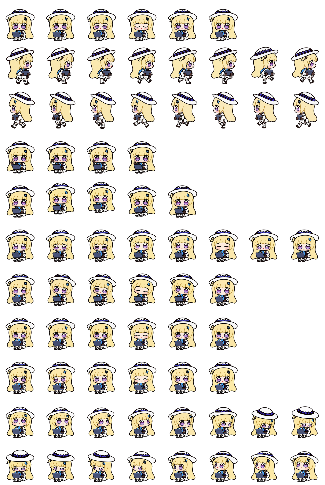

# Look and face studies / 转头与脸型制作图 · 2

[Archive](../IMAGE-GALLERY.md) · [中文目录](../IMAGE-GALLERY.zh-CN.md) · [Previous / 上一页](look-face-repair-01.md) · [Next / 下一页](look-face-repair-03.md)

Full character drawings, including unused drafts and normalized frames. Identical source files share one record.

完整角色制作图，包括未采用的生成稿和规范化帧。相同源文件共用一条记录。

Open a thumbnail to view the original. Image IDs map to `art/index.json`.

点击缩略图查看原图，图片编号可在 `art/index.json` 中查找。

| Image / 图片 | Record / 记录 |
| --- | --- |
|  | **image-0782** · 1024 × 1024 Character study / 完整角色制作稿 [Full image / 查看原图](../../art/archive/look-face-repair/0782-270-v3-rejected-scale.png) |
|  | **image-0783** · 1024 × 1024 Character study / 完整角色制作稿 [Full image / 查看原图](../../art/archive/look-face-repair/0783-270-v4-right-anchor.png) |
|  | **image-0784** · 1024 × 1024 Character study / 完整角色制作稿 [Full image / 查看原图](../../art/archive/look-face-repair/0784-270-v5-hair.png) |
|  | **image-0785** · 1024 × 1024 Character study / 完整角色制作稿 [Full image / 查看原图](../../art/archive/look-face-repair/0785-292.5-v1.png) |
|  | **image-0786** · 1024 × 1024 Character study / 完整角色制作稿 [Full image / 查看原图](../../art/archive/look-face-repair/0786-292.5-v2-camera.png) |
|  | **image-0787** · 1024 × 1024 Character study / 完整角色制作稿 [Full image / 查看原图](../../art/archive/look-face-repair/0787-292.5-v2-hair.png) |
|  | **image-0788** · 1024 × 1024 Character study / 完整角色制作稿 [Full image / 查看原图](../../art/archive/look-face-repair/0788-315-v1-camera.png) |
|  | **image-0789** · 1024 × 1024 Character study / 完整角色制作稿 [Full image / 查看原图](../../art/archive/look-face-repair/0789-315-v1-continuity.png) |
|  | **image-0790** · 1024 × 1024 Character study / 完整角色制作稿 [Full image / 查看原图](../../art/archive/look-face-repair/0790-337.5-v1-continuity.png) |
|  | **image-0791** · 1536 × 2288 Production reference / 制作参考 [Full image / 查看原图](../../art/archive/look-face-repair/0791-reference-current-stored-atlas.png) |
|  | **image-0792** · 1254 × 1254 Character study / 完整角色制作稿 [Full image / 查看原图](../../art/archive/look-face-repair/0792-v04-157.5-157.5-from-down-v1.png) |
|  | **image-0793** · 1254 × 1254 Character study / 完整角色制作稿 [Full image / 查看原图](../../art/archive/look-face-repair/0793-v04-157.5-157.5-from-down-v2-unused.png) |
|  | **image-0794** · 1024 × 1024 Character study / 完整角色制作稿 [Full image / 查看原图](../../art/archive/look-face-repair/0794-v04-157.5-157.5-from-down-v1.png) |
|  | **image-0795** · 1254 × 1254 Character study / 完整角色制作稿 [Full image / 查看原图](../../art/archive/look-face-repair/0795-v04-247.5-attempt-01.png) |
|  | **image-0796** · 1254 × 1254 Character study / 完整角色制作稿 [Full image / 查看原图](../../art/archive/look-face-repair/0796-v04-247.5-attempt-02.png) |
|  | **image-0797** · 1024 × 1024 Character study / 完整角色制作稿 [Full image / 查看原图](../../art/archive/look-face-repair/0797-v04-247.5-attempt-01.png) |
|  | **image-0798** · 1024 × 1024 Character study / 完整角色制作稿 [Full image / 查看原图](../../art/archive/look-face-repair/0798-v04-247.5-attempt-02.png) |
|  | **image-0799** · 1254 × 1254 Character study / 完整角色制作稿 [Full image / 查看原图](../../art/archive/look-face-repair/0799-v05-000-attempt-01.png) |
|  | **image-0800** · 1024 × 1024 Character study / 完整角色制作稿 [Full image / 查看原图](../../art/archive/look-face-repair/0800-v05-000-attempt-01.png) |
|  | **image-0801** · 1254 × 1254 Character study / 完整角色制作稿 [Full image / 查看原图](../../art/archive/look-face-repair/0801-v05-157.5-157.5-return-from-right-v2.png) |
|  | **image-0802** · 1254 × 1254 Character study / 完整角色制作稿 [Full image / 查看原图](../../art/archive/look-face-repair/0802-v05-157.5-157.5-small-right-v1-rejected.png) |
|  | **image-0803** · 1024 × 1024 Character study / 完整角色制作稿 [Full image / 查看原图](../../art/archive/look-face-repair/0803-v05-157.5-157.5-return-from-right-v2-camera.png) |
|  | **image-0804** · 1024 × 1024 Character study / 完整角色制作稿 [Full image / 查看原图](../../art/archive/look-face-repair/0804-v05-157.5-157.5-return-from-right-v2.png) |
|  | **image-0805** · 1024 × 1024 Character study / 完整角色制作稿 [Full image / 查看原图](../../art/archive/look-face-repair/0805-v05-157.5-draft-v2.png) |
|  | **image-0806** · 1254 × 1254 Character study / 完整角色制作稿 [Full image / 查看原图](../../art/archive/look-face-repair/0806-v05-247.5-attempt01.png) |
|  | **image-0807** · 1024 × 1024 Character study / 完整角色制作稿 [Full image / 查看原图](../../art/archive/look-face-repair/0807-v05-247.5-attempt01.png) |
|  | **image-0808** · 1254 × 1254 Character study / 完整角色制作稿 [Full image / 查看原图](../../art/archive/look-face-repair/0808-v05-292.5-attempt-01.png) |
|  | **image-0809** · 1254 × 1254 Character study / 完整角色制作稿 [Full image / 查看原图](../../art/archive/look-face-repair/0809-v05-292.5-attempt-02.png) |
|  | **image-0810** · 1254 × 1254 Character study / 完整角色制作稿 [Full image / 查看原图](../../art/archive/look-face-repair/0810-v05-292.5-attempt-03.png) |
|  | **image-0811** · 1254 × 1254 Character study / 完整角色制作稿 [Full image / 查看原图](../../art/archive/look-face-repair/0811-v05-292.5-attempt-04.png) |
|  | **image-0812** · 1024 × 1024 Character study / 完整角色制作稿 [Full image / 查看原图](../../art/archive/look-face-repair/0812-v05-292.5-292.5-attempt-01.png) |
|  | **image-0813** · 1024 × 1024 Character study / 完整角色制作稿 [Full image / 查看原图](../../art/archive/look-face-repair/0813-v05-292.5-292.5-attempt-02.png) |
|  | **image-0814** · 1024 × 1024 Character study / 完整角色制作稿 [Full image / 查看原图](../../art/archive/look-face-repair/0814-v05-292.5-292.5-attempt-03.png) |
|  | **image-0815** · 1024 × 1024 Character study / 完整角色制作稿 [Full image / 查看原图](../../art/archive/look-face-repair/0815-v05-292.5-292.5-attempt-04-camera.png) |
|  | **image-0816** · 1024 × 1024 Character study / 完整角色制作稿 [Full image / 查看原图](../../art/archive/look-face-repair/0816-v05-292.5-292.5-attempt-04.png) |
|  | **image-0817** · 1254 × 1254 Character study / 完整角色制作稿 [Full image / 查看原图](../../art/archive/look-face-repair/0817-v05-315-attempt-01.png) |
|  | **image-0818** · 1254 × 1254 Character study / 完整角色制作稿 [Full image / 查看原图](../../art/archive/look-face-repair/0818-v05-315-attempt-02.png) |
|  | **image-0819** · 1254 × 1254 Character study / 完整角色制作稿 [Full image / 查看原图](../../art/archive/look-face-repair/0819-v05-315-attempt-03.png) |
|  | **image-0820** · 1024 × 1024 Character study / 完整角色制作稿 [Full image / 查看原图](../../art/archive/look-face-repair/0820-v05-315-315-attempt-01.png) |
|  | **image-0821** · 1024 × 1024 Character study / 完整角色制作稿 [Full image / 查看原图](../../art/archive/look-face-repair/0821-v05-315-315-attempt-02.png) |
|  | **image-0822** · 1024 × 1024 Character study / 完整角色制作稿 [Full image / 查看原图](../../art/archive/look-face-repair/0822-v05-315-315-attempt-03.png) |
|  | **image-0823** · 1254 × 1254 Character study / 完整角色制作稿 [Full image / 查看原图](../../art/archive/look-face-repair/0823-v05-337.5-attempt-01-recovered.png) |
|  | **image-0824** · 1024 × 1024 Character study / 完整角色制作稿 [Full image / 查看原图](../../art/archive/look-face-repair/0824-v05-337.5-337.5-attempt-01.png) |
|  | **image-0825** · 1254 × 1254 Character study / 完整角色制作稿 [Full image / 查看原图](../../art/archive/look-face-repair/0825-v05-292.5-attempt-05-aligned-endpoints.png) |
|  | **image-0826** · 1254 × 1254 Character study / 完整角色制作稿 [Full image / 查看原图](../../art/archive/look-face-repair/0826-v05-292.5-attempt-06-toward-viewer.png) |
|  | **image-0827** · 1254 × 1254 Character study / 完整角色制作稿 [Full image / 查看原图](../../art/archive/look-face-repair/0827-v05-292.5-attempt-07-compact.png) |
|  | **image-0828** · 1024 × 1024 Character study / 完整角色制作稿 [Full image / 查看原图](../../art/archive/look-face-repair/0828-v05-292.5-292.5-attempt-05.png) |
|  | **image-0829** · 1024 × 1024 Character study / 完整角色制作稿 [Full image / 查看原图](../../art/archive/look-face-repair/0829-v05-292.5-292.5-attempt-06.png) |
