# Seated production / 坐姿制作 · 1

[Archive / 英文总览](../IMAGE-GALLERY.md) · [中文目录](../IMAGE-GALLERY.zh-CN.md) · [Next / 下一页 →](seated-production-02.md)

> **Page 1 of 11 / 第 1 页（共 11 页）** · **48 images on this page / 本页共收录 48 张源图**
>
> - **EN**: Core production archive covering the seated and carry masters, frame-by-frame generations across all nine standard states, prop/hand defect repairs, and early 16-angle look passes.
> - **ZH**: 核心动作制作档案，涵盖坐姿工作与抱电脑移动双母本、9 类标准动作的逐帧生成稿、手套/电脑局部穿帮修整以及早期 16 向转头探索。

Click any thumbnail or **Full image / 查看原图** link to inspect the uncompressed source file. Image IDs (`image-XXXX`) map directly to [`art/index.json`](../../art/index.json).

点击任意缩略图或「**Full image / 查看原图**」即可查看未压缩原图；图片编号（`image-XXXX`）与 [`art/index.json`](../../art/index.json) 一一对应。

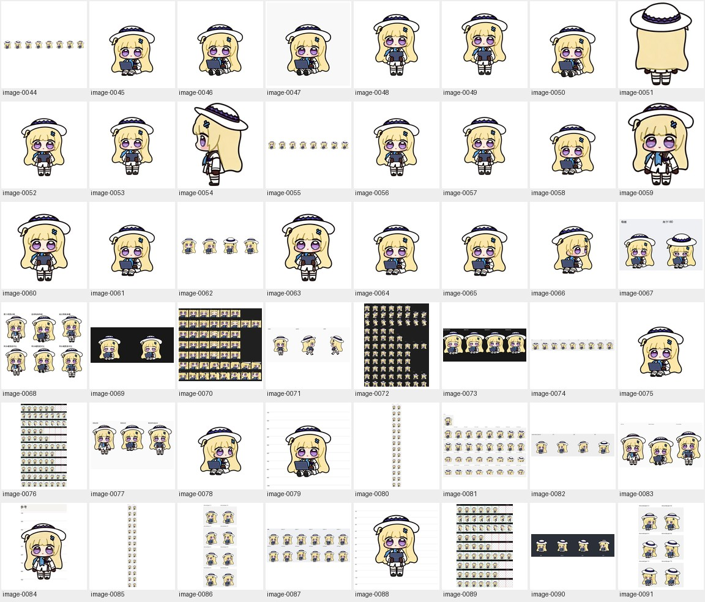

| Preview / 缩略预览 | Archive Record & Provenance / 档案记录与来源路径 |
| :---: | --- |
|  | **image-0044** · `1536 × 208` · PNG (274 KB) Iterative production study (Dot 16-angle head-turn study) / 制作过程迭代与候选稿（Dot 16 向转头朝向研究） Primary working path / 原始工作路径: `production-v3/look-prepared/look-row10-source.png` [Full image / 查看原图](../../art/archive/seated-production/0001-look-row10-source.png) |
|  | **image-0045** · `1024 × 1024` · PNG (408 KB) Approved seated master anchor (open laptop) / 坐姿工作定稿母本（展开笔记本） Primary working path / 原始工作路径: `production-v3/canonical/seated-master-approved.png` (+4 aliases / 处复用) [Full image / 查看原图](../../art/canonical/seated-master-approved.png) |
|  | **image-0046** · `1024 × 1024` · PNG (415 KB) Iterative production study / 制作过程迭代与候选稿 Primary working path / 原始工作路径: `production-v3/canonical/seated-master.png` [Full image / 查看原图](../../art/archive/seated-production/0002-seated-master.png) |
|  | **image-0047** · `1024 × 1024` · JPEG (118 KB) Iterative production study / 制作过程迭代与候选稿 Primary working path / 原始工作路径: `production-v3/canonical/seated-review.jpg` [Full image / 查看原图](../../art/archive/seated-production/0003-seated-review.jpg) |
|  | **image-0048** · `1024 × 1024` · PNG (443 KB) Iterative production study / 制作过程迭代与候选稿 Primary working path / 原始工作路径: `production-v3/canonical/carry-candidate.png` [Full image / 查看原图](../../art/archive/seated-production/0004-carry-candidate.png) |
|  | **image-0049** · `1254 × 1254` · PNG (642 KB) Iterative production study / 制作过程迭代与候选稿 Primary working path / 原始工作路径: `production-v3/canonical/carry-generated-original.png` [Full image / 查看原图](../../art/archive/seated-production/0005-carry-generated-original.png) |
|  | **image-0050** · `1254 × 1254` · PNG (619 KB) Iterative production study / 制作过程迭代与候选稿 Primary working path / 原始工作路径: `production-v3/canonical/seated-generated-original.png` [Full image / 查看原图](../../art/archive/seated-production/0006-seated-generated-original.png) |
|  | **image-0051** · `503 × 671` · PNG (225 KB) Orthographic back reference cutout / 三视图背面去背参考切图 Primary working path / 原始工作路径: `production-v3/canonical/reference-back-cutout.png` [Full image / 查看原图](../../art/canonical/reference-back-cutout.png) |
|  | **image-0052** · `1024 × 1024` · PNG (435 KB) Iterative production study / 制作过程迭代与候选稿 Primary working path / 原始工作路径: `production-v3/canonical/carry-ready.png` [Full image / 查看原图](../../art/archive/seated-production/0007-carry-ready.png) |
|  | **image-0053** · `1254 × 1254` · PNG (594 KB) Iterative production study / 制作过程迭代与候选稿 Primary working path / 原始工作路径: `production-v3/canonical/carry-repair-v1-original.png` [Full image / 查看原图](../../art/archive/seated-production/0008-carry-repair-v1-original.png) |
|  | **image-0054** · `450 × 668` · PNG (282 KB) Orthographic left-profile reference cutout / 三视图左侧面去背参考切图 Primary working path / 原始工作路径: `production-v3/canonical/reference-left-profile-cutout.png` [Full image / 查看原图](../../art/canonical/reference-left-profile-cutout.png) |
|  | **image-0055** · `1536 × 208` · PNG (273 KB) Iterative production study (Dot 16-angle head-turn study) / 制作过程迭代与候选稿（Dot 16 向转头朝向研究） Primary working path / 原始工作路径: `production-v3/canonical/approved-look-row9.png` (+1 alias / 处复用) [Full image / 查看原图](../../art/archive/seated-production/0009-approved-look-row9.png) |
|  | **image-0056** · `1024 × 1024` · PNG (429 KB) Approved carry master anchor (closed laptop) / 抱电脑移动定稿母本（合上笔记本） Primary working path / 原始工作路径: `production-v3/canonical/carry-master-approved.png` [Full image / 查看原图](../../art/canonical/carry-master-approved.png) |
|  | **image-0057** · `1024 × 1024` · PNG (426 KB) Iterative production study / 制作过程迭代与候选稿 Primary working path / 原始工作路径: `production-v3/canonical/carry-repair-v1.png` [Full image / 查看原图](../../art/archive/seated-production/0010-carry-repair-v1.png) |
|  | **image-0058** · `1024 × 1024` · PNG (420 KB) Iterative production study / 制作过程迭代与候选稿 Primary working path / 原始工作路径: `production-v3/canonical/seated-repair-v1.png` [Full image / 查看原图](../../art/archive/seated-production/0011-seated-repair-v1.png) |
|  | **image-0059** · `541 × 683` · PNG (394 KB) Orthographic front reference cutout / 三视图正面去背参考切图 Primary working path / 原始工作路径: `production-v3/canonical/reference-front-cutout.png` [Full image / 查看原图](../../art/canonical/reference-front-cutout.png) |
|  | **image-0060** · `1024 × 1024` · PNG (543 KB) Iterative production study / 制作过程迭代与候选稿 Primary working path / 原始工作路径: `production-v3/canonical/carry-repair-v2.png` [Full image / 查看原图](../../art/archive/seated-production/0012-carry-repair-v2.png) |
|  | **image-0061** · `1024 × 1024` · PNG (416 KB) Iterative production study / 制作过程迭代与候选稿 Primary working path / 原始工作路径: `production-v3/canonical/seated-repair-v2.png` [Full image / 查看原图](../../art/archive/seated-production/0013-seated-repair-v2.png) |
|  | **image-0062** · `768 × 208` · PNG (139 KB) Approved four-cardinal look reference (`000/090/180/270`) / 十字四正方向定稿基准图 Primary working path / 原始工作路径: `production-v3/canonical/approved-cardinal-reference.png` [Full image / 查看原图](../../art/canonical/approved-cardinal-reference.png) |
|  | **image-0063** · `1254 × 1254` · PNG (768 KB) Iterative production study / 制作过程迭代与候选稿 Primary working path / 原始工作路径: `production-v3/canonical/carry-repair-v2-original.png` [Full image / 查看原图](../../art/archive/seated-production/0014-carry-repair-v2-original.png) |
|  | **image-0064** · `1254 × 1254` · PNG (596 KB) Iterative production study / 制作过程迭代与候选稿 Primary working path / 原始工作路径: `production-v3/canonical/seated-repair-v1-generated-original.png` [Full image / 查看原图](../../art/archive/seated-production/0015-seated-repair-v1-generated-original.png) |
|  | **image-0065** · `1254 × 1254` · PNG (596 KB) Iterative production study / 制作过程迭代与候选稿 Primary working path / 原始工作路径: `production-v3/canonical/seated-repair-v2-generated-original.png` [Full image / 查看原图](../../art/archive/seated-production/0016-seated-repair-v2-generated-original.png) |
|  | **image-0066** · `1024 × 1024` · PNG (367 KB) Iterative production study (Dot 16-angle head-turn study) / 制作过程迭代与候选稿（Dot 16 向转头朝向研究） Primary working path / 原始工作路径: `production-v3/qa/look090-rejected-small-head-source.png` [Full image / 查看原图](../../art/archive/seated-production/0017-look090-rejected-small-head-source.png) |
|  | **image-0067** · `384 × 236` · PNG (71 KB) Iterative production study (Dot 16-angle head-turn study) / 制作过程迭代与候选稿（Dot 16 向转头朝向研究） Primary working path / 原始工作路径: `production-v3/qa/look-180-native.png` [Full image / 查看原图](../../art/archive/seated-production/0018-look-180-native.png) |
| <a href="../../art/archive/seated-production/0019-small-size-comparison.png">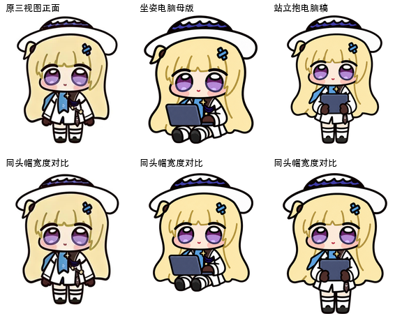</a> | **image-0068** · `576 × 450` · PNG (249 KB) Iterative production study (QA comparison & alignment check) / 制作过程迭代与候选稿（质量复查与对齐检验图） Primary working path / 原始工作路径: `production-v3/qa/small-size-comparison.png` [Full image / 查看原图](../../art/archive/seated-production/0019-small-size-comparison.png) |
|  | **image-0069** · `588 × 250` · PNG (74 KB) Iterative production study (QA comparison & alignment check) / 制作过程迭代与候选稿（质量复查与对齐检验图） Primary working path / 原始工作路径: `production-v3/qa/blink-refined-comparison-20261015.png` [Full image / 查看原图](../../art/archive/seated-production/0020-blink-refined-comparison-20261015.png) |
| <a href="../../art/archive/seated-production/0021-blink-face-contact-20261015.png">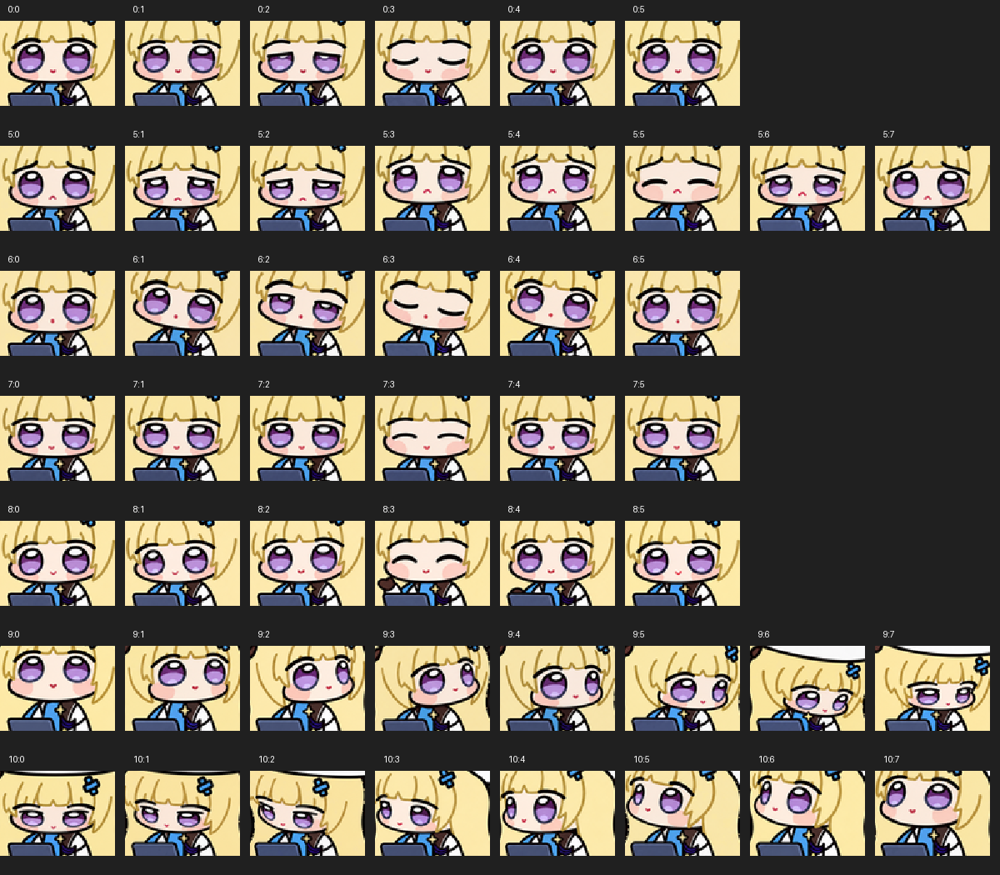</a> | **image-0070** · `1200 × 1050` · PNG (720 KB) Iterative production study (QA comparison & alignment check) / 制作过程迭代与候选稿（质量复查与对齐检验图） Primary working path / 原始工作路径: `production-v3/qa/blink-face-contact-20261015.png` [Full image / 查看原图](../../art/archive/seated-production/0021-blink-face-contact-20261015.png) |
| <a href="../../art/archive/seated-production/0022-locomotion-first-pair.jpg">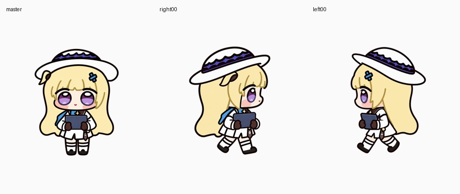</a> | **image-0071** · `900 × 380` · JPEG (58 KB) Iterative production study (QA comparison & alignment check) / 制作过程迭代与候选稿（质量复查与对齐检验图） Primary working path / 原始工作路径: `production-v3/qa/locomotion-first-pair.jpg` [Full image / 查看原图](../../art/archive/seated-production/0022-locomotion-first-pair.jpg) |
| <a href="../../art/archive/seated-production/0023-blink-contact-20261015.jpg">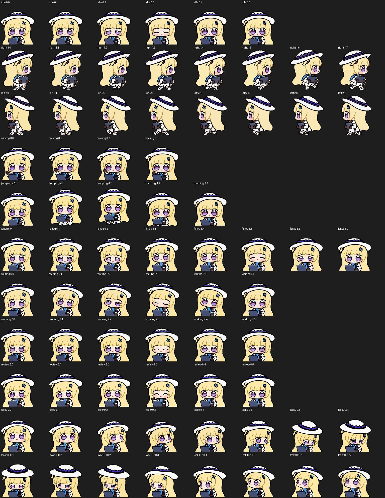</a> | **image-0072** · `1536 × 1980` · JPEG (447 KB) Iterative production study (QA comparison & alignment check) / 制作过程迭代与候选稿（质量复查与对齐检验图） Primary working path / 原始工作路径: `production-v3/qa/blink-contact-20261015.jpg` [Full image / 查看原图](../../art/archive/seated-production/0023-blink-contact-20261015.jpg) |
| <a href="../../art/archive/seated-production/0024-blink-match-20261015.png">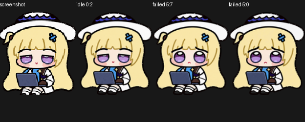</a> | **image-0073** · `624 × 250` · PNG (144 KB) Iterative production study (QA comparison & alignment check) / 制作过程迭代与候选稿（质量复查与对齐检验图） Primary working path / 原始工作路径: `production-v3/qa/blink-match-20261015.png` [Full image / 查看原图](../../art/archive/seated-production/0024-blink-match-20261015.png) |
| <a href="../../art/archive/seated-production/0025-row10-source-contact.png">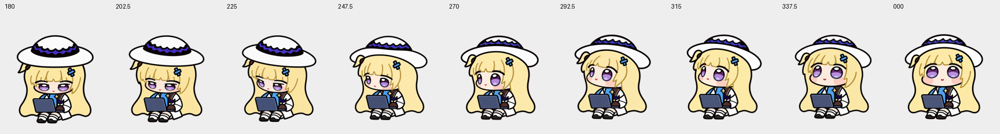</a> | **image-0074** · `1728 × 232` · PNG (261 KB) Iterative production study (QA comparison & alignment check) / 制作过程迭代与候选稿（质量复查与对齐检验图） Primary working path / 原始工作路径: `production-v3/qa/row10-source-contact.png` [Full image / 查看原图](../../art/archive/seated-production/0025-row10-source-contact.png) |
|  | **image-0075** · `1024 × 1024` · JPEG (59 KB) Iterative production study (Dot 16-angle head-turn study) / 制作过程迭代与候选稿（Dot 16 向转头朝向研究） Primary working path / 原始工作路径: `production-v3/qa/look270-seated-master-approved.jpg` [Full image / 查看原图](../../art/archive/seated-production/0026-look270-seated-master-approved.jpg) |
| <a href="../../art/archive/seated-production/0027-contact-extended.png">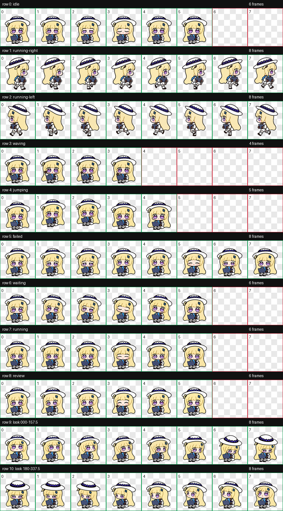</a> | **image-0076** · `768 × 1386` · PNG (771 KB) Iterative production study (QA comparison & alignment check) / 制作过程迭代与候选稿（质量复查与对齐检验图） Primary working path / 原始工作路径: `production-v3/final/download-package/73帧对照.png` (+2 aliases / 处复用) [Full image / 查看原图](../../art/archive/seated-production/0027-contact-extended.png) |
| <a href="../../art/archive/seated-production/0028-repaired-proportion-comparison.jpg">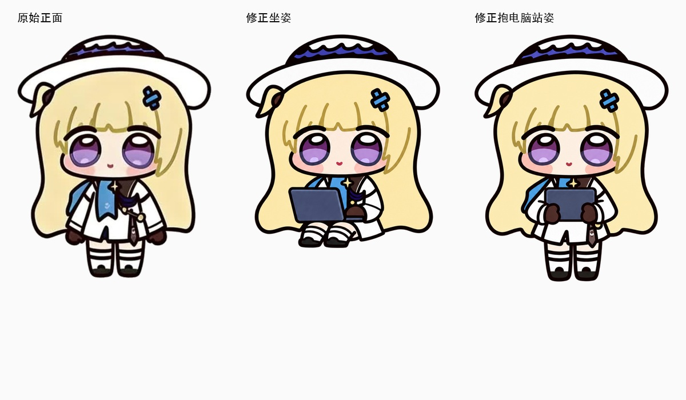</a> | **image-0077** · `1200 × 700` · JPEG (155 KB) Iterative production study (QA comparison & alignment check) / 制作过程迭代与候选稿（质量复查与对齐检验图） Primary working path / 原始工作路径: `production-v3/qa/repaired-proportion-comparison.jpg` [Full image / 查看原图](../../art/archive/seated-production/0028-repaired-proportion-comparison.jpg) |
|  | **image-0078** · `1024 × 1024` · PNG (401 KB) Selected v1.0.2 Dot look `090°` source frame (reused original full-frame drawing) / v1.0.2 正式采用的 Dot `090°` 转头源图（沿用表现良好的原画） Primary working path / 原始工作路径: `production-v3/qa/look090-repair3-candidate.png` (+6 aliases / 处复用) [Full image / 查看原图](../../art/source-frames/look/090.png) |
|  | **image-0079** · `650 × 650` · JPEG (39 KB) Iterative production study (QA comparison & alignment check) / 制作过程迭代与候选稿（质量复查与对齐检验图） Primary working path / 原始工作路径: `production-v3/qa/grid-seated.jpg` [Full image / 查看原图](../../art/archive/seated-production/0029-grid-seated.jpg) |
| <a href="../../art/archive/seated-production/0030-blind-direction-pairs-final.png">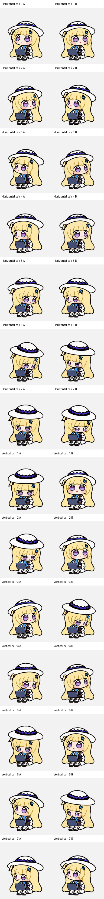</a> | **image-0080** · `384 × 3304` · PNG (859 KB) Iterative production study (QA comparison & alignment check) / 制作过程迭代与候选稿（质量复查与对齐检验图） Primary working path / 原始工作路径: `production-v3/qa/blind-direction-pairs-final.png` [Full image / 查看原图](../../art/archive/seated-production/0030-blind-direction-pairs-final.png) |
| <a href="../../art/archive/seated-production/0031-direction-sheet.png">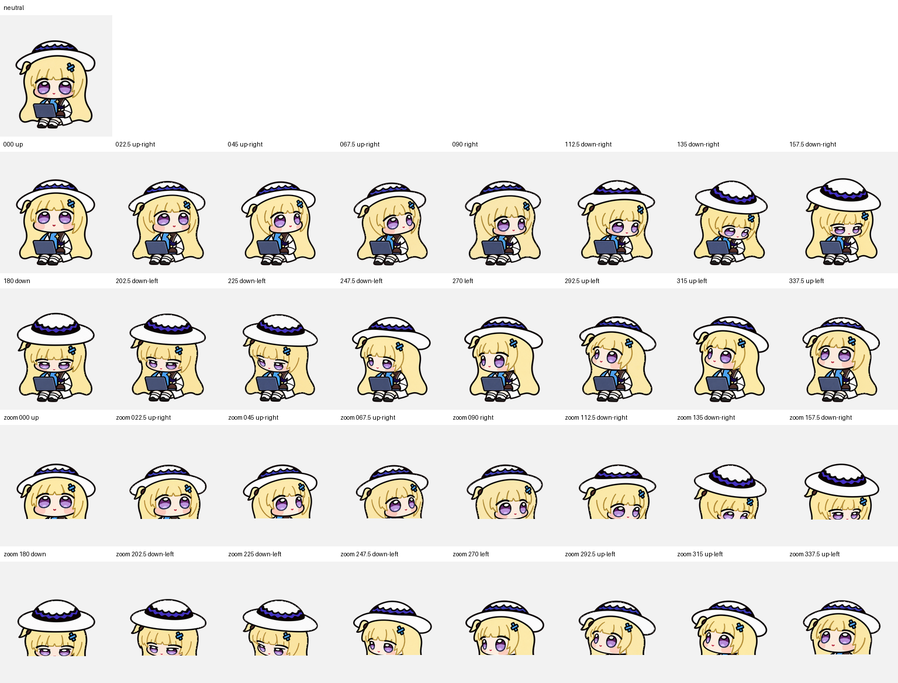</a> | **image-0081** · `1536 × 1170` · PNG (830 KB) Iterative production study (QA comparison & alignment check) / 制作过程迭代与候选稿（质量复查与对齐检验图） Primary working path / 原始工作路径: `production-v3/qa/direction-sheet.png` [Full image / 查看原图](../../art/archive/seated-production/0031-direction-sheet.png) |
|  | **image-0082** · `1024 × 280` · JPEG (30 KB) Iterative production study (QA comparison & alignment check) / 制作过程迭代与候选稿（质量复查与对齐检验图） Primary working path / 原始工作路径: `production-v3/qa/cardinals-progress.jpg` [Full image / 查看原图](../../art/archive/seated-production/0032-cardinals-progress.jpg) |
| <a href="../../art/archive/seated-production/0033-proportion-candidate-comparison.jpg">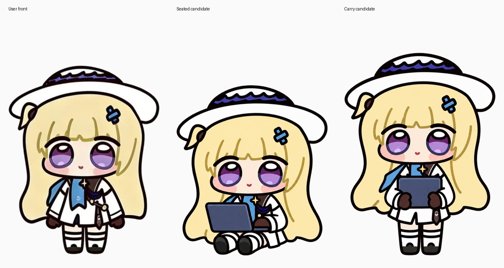</a> | **image-0083** · `1200 × 640` · JPEG (168 KB) Iterative production study (QA comparison & alignment check) / 制作过程迭代与候选稿（质量复查与对齐检验图） Primary working path / 原始工作路径: `production-v3/qa/proportion-candidate-comparison.jpg` [Full image / 查看原图](../../art/archive/seated-production/0033-proportion-candidate-comparison.jpg) |
| <a href="../../art/archive/seated-production/0034-grid-reference.jpg">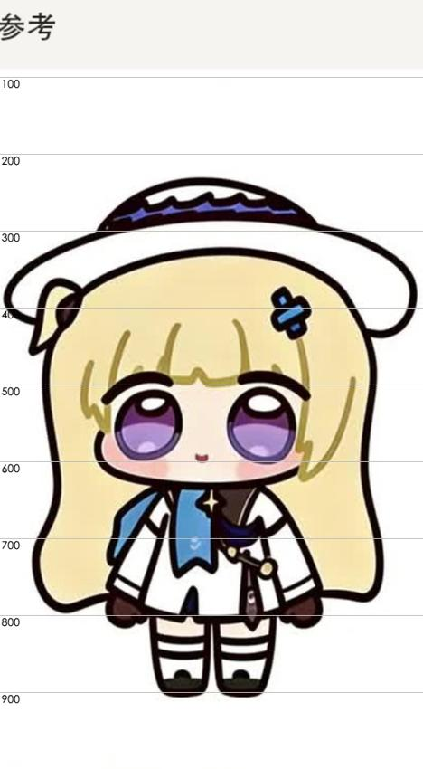</a> | **image-0084** · `468 × 850` · JPEG (43 KB) Iterative production study (QA comparison & alignment check) / 制作过程迭代与候选稿（质量复查与对齐检验图） Primary working path / 原始工作路径: `production-v3/qa/grid-reference.jpg` [Full image / 查看原图](../../art/archive/seated-production/0034-grid-reference.jpg) |
| <a href="../../art/archive/seated-production/0035-blind-direction-pairs.png">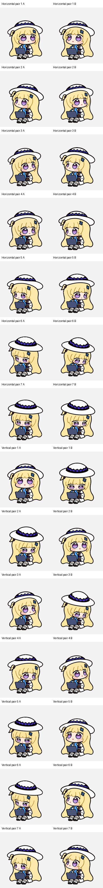</a> | **image-0085** · `384 × 3304` · PNG (859 KB) Iterative production study (QA comparison & alignment check) / 制作过程迭代与候选稿（质量复查与对齐检验图） Primary working path / 原始工作路径: `production-v3/qa/blind-direction-pairs.png` [Full image / 查看原图](../../art/archive/seated-production/0035-blind-direction-pairs.png) |
| <a href="../../art/archive/seated-production/0036-blind-c-crop-h1-4.png">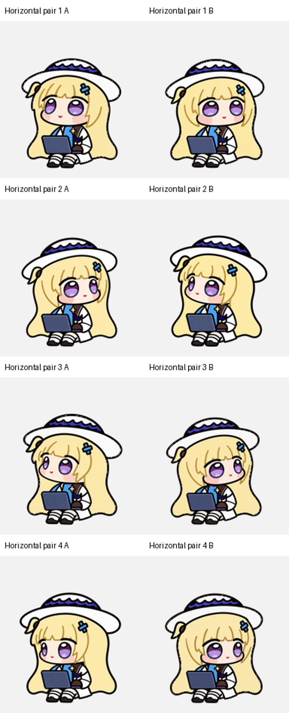</a> | **image-0086** · `768 × 1888` · PNG (780 KB) Iterative production study (QA comparison & alignment check) / 制作过程迭代与候选稿（质量复查与对齐检验图） Primary working path / 原始工作路径: `production-v3/qa/blind-c-crop-h1-4.png` [Full image / 查看原图](../../art/archive/seated-production/0036-blind-c-crop-h1-4.png) |
| <a href="../../art/archive/seated-production/0037-standard-independent-part1-native.png">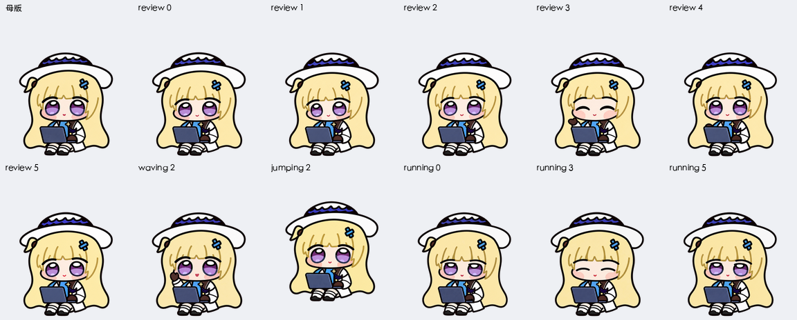</a> | **image-0087** · `1152 × 464` · PNG (380 KB) Iterative production study (QA comparison & alignment check) / 制作过程迭代与候选稿（质量复查与对齐检验图） Primary working path / 原始工作路径: `production-v3/qa/standard-independent-part1-native.png` [Full image / 查看原图](../../art/archive/seated-production/0037-standard-independent-part1-native.png) |
| <a href="../../art/archive/seated-production/0038-grid-carry.jpg">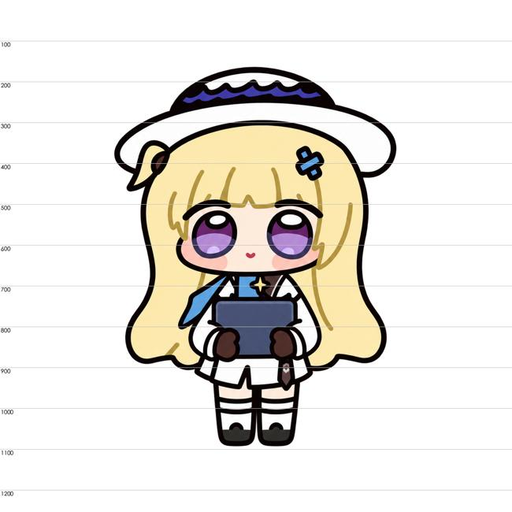</a> | **image-0088** · `650 × 650` · JPEG (41 KB) Iterative production study (QA comparison & alignment check) / 制作过程迭代与候选稿（质量复查与对齐检验图） Primary working path / 原始工作路径: `production-v3/qa/grid-carry.jpg` [Full image / 查看原图](../../art/archive/seated-production/0038-grid-carry.jpg) |
| <a href="../../art/archive/seated-production/0039-contact-standard.png">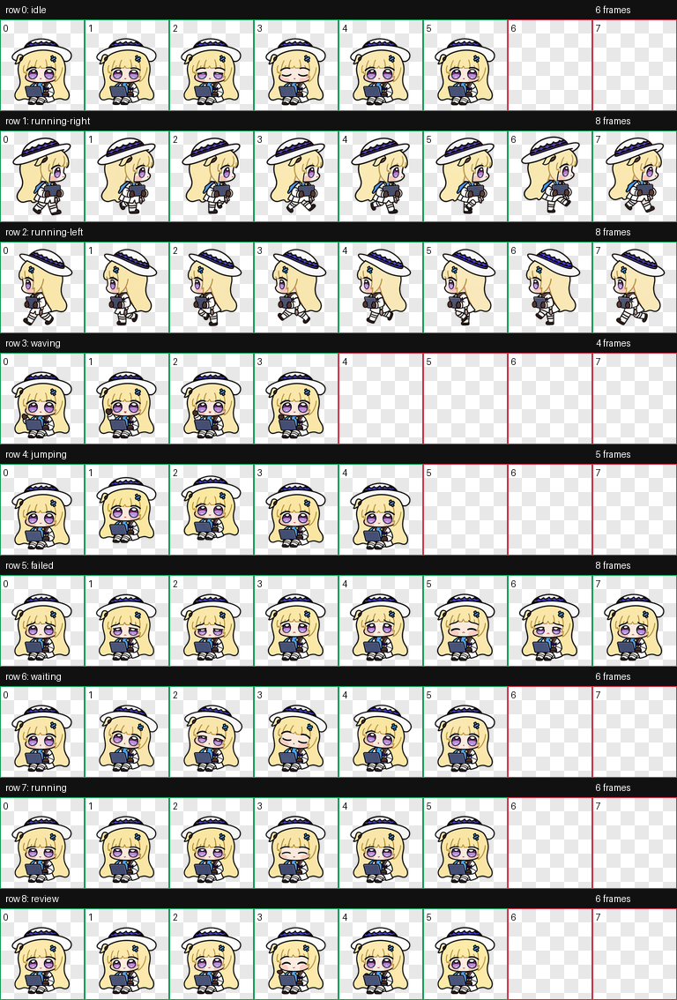</a> | **image-0089** · `768 × 1134` · PNG (608 KB) Iterative production study (QA comparison & alignment check) / 制作过程迭代与候选稿（质量复查与对齐检验图） Primary working path / 原始工作路径: `production-v3/qa/contact-standard.png` [Full image / 查看原图](../../art/archive/seated-production/0039-contact-standard.png) |
|  | **image-0090** · `800 × 220` · PNG (93 KB) Iterative production study (Dot 16-angle head-turn study) / 制作过程迭代与候选稿（Dot 16 向转头朝向研究） Primary working path / 原始工作路径: `production-v3/qa/look-lower-left-200px.png` [Full image / 查看原图](../../art/archive/seated-production/0040-look-lower-left-200px.png) |
| <a href="../../art/archive/seated-production/0041-blind-c-crop-h5-7.png">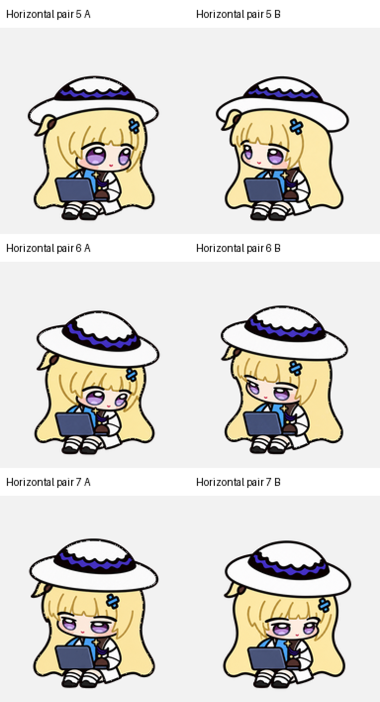</a> | **image-0091** · `768 × 1416` · PNG (567 KB) Iterative production study (QA comparison & alignment check) / 制作过程迭代与候选稿（质量复查与对齐检验图） Primary working path / 原始工作路径: `production-v3/qa/blind-c-crop-h5-7.png` [Full image / 查看原图](../../art/archive/seated-production/0041-blind-c-crop-h5-7.png) |

---

[Archive / 英文总览](../IMAGE-GALLERY.md) · [中文目录](../IMAGE-GALLERY.zh-CN.md) · [Next / 下一页 →](seated-production-02.md)
