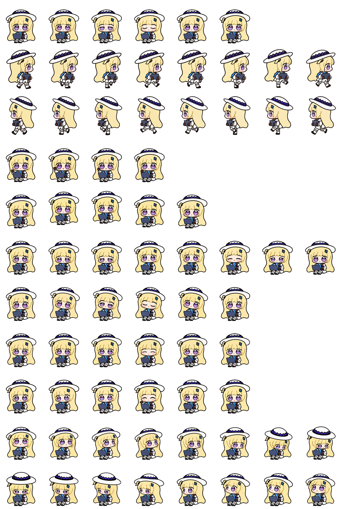

# Seated production / 坐姿制作 · 2

[Archive / 英文总览](../IMAGE-GALLERY.md) · [中文目录](../IMAGE-GALLERY.zh-CN.md) · [← Prev / 上一页](seated-production-01.md) · [Next / 下一页 →](seated-production-03.md)

> **Page 2 of 11 / 第 2 页（共 11 页）** · **48 images on this page / 本页共收录 48 张源图**
>
> - **EN**: Core production archive covering the seated and carry masters, frame-by-frame generations across all nine standard states, prop/hand defect repairs, and early 16-angle look passes.
> - **ZH**: 核心动作制作档案，涵盖坐姿工作与抱电脑移动双母本、9 类标准动作的逐帧生成稿、手套/电脑局部穿帮修整以及早期 16 向转头探索。

Click any thumbnail or **Full image / 查看原图** link to inspect the uncompressed source file. Image IDs (`image-XXXX`) map directly to [`art/index.json`](../../art/index.json).

点击任意缩略图或「**Full image / 查看原图**」即可查看未压缩原图；图片编号（`image-XXXX`）与 [`art/index.json`](../../art/index.json) 一一对应。

| Preview / 缩略预览 | Archive Record & Provenance / 档案记录与来源路径 |
| :---: | --- |
|  | **image-0092** · `1024 × 1024` · JPEG (54 KB) Iterative production study (Dot 16-angle head-turn study) / 制作过程迭代与候选稿（Dot 16 向转头朝向研究） Primary working path / 原始工作路径: `production-v3/qa/look270-270.jpg` [Full image / 查看原图](../../art/archive/seated-production/0042-look270-270.jpg) |
|  | **image-0093** · `768 × 288` · PNG (94 KB) Iterative production study (Dot 16-angle head-turn study) / 制作过程迭代与候选稿（Dot 16 向转头朝向研究） Primary working path / 原始工作路径: `production-v3/qa/look-157.5-comparison.png` [Full image / 查看原图](../../art/archive/seated-production/0043-look-157.5-comparison.png) |
|  | **image-0094** · `600 × 300` · PNG (170 KB) Iterative production study (QA comparison & alignment check) / 制作过程迭代与候选稿（质量复查与对齐检验图） Primary working path / 原始工作路径: `production-v3/qa/review-03-04-hand-detail.png` [Full image / 查看原图](../../art/archive/seated-production/0044-review-03-04-hand-detail.png) |
|  | **image-0095** · `1800 × 970` · JPEG (167 KB) Iterative production study (QA comparison & alignment check) / 制作过程迭代与候选稿（质量复查与对齐检验图） Primary working path / 原始工作路径: `production-v3/qa/geometry-review-comparison.jpg` [Full image / 查看原图](../../art/archive/seated-production/0045-geometry-review-comparison.jpg) |
|  | **image-0096** · `900 × 400` · JPEG (53 KB) Iterative production study (QA comparison & alignment check) / 制作过程迭代与候选稿（质量复查与对齐检验图） Primary working path / 原始工作路径: `production-v3/qa/standard-first-frames.jpg` [Full image / 查看原图](../../art/archive/seated-production/0046-standard-first-frames.jpg) |
|  | **image-0097** · `1728 × 232` · PNG (235 KB) Iterative production study (QA comparison & alignment check) / 制作过程迭代与候选稿（质量复查与对齐检验图） Primary working path / 原始工作路径: `production-v3/qa/row9-progress.png` [Full image / 查看原图](../../art/archive/seated-production/0047-row9-progress.png) |
|  | **image-0098** · `576 × 252` · PNG (128 KB) Iterative production study (QA comparison & alignment check) / 制作过程迭代与候选稿（质量复查与对齐检验图） Primary working path / 原始工作路径: `production-v3/qa/seated-repair-v1-comparison.png` [Full image / 查看原图](../../art/archive/seated-production/0048-seated-repair-v1-comparison.png) |
|  | **image-0099** · `384 × 236` · PNG (72 KB) Iterative production study (Dot 16-angle head-turn study) / 制作过程迭代与候选稿（Dot 16 向转头朝向研究） Primary working path / 原始工作路径: `production-v3/qa/look-180-candidate-native.png` [Full image / 查看原图](../../art/archive/seated-production/0049-look-180-candidate-native.png) |
|  | **image-0100** · `768 × 1888` · PNG (781 KB) Iterative production study (QA comparison & alignment check) / 制作过程迭代与候选稿（质量复查与对齐检验图） Primary working path / 原始工作路径: `production-v3/qa/blind-c-crop-v1-4.png` [Full image / 查看原图](../../art/archive/seated-production/0050-blind-c-crop-v1-4.png) |
|  | **image-0101** · `960 × 480` · PNG (206 KB) Iterative production study (QA comparison & alignment check) / 制作过程迭代与候选稿（质量复查与对齐检验图） Primary working path / 原始工作路径: `production-v3/qa/holistic-clarity-native-review-20261015.png` [Full image / 查看原图](../../art/archive/seated-production/0051-holistic-clarity-native-review-20261015.png) |
|  | **image-0102** · `1024 × 1024` · PNG (397 KB) Earlier accepted look `000°` source frame (v1.0.1 baseline) / 早期采用的 `000°` 转头源帧（v1.0.1 基准） Primary working path / 原始工作路径: `production-v3/qa/look000-root-candidate.png` (+5 aliases / 处复用) [Full image / 查看原图](../../art/source-frames/look/000.png) |
|  | **image-0103** · `1152 × 464` · PNG (380 KB) Iterative production study (QA comparison & alignment check) / 制作过程迭代与候选稿（质量复查与对齐检验图） Primary working path / 原始工作路径: `production-v3/qa/standard-independent-part1-native-before-repair.png` [Full image / 查看原图](../../art/archive/seated-production/0052-standard-independent-part1-native-before-repair.png) |
|  | **image-0104** · `768 × 1416` · PNG (576 KB) Iterative production study (QA comparison & alignment check) / 制作过程迭代与候选稿（质量复查与对齐检验图） Primary working path / 原始工作路径: `production-v3/qa/blind-c-crop-v5-7.png` [Full image / 查看原图](../../art/archive/seated-production/0053-blind-c-crop-v5-7.png) |
|  | **image-0105** · `1024 × 1024` · PNG (382 KB) Iterative production study (Dot 16-angle head-turn study) / 制作过程迭代与候选稿（Dot 16 向转头朝向研究） Primary working path / 原始工作路径: `production-v3/qa/look000-rejected-inflated-chin-source.png` [Full image / 查看原图](../../art/archive/seated-production/0054-look000-rejected-inflated-chin-source.png) |
|  | **image-0106** · `1536 × 2288` · PNG (2590 KB) Iterative production study / 制作过程迭代与候选稿 Primary working path / 原始工作路径: `production-v3/final/spritesheet-extended-before-despill.png` [Full image / 查看原图](../../art/archive/seated-production/0055-spritesheet-extended-before-despill.png) |
|  | **image-0107** · `1536 × 2288` · PNG (2626 KB) Historical v1.0.0 snapshot / v1.0.0 历史发布整图快照 Primary working path / 原始工作路径: `production-v3/final/download-package/完整动作图.png` (+2 aliases / 处复用) [Full image / 查看原图](../../art/releases/v1.0.0/spritesheet.png) |
|  | **image-0108** · `1536 × 2288` · WEBP (1887 KB) Historical v1.0.0 snapshot / v1.0.0 历史发布整图快照 Primary working path / 原始工作路径: `production-v3/final/download-package/phoebe/spritesheet.webp` (+3 aliases / 处复用) [Full image / 查看原图](../../art/releases/v1.0.0/spritesheet.webp) |
|  | **image-0109** · `1536 × 1872` · PNG (2052 KB) Iterative production study / 制作过程迭代与候选稿 Primary working path / 原始工作路径: `production-v3/final/spritesheet-standard.png` [Full image / 查看原图](../../art/archive/seated-production/0056-spritesheet-standard.png) |
|  | **image-0110** · `1536 × 2288` · PNG (2695 KB) Iterative production study / 制作过程迭代与候选稿 Primary working path / 原始工作路径: `production-v3/final/cloud-readback.png` (+4 aliases / 处复用) [Full image / 查看原图](../../art/archive/seated-production/0057-separate-new-cloud.png) |
|  | **image-0111** · `1536 × 2288` · PNG (2668 KB) Iterative production study / 制作过程迭代与候选稿 Primary working path / 原始工作路径: `production-v3/backup/original-cloud.png` (+1 alias / 处复用) [Full image / 查看原图](../../art/archive/seated-production/0058-restored-original-cloud.png) |
|  | **image-0112** · `1536 × 2288` · WEBP (1751 KB) Iterative production study / 制作过程迭代与候选稿 Primary working path / 原始工作路径: `production-v3/backup/local-desktop/spritesheet.webp` [Full image / 查看原图](../../art/archive/seated-production/0059-spritesheet.webp) |
|  | **image-0113** · `192 × 208` · GIF (44 KB) Iterative production study / 制作过程迭代与候选稿 Primary working path / 原始工作路径: `production-v3/previews/standard-final/waiting.gif` [Full image / 查看原图](../../art/archive/seated-production/0060-waiting.gif) |
|  | **image-0114** · `192 × 208` · GIF (38 KB) Iterative production study / 制作过程迭代与候选稿 Primary working path / 原始工作路径: `production-v3/previews/standard-final/jumping.gif` [Full image / 查看原图](../../art/archive/seated-production/0061-jumping.gif) |
|  | **image-0115** · `192 × 208` · GIF (44 KB) Iterative production study / 制作过程迭代与候选稿 Primary working path / 原始工作路径: `production-v3/previews/standard-final/running.gif` [Full image / 查看原图](../../art/archive/seated-production/0062-running.gif) |
|  | **image-0116** · `192 × 208` · GIF (51 KB) Iterative production study / 制作过程迭代与候选稿 Primary working path / 原始工作路径: `production-v3/previews/standard-final/running-left.gif` [Full image / 查看原图](../../art/archive/seated-production/0063-running-left.gif) |
|  | **image-0117** · `192 × 208` · GIF (30 KB) Iterative production study / 制作过程迭代与候选稿 Primary working path / 原始工作路径: `production-v3/previews/standard-final/waving.gif` [Full image / 查看原图](../../art/archive/seated-production/0064-waving.gif) |
|  | **image-0118** · `192 × 208` · GIF (60 KB) Iterative production study / 制作过程迭代与候选稿 Primary working path / 原始工作路径: `production-v3/previews/standard-final/failed.gif` [Full image / 查看原图](../../art/archive/seated-production/0065-failed.gif) |
|  | **image-0119** · `192 × 208` · GIF (44 KB) Iterative production study / 制作过程迭代与候选稿 Primary working path / 原始工作路径: `production-v3/previews/standard-final/review.gif` [Full image / 查看原图](../../art/archive/seated-production/0066-review.gif) |
|  | **image-0120** · `192 × 208` · GIF (45 KB) Iterative production study / 制作过程迭代与候选稿 Primary working path / 原始工作路径: `production-v3/previews/standard-final/idle.gif` [Full image / 查看原图](../../art/archive/seated-production/0067-idle.gif) |
|  | **image-0121** · `192 × 208` · GIF (57 KB) Iterative production study / 制作过程迭代与候选稿 Primary working path / 原始工作路径: `production-v3/previews/standard-final/running-right.gif` [Full image / 查看原图](../../art/archive/seated-production/0068-running-right.gif) |
|  | **image-0122** · `192 × 244` · GIF (211 KB) Iterative production study (Dot 16-angle head-turn study) / 制作过程迭代与候选稿（Dot 16 向转头朝向研究） Primary working path / 原始工作路径: `production-v3/final/download-package/look-loop.gif` (+3 aliases / 处复用) [Full image / 查看原图](../../art/archive/seated-production/0069-look-loop.gif) |
|  | **image-0123** · `192 × 244` · GIF (240 KB) Iterative production study (QA comparison & alignment check) / 制作过程迭代与候选稿（质量复查与对齐检验图） Primary working path / 原始工作路径: `production-v3/final/download-package/idle-jump-idle.gif` (+3 aliases / 处复用) [Full image / 查看原图](../../art/archive/seated-production/0070-idle-jump-idle.gif) |
|  | **image-0124** · `192 × 244` · GIF (806 KB) Iterative production study (QA comparison & alignment check) / 制作过程迭代与候选稿（质量复查与对齐检验图） Primary working path / 原始工作路径: `production-v3/final/download-package/all-states.gif` (+3 aliases / 处复用) [Full image / 查看原图](../../art/archive/seated-production/0071-all-states.gif) |
|  | **image-0125** · `192 × 244` · PNG (34 KB) Iterative production study (QA comparison & alignment check) / 制作过程迭代与候选稿（质量复查与对齐检验图） Primary working path / 原始工作路径: `production-v3/previews/final/stills/review-03.png` (+2 aliases / 处复用) [Full image / 查看原图](../../art/archive/seated-production/0072-review-03.png) |
|  | **image-0126** · `192 × 244` · PNG (34 KB) Iterative production study (QA comparison & alignment check) / 制作过程迭代与候选稿（质量复查与对齐检验图） Primary working path / 原始工作路径: `production-v3/previews/final/stills/jumping-02.png` (+2 aliases / 处复用) [Full image / 查看原图](../../art/archive/seated-production/0073-jumping-02.png) |
|  | **image-0127** · `192 × 244` · PNG (36 KB) Iterative production study (QA comparison & alignment check) / 制作过程迭代与候选稿（质量复查与对齐检验图） Primary working path / 原始工作路径: `production-v3/previews/final/stills/waving-01.png` (+2 aliases / 处复用) [Full image / 查看原图](../../art/archive/seated-production/0074-waving-01.png) |
|  | **image-0128** · `192 × 244` · PNG (35 KB) Iterative production study (QA comparison & alignment check) / 制作过程迭代与候选稿（质量复查与对齐检验图） Primary working path / 原始工作路径: `production-v3/previews/final/stills/running-02.png` (+2 aliases / 处复用) [Full image / 查看原图](../../art/archive/seated-production/0075-running-02.png) |
|  | **image-0129** · `192 × 244` · PNG (34 KB) Iterative production study (QA comparison & alignment check) / 制作过程迭代与候选稿（质量复查与对齐检验图） Primary working path / 原始工作路径: `production-v3/previews/final/stills/idle-00.png` (+2 aliases / 处复用) [Full image / 查看原图](../../art/archive/seated-production/0076-idle-00.png) |
|  | **image-0130** · `192 × 208` · GIF (44 KB) Iterative production study (QA comparison & alignment check) / 制作过程迭代与候选稿（质量复查与对齐检验图） Primary working path / 原始工作路径: `production-v3/previews/final/states/waiting.gif` (+1 alias / 处复用) [Full image / 查看原图](../../art/archive/seated-production/0077-waiting.gif) |
|  | **image-0131** · `192 × 208` · GIF (37 KB) Iterative production study (QA comparison & alignment check) / 制作过程迭代与候选稿（质量复查与对齐检验图） Primary working path / 原始工作路径: `production-v3/previews/final/states/jumping.gif` (+1 alias / 处复用) [Full image / 查看原图](../../art/archive/seated-production/0078-jumping.gif) |
|  | **image-0132** · `192 × 208` · GIF (44 KB) Iterative production study (QA comparison & alignment check) / 制作过程迭代与候选稿（质量复查与对齐检验图） Primary working path / 原始工作路径: `production-v3/previews/final/states/running.gif` (+1 alias / 处复用) [Full image / 查看原图](../../art/archive/seated-production/0079-running.gif) |
|  | **image-0133** · `192 × 208` · GIF (51 KB) Iterative production study (QA comparison & alignment check) / 制作过程迭代与候选稿（质量复查与对齐检验图） Primary working path / 原始工作路径: `production-v3/previews/final/states/running-left.gif` (+1 alias / 处复用) [Full image / 查看原图](../../art/archive/seated-production/0080-running-left.gif) |
|  | **image-0134** · `192 × 208` · GIF (30 KB) Iterative production study (QA comparison & alignment check) / 制作过程迭代与候选稿（质量复查与对齐检验图） Primary working path / 原始工作路径: `production-v3/previews/final/states/waving.gif` (+1 alias / 处复用) [Full image / 查看原图](../../art/archive/seated-production/0081-waving.gif) |
|  | **image-0135** · `192 × 208` · GIF (59 KB) Iterative production study (QA comparison & alignment check) / 制作过程迭代与候选稿（质量复查与对齐检验图） Primary working path / 原始工作路径: `production-v3/previews/final/states/failed.gif` (+1 alias / 处复用) [Full image / 查看原图](../../art/archive/seated-production/0082-failed.gif) |
|  | **image-0136** · `192 × 208` · GIF (43 KB) Iterative production study (QA comparison & alignment check) / 制作过程迭代与候选稿（质量复查与对齐检验图） Primary working path / 原始工作路径: `production-v3/previews/final/states/review.gif` (+1 alias / 处复用) [Full image / 查看原图](../../art/archive/seated-production/0083-review.gif) |
|  | **image-0137** · `192 × 208` · GIF (44 KB) Iterative production study (QA comparison & alignment check) / 制作过程迭代与候选稿（质量复查与对齐检验图） Primary working path / 原始工作路径: `production-v3/previews/final/states/idle.gif` (+1 alias / 处复用) [Full image / 查看原图](../../art/archive/seated-production/0084-idle.gif) |
|  | **image-0138** · `192 × 208` · GIF (57 KB) Iterative production study (QA comparison & alignment check) / 制作过程迭代与候选稿（质量复查与对齐检验图） Primary working path / 原始工作路径: `production-v3/previews/final/states/running-right.gif` (+1 alias / 处复用) [Full image / 查看原图](../../art/archive/seated-production/0085-running-right.gif) |
|  | **image-0139** · `192 × 208` · PNG (37 KB) Iterative production study — Working / typing (`running`) / 制作过程迭代与候选稿 — 专注敲代码（`running`） Primary working path / 原始工作路径: `production-v3/previews/final/frames-from-final/running/00.png` (+2 aliases / 处复用) [Full image / 查看原图](../../art/archive/seated-production/0086-00.png) |

---

[Archive / 英文总览](../IMAGE-GALLERY.md) · [中文目录](../IMAGE-GALLERY.zh-CN.md) · [← Prev / 上一页](seated-production-01.md) · [Next / 下一页 →](seated-production-03.md)
