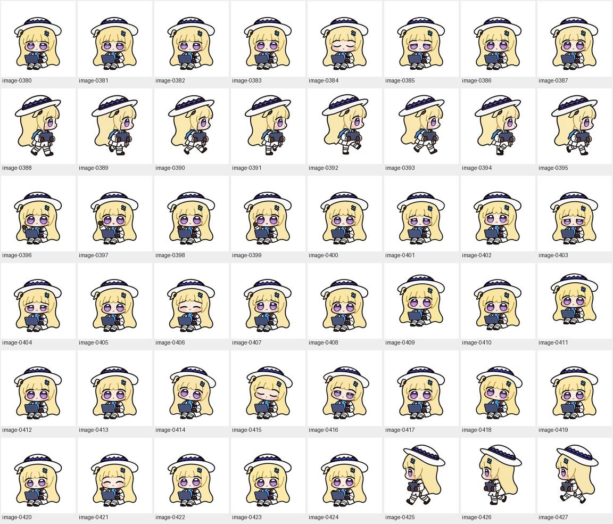

# Seated production / 坐姿制作 · 8

[Archive / 英文总览](../IMAGE-GALLERY.md) · [中文目录](../IMAGE-GALLERY.zh-CN.md) · [← Prev / 上一页](seated-production-07.md) · [Next / 下一页 →](seated-production-09.md)

> **Page 8 of 11 / 第 8 页（共 11 页）** · **48 images on this page / 本页共收录 48 张源图**
>
> - **EN**: Core production archive covering the seated and carry masters, frame-by-frame generations across all nine standard states, prop/hand defect repairs, and early 16-angle look passes.
> - **ZH**: 核心动作制作档案，涵盖坐姿工作与抱电脑移动双母本、9 类标准动作的逐帧生成稿、手套/电脑局部穿帮修整以及早期 16 向转头探索。

Click any thumbnail or **Full image / 查看原图** link to inspect the uncompressed source file. Image IDs (`image-XXXX`) map directly to [`art/index.json`](../../art/index.json).

点击任意缩略图或「**Full image / 查看原图**」即可查看未压缩原图；图片编号（`image-XXXX`）与 [`art/index.json`](../../art/index.json) 一一对应。

| Preview / 缩略预览 | Archive Record & Provenance / 档案记录与来源路径 |
| :---: | --- |
|  | **image-0380** · `192 × 208` · PNG (37 KB) Iterative production study — Working / typing (`running`) / 制作过程迭代与候选稿 — 专注敲代码（`running`） Primary working path / 原始工作路径: `production-v3/frames/running/02.png` (+1 alias / 处复用) [Full image / 查看原图](../../art/archive/seated-production/0257-02.png) |
|  | **image-0381** · `192 × 208` · PNG (37 KB) Iterative production study — Working / typing (`running`) / 制作过程迭代与候选稿 — 专注敲代码（`running`） Primary working path / 原始工作路径: `production-v3/frames/running/05.png` (+1 alias / 处复用) [Full image / 查看原图](../../art/archive/seated-production/0258-05.png) |
|  | **image-0382** · `192 × 208` · PNG (37 KB) Iterative production study — Working / typing (`running`) / 制作过程迭代与候选稿 — 专注敲代码（`running`） Primary working path / 原始工作路径: `production-v3/frames/running/04.png` (+1 alias / 处复用) [Full image / 查看原图](../../art/archive/seated-production/0259-04.png) |
|  | **image-0383** · `192 × 208` · PNG (37 KB) Iterative production study — Idle & blink (`idle`) / 制作过程迭代与候选稿 — 待机与眨眼（`idle`） Primary working path / 原始工作路径: `production-v3/frames/idle/01.png` (+1 alias / 处复用) [Full image / 查看原图](../../art/archive/seated-production/0260-01.png) |
|  | **image-0384** · `192 × 208` · PNG (37 KB) Iterative production study — Idle & blink (`idle`) / 制作过程迭代与候选稿 — 待机与眨眼（`idle`） Primary working path / 原始工作路径: `production-v3/frames/idle/03.png` (+1 alias / 处复用) [Full image / 查看原图](../../art/archive/seated-production/0261-03.png) |
|  | **image-0385** · `192 × 208` · PNG (36 KB) Iterative production study — Idle & blink (`idle`) / 制作过程迭代与候选稿 — 待机与眨眼（`idle`） Primary working path / 原始工作路径: `production-v3/frames/idle/02.png` (+1 alias / 处复用) [Full image / 查看原图](../../art/archive/seated-production/0262-02.png) |
|  | **image-0386** · `192 × 208` · PNG (38 KB) Iterative production study — Idle & blink (`idle`) / 制作过程迭代与候选稿 — 待机与眨眼（`idle`） Primary working path / 原始工作路径: `production-v3/frames/idle/05.png` (+1 alias / 处复用) [Full image / 查看原图](../../art/archive/seated-production/0263-05.png) |
|  | **image-0387** · `192 × 208` · PNG (38 KB) Iterative production study — Idle & blink (`idle`) / 制作过程迭代与候选稿 — 待机与眨眼（`idle`） Primary working path / 原始工作路径: `production-v3/frames/idle/04.png` (+1 alias / 处复用) [Full image / 查看原图](../../art/archive/seated-production/0264-04.png) |
|  | **image-0388** · `192 × 208` · PNG (39 KB) Iterative production study — Carry laptop right (`running-right`) / 制作过程迭代与候选稿 — 抱电脑向右走（`running-right`） Primary working path / 原始工作路径: `production-v3/frames/running-right/00.png` (+1 alias / 处复用) [Full image / 查看原图](../../art/archive/seated-production/0265-00.png) |
|  | **image-0389** · `192 × 208` · PNG (38 KB) Iterative production study — Carry laptop right (`running-right`) / 制作过程迭代与候选稿 — 抱电脑向右走（`running-right`） Primary working path / 原始工作路径: `production-v3/frames/running-right/01.png` (+1 alias / 处复用) [Full image / 查看原图](../../art/archive/seated-production/0266-01.png) |
|  | **image-0390** · `192 × 208` · PNG (38 KB) Iterative production study — Carry laptop right (`running-right`) / 制作过程迭代与候选稿 — 抱电脑向右走（`running-right`） Primary working path / 原始工作路径: `production-v3/frames/running-right/03.png` (+1 alias / 处复用) [Full image / 查看原图](../../art/archive/seated-production/0267-03.png) |
|  | **image-0391** · `192 × 208` · PNG (37 KB) Iterative production study — Carry laptop right (`running-right`) / 制作过程迭代与候选稿 — 抱电脑向右走（`running-right`） Primary working path / 原始工作路径: `production-v3/frames/running-right/02.png` (+1 alias / 处复用) [Full image / 查看原图](../../art/archive/seated-production/0268-02.png) |
|  | **image-0392** · `192 × 208` · PNG (37 KB) Iterative production study — Carry laptop right (`running-right`) / 制作过程迭代与候选稿 — 抱电脑向右走（`running-right`） Primary working path / 原始工作路径: `production-v3/frames/running-right/06.png` (+1 alias / 处复用) [Full image / 查看原图](../../art/archive/seated-production/0269-06.png) |
|  | **image-0393** · `192 × 208` · PNG (38 KB) Iterative production study — Carry laptop right (`running-right`) / 制作过程迭代与候选稿 — 抱电脑向右走（`running-right`） Primary working path / 原始工作路径: `production-v3/frames/running-right/07.png` (+1 alias / 处复用) [Full image / 查看原图](../../art/archive/seated-production/0270-07.png) |
|  | **image-0394** · `192 × 208` · PNG (37 KB) Iterative production study — Carry laptop right (`running-right`) / 制作过程迭代与候选稿 — 抱电脑向右走（`running-right`） Primary working path / 原始工作路径: `production-v3/frames/running-right/05.png` (+1 alias / 处复用) [Full image / 查看原图](../../art/archive/seated-production/0271-05.png) |
|  | **image-0395** · `192 × 208` · PNG (37 KB) Iterative production study — Carry laptop right (`running-right`) / 制作过程迭代与候选稿 — 抱电脑向右走（`running-right`） Primary working path / 原始工作路径: `production-v3/frames/running-right/04.png` (+1 alias / 处复用) [Full image / 查看原图](../../art/archive/seated-production/0272-04.png) |
|  | **image-0396** · `192 × 208` · PNG (38 KB) Iterative production study — Seated wave (`waving`) / 制作过程迭代与候选稿 — 坐姿挥手（`waving`） Primary working path / 原始工作路径: `production-v3/frames/waving/00.png` (+1 alias / 处复用) [Full image / 查看原图](../../art/archive/seated-production/0273-00.png) |
|  | **image-0397** · `192 × 208` · PNG (38 KB) Iterative production study — Seated wave (`waving`) / 制作过程迭代与候选稿 — 坐姿挥手（`waving`） Primary working path / 原始工作路径: `production-v3/frames/waving/01.png` (+1 alias / 处复用) [Full image / 查看原图](../../art/archive/seated-production/0274-01.png) |
|  | **image-0398** · `192 × 208` · PNG (38 KB) Iterative production study — Seated wave (`waving`) / 制作过程迭代与候选稿 — 坐姿挥手（`waving`） Primary working path / 原始工作路径: `production-v3/frames/waving/03.png` (+1 alias / 处复用) [Full image / 查看原图](../../art/archive/seated-production/0275-03.png) |
|  | **image-0399** · `192 × 208` · PNG (38 KB) Iterative production study — Seated wave (`waving`) / 制作过程迭代与候选稿 — 坐姿挥手（`waving`） Primary working path / 原始工作路径: `production-v3/frames/waving/02.png` (+1 alias / 处复用) [Full image / 查看原图](../../art/archive/seated-production/0276-02.png) |
|  | **image-0400** · `192 × 208` · PNG (37 KB) Iterative production study — Needs help / recovery (`failed`) / 制作过程迭代与候选稿 — 报错委屈求助（`failed`） Primary working path / 原始工作路径: `production-v3/frames/failed/00.png` (+1 alias / 处复用) [Full image / 查看原图](../../art/archive/seated-production/0277-00.png) |
|  | **image-0401** · `192 × 208` · PNG (37 KB) Iterative production study — Needs help / recovery (`failed`) / 制作过程迭代与候选稿 — 报错委屈求助（`failed`） Primary working path / 原始工作路径: `production-v3/frames/failed/01.png` (+1 alias / 处复用) [Full image / 查看原图](../../art/archive/seated-production/0278-01.png) |
|  | **image-0402** · `192 × 208` · PNG (38 KB) Iterative production study — Needs help / recovery (`failed`) / 制作过程迭代与候选稿 — 报错委屈求助（`failed`） Primary working path / 原始工作路径: `production-v3/frames/failed/03.png` (+1 alias / 处复用) [Full image / 查看原图](../../art/archive/seated-production/0279-03.png) |
|  | **image-0403** · `192 × 208` · PNG (38 KB) Iterative production study — Needs help / recovery (`failed`) / 制作过程迭代与候选稿 — 报错委屈求助（`failed`） Primary working path / 原始工作路径: `production-v3/frames/failed/02.png` (+1 alias / 处复用) [Full image / 查看原图](../../art/archive/seated-production/0280-02.png) |
|  | **image-0404** · `192 × 208` · PNG (38 KB) Iterative production study — Needs help / recovery (`failed`) / 制作过程迭代与候选稿 — 报错委屈求助（`failed`） Primary working path / 原始工作路径: `production-v3/frames/failed/06.png` (+1 alias / 处复用) [Full image / 查看原图](../../art/archive/seated-production/0281-06.png) |
|  | **image-0405** · `192 × 208` · PNG (37 KB) Iterative production study — Needs help / recovery (`failed`) / 制作过程迭代与候选稿 — 报错委屈求助（`failed`） Primary working path / 原始工作路径: `production-v3/frames/failed/07.png` (+1 alias / 处复用) [Full image / 查看原图](../../art/archive/seated-production/0282-07.png) |
|  | **image-0406** · `192 × 208` · PNG (37 KB) Iterative production study — Needs help / recovery (`failed`) / 制作过程迭代与候选稿 — 报错委屈求助（`failed`） Primary working path / 原始工作路径: `production-v3/frames/failed/05.png` (+1 alias / 处复用) [Full image / 查看原图](../../art/archive/seated-production/0283-05.png) |
|  | **image-0407** · `192 × 208` · PNG (38 KB) Iterative production study — Needs help / recovery (`failed`) / 制作过程迭代与候选稿 — 报错委屈求助（`failed`） Primary working path / 原始工作路径: `production-v3/frames/failed/04.png` (+1 alias / 处复用) [Full image / 查看原图](../../art/archive/seated-production/0284-04.png) |
|  | **image-0408** · `192 × 208` · PNG (37 KB) Iterative production study — Seated small hop (`jumping`) / 制作过程迭代与候选稿 — 坐姿小跳（`jumping`） Primary working path / 原始工作路径: `production-v3/frames/jumping/00.png` (+1 alias / 处复用) [Full image / 查看原图](../../art/archive/seated-production/0285-00.png) |
|  | **image-0409** · `192 × 208` · PNG (37 KB) Iterative production study — Seated small hop (`jumping`) / 制作过程迭代与候选稿 — 坐姿小跳（`jumping`） Primary working path / 原始工作路径: `production-v3/frames/jumping/01.png` (+1 alias / 处复用) [Full image / 查看原图](../../art/archive/seated-production/0286-01.png) |
|  | **image-0410** · `192 × 208` · PNG (37 KB) Iterative production study — Seated small hop (`jumping`) / 制作过程迭代与候选稿 — 坐姿小跳（`jumping`） Primary working path / 原始工作路径: `production-v3/frames/jumping/03.png` (+1 alias / 处复用) [Full image / 查看原图](../../art/archive/seated-production/0287-03.png) |
|  | **image-0411** · `192 × 208` · PNG (36 KB) Iterative production study — Seated small hop (`jumping`) / 制作过程迭代与候选稿 — 坐姿小跳（`jumping`） Primary working path / 原始工作路径: `production-v3/frames/jumping/02.png` (+1 alias / 处复用) [Full image / 查看原图](../../art/archive/seated-production/0288-02.png) |
|  | **image-0412** · `192 × 208` · PNG (38 KB) Iterative production study — Seated small hop (`jumping`) / 制作过程迭代与候选稿 — 坐姿小跳（`jumping`） Primary working path / 原始工作路径: `production-v3/frames/jumping/04.png` (+1 alias / 处复用) [Full image / 查看原图](../../art/archive/seated-production/0289-04.png) |
|  | **image-0413** · `192 × 208` · PNG (38 KB) Iterative production study — Waiting for reply (`waiting`) / 制作过程迭代与候选稿 — 等待回复（`waiting`） Primary working path / 原始工作路径: `production-v3/frames/waiting/00.png` (+1 alias / 处复用) [Full image / 查看原图](../../art/archive/seated-production/0290-00.png) |
|  | **image-0414** · `192 × 208` · PNG (37 KB) Iterative production study — Waiting for reply (`waiting`) / 制作过程迭代与候选稿 — 等待回复（`waiting`） Primary working path / 原始工作路径: `production-v3/frames/waiting/01.png` (+1 alias / 处复用) [Full image / 查看原图](../../art/archive/seated-production/0291-01.png) |
|  | **image-0415** · `192 × 208` · PNG (36 KB) Iterative production study — Waiting for reply (`waiting`) / 制作过程迭代与候选稿 — 等待回复（`waiting`） Primary working path / 原始工作路径: `production-v3/frames/waiting/03.png` (+1 alias / 处复用) [Full image / 查看原图](../../art/archive/seated-production/0292-03.png) |
|  | **image-0416** · `192 × 208` · PNG (37 KB) Iterative production study — Waiting for reply (`waiting`) / 制作过程迭代与候选稿 — 等待回复（`waiting`） Primary working path / 原始工作路径: `production-v3/frames/waiting/02.png` (+1 alias / 处复用) [Full image / 查看原图](../../art/archive/seated-production/0293-02.png) |
|  | **image-0417** · `192 × 208` · PNG (38 KB) Iterative production study — Waiting for reply (`waiting`) / 制作过程迭代与候选稿 — 等待回复（`waiting`） Primary working path / 原始工作路径: `production-v3/frames/waiting/05.png` (+1 alias / 处复用) [Full image / 查看原图](../../art/archive/seated-production/0294-05.png) |
|  | **image-0418** · `192 × 208` · PNG (37 KB) Iterative production study — Waiting for reply (`waiting`) / 制作过程迭代与候选稿 — 等待回复（`waiting`） Primary working path / 原始工作路径: `production-v3/frames/waiting/04.png` (+1 alias / 处复用) [Full image / 查看原图](../../art/archive/seated-production/0295-04.png) |
|  | **image-0419** · `192 × 208` · PNG (36 KB) Iterative production study — Reviewing output (`review`) / 制作过程迭代与候选稿 — 检查结果（`review`） Primary working path / 原始工作路径: `production-v3/frames/review/00.png` (+1 alias / 处复用) [Full image / 查看原图](../../art/archive/seated-production/0296-00.png) |
|  | **image-0420** · `192 × 208` · PNG (36 KB) Iterative production study — Reviewing output (`review`) / 制作过程迭代与候选稿 — 检查结果（`review`） Primary working path / 原始工作路径: `production-v3/frames/review/01.png` (+1 alias / 处复用) [Full image / 查看原图](../../art/archive/seated-production/0297-01.png) |
|  | **image-0421** · `192 × 208` · PNG (36 KB) Iterative production study — Reviewing output (`review`) / 制作过程迭代与候选稿 — 检查结果（`review`） Primary working path / 原始工作路径: `production-v3/frames/review/03.png` (+1 alias / 处复用) [Full image / 查看原图](../../art/archive/seated-production/0298-03.png) |
|  | **image-0422** · `192 × 208` · PNG (36 KB) Iterative production study — Reviewing output (`review`) / 制作过程迭代与候选稿 — 检查结果（`review`） Primary working path / 原始工作路径: `production-v3/frames/review/02.png` (+1 alias / 处复用) [Full image / 查看原图](../../art/archive/seated-production/0299-02.png) |
|  | **image-0423** · `192 × 208` · PNG (36 KB) Iterative production study — Reviewing output (`review`) / 制作过程迭代与候选稿 — 检查结果（`review`） Primary working path / 原始工作路径: `production-v3/frames/review/05.png` (+1 alias / 处复用) [Full image / 查看原图](../../art/archive/seated-production/0300-05.png) |
|  | **image-0424** · `192 × 208` · PNG (36 KB) Iterative production study — Reviewing output (`review`) / 制作过程迭代与候选稿 — 检查结果（`review`） Primary working path / 原始工作路径: `production-v3/frames/review/04.png` (+1 alias / 处复用) [Full image / 查看原图](../../art/archive/seated-production/0301-04.png) |
|  | **image-0425** · `192 × 208` · PNG (35 KB) Iterative production study — Carry laptop left (`running-left`) / 制作过程迭代与候选稿 — 抱电脑向左走（`running-left`） Primary working path / 原始工作路径: `production-v3/frames/running-left/00.png` (+1 alias / 处复用) [Full image / 查看原图](../../art/archive/seated-production/0302-00.png) |
|  | **image-0426** · `192 × 208` · PNG (34 KB) Iterative production study — Carry laptop left (`running-left`) / 制作过程迭代与候选稿 — 抱电脑向左走（`running-left`） Primary working path / 原始工作路径: `production-v3/frames/running-left/01.png` (+1 alias / 处复用) [Full image / 查看原图](../../art/archive/seated-production/0303-01.png) |
|  | **image-0427** · `192 × 208` · PNG (34 KB) Iterative production study — Carry laptop left (`running-left`) / 制作过程迭代与候选稿 — 抱电脑向左走（`running-left`） Primary working path / 原始工作路径: `production-v3/frames/running-left/03.png` (+1 alias / 处复用) [Full image / 查看原图](../../art/archive/seated-production/0304-03.png) |

---

[Archive / 英文总览](../IMAGE-GALLERY.md) · [中文目录](../IMAGE-GALLERY.zh-CN.md) · [← Prev / 上一页](seated-production-07.md) · [Next / 下一页 →](seated-production-09.md)
