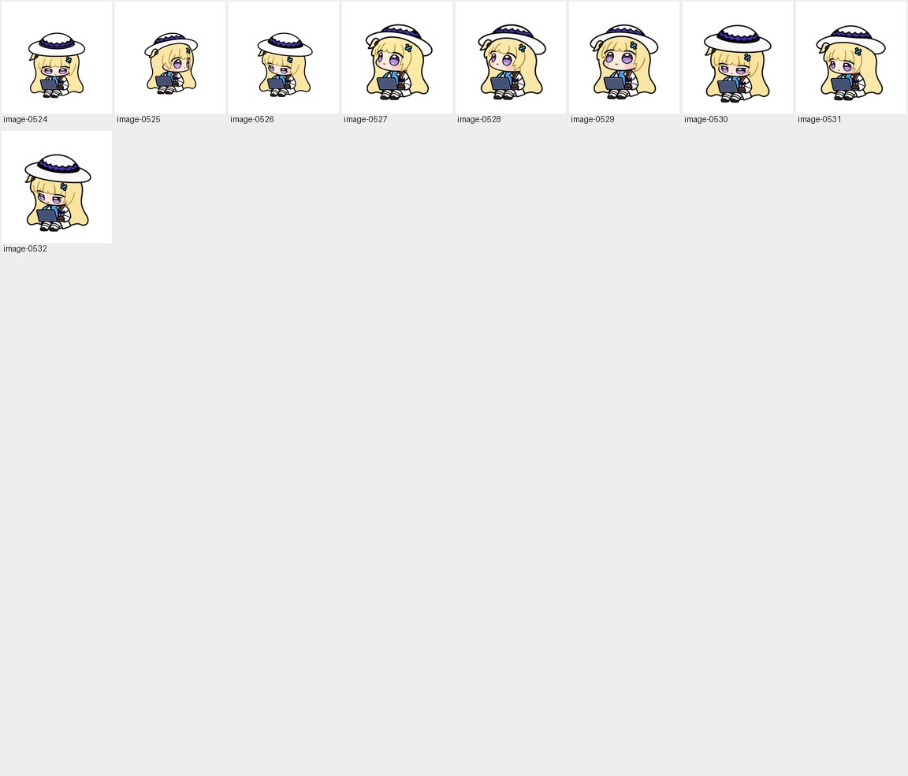

# Seated production / 坐姿制作 · 11

[Archive / 英文总览](../IMAGE-GALLERY.md) · [中文目录](../IMAGE-GALLERY.zh-CN.md) · [← Prev / 上一页](seated-production-10.md)

> **Page 11 of 11 / 第 11 页（共 11 页）** · **9 images on this page / 本页共收录 9 张源图**
>
> - **EN**: Core production archive covering the seated and carry masters, frame-by-frame generations across all nine standard states, prop/hand defect repairs, and early 16-angle look passes.
> - **ZH**: 核心动作制作档案，涵盖坐姿工作与抱电脑移动双母本、9 类标准动作的逐帧生成稿、手套/电脑局部穿帮修整以及早期 16 向转头探索。

Click any thumbnail or **Full image / 查看原图** link to inspect the uncompressed source file. Image IDs (`image-XXXX`) map directly to [`art/index.json`](../../art/index.json).

点击任意缩略图或「**Full image / 查看原图**」即可查看未压缩原图；图片编号（`image-XXXX`）与 [`art/index.json`](../../art/index.json) 一一对应。

| Preview / 缩略预览 | Archive Record & Provenance / 档案记录与来源路径 |
| :---: | --- |
|  | **image-0524** · `1254 × 1254` · PNG (574 KB) Iterative production study (Dot 16-angle head-turn study) / 制作过程迭代与候选稿（Dot 16 向转头朝向研究） Primary working path / 原始工作路径: `production-v3/generated-originals/look/180-attempt1.png` [Full image / 查看原图](../../art/archive/seated-production/0401-180-attempt1.png) |
|  | **image-0525** · `1254 × 1254` · PNG (528 KB) Iterative production study (Dot 16-angle head-turn study) / 制作过程迭代与候选稿（Dot 16 向转头朝向研究） Primary working path / 原始工作路径: `production-v3/generated-originals/look/090-repair1.png` [Full image / 查看原图](../../art/archive/seated-production/0402-090-repair1.png) |
|  | **image-0526** · `1254 × 1254` · PNG (563 KB) Iterative production study (Dot 16-angle head-turn study) / 制作过程迭代与候选稿（Dot 16 向转头朝向研究） Primary working path / 原始工作路径: `production-v3/generated-originals/look/225.png` [Full image / 查看原图](../../art/archive/seated-production/0403-225.png) |
|  | **image-0527** · `192 × 208` · PNG (34 KB) Iterative production study (Dot 16-angle head-turn study) / 制作过程迭代与候选稿（Dot 16 向转头朝向研究） Primary working path / 原始工作路径: `production-v3/look-prepared/look/315.png` (+1 alias / 处复用) [Full image / 查看原图](../../art/archive/seated-production/0404-315.png) |
|  | **image-0528** · `192 × 208` · PNG (36 KB) Iterative production study (Dot 16-angle head-turn study) / 制作过程迭代与候选稿（Dot 16 向转头朝向研究） Primary working path / 原始工作路径: `production-v3/look-prepared/look/292.5.png` (+1 alias / 处复用) [Full image / 查看原图](../../art/archive/seated-production/0405-292.5.png) |
|  | **image-0529** · `192 × 208` · PNG (36 KB) Iterative production study (Dot 16-angle head-turn study) / 制作过程迭代与候选稿（Dot 16 向转头朝向研究） Primary working path / 原始工作路径: `production-v3/look-prepared/look/337.5.png` (+1 alias / 处复用) [Full image / 查看原图](../../art/archive/seated-production/0406-337.5.png) |
|  | **image-0530** · `192 × 208` · PNG (35 KB) Iterative production study (Dot 16-angle head-turn study) / 制作过程迭代与候选稿（Dot 16 向转头朝向研究） Primary working path / 原始工作路径: `production-v3/look-prepared/look/202.5.png` (+1 alias / 处复用) [Full image / 查看原图](../../art/archive/seated-production/0407-202.5.png) |
|  | **image-0531** · `192 × 208` · PNG (33 KB) Iterative production study (Dot 16-angle head-turn study) / 制作过程迭代与候选稿（Dot 16 向转头朝向研究） Primary working path / 原始工作路径: `production-v3/look-prepared/look/247.5.png` (+1 alias / 处复用) [Full image / 查看原图](../../art/archive/seated-production/0408-247.5.png) |
|  | **image-0532** · `192 × 208` · PNG (34 KB) Iterative production study (Dot 16-angle head-turn study) / 制作过程迭代与候选稿（Dot 16 向转头朝向研究） Primary working path / 原始工作路径: `production-v3/look-prepared/look/225.png` (+1 alias / 处复用) [Full image / 查看原图](../../art/archive/seated-production/0409-225.png) |

---

[Archive / 英文总览](../IMAGE-GALLERY.md) · [中文目录](../IMAGE-GALLERY.zh-CN.md) · [← Prev / 上一页](seated-production-10.md)
