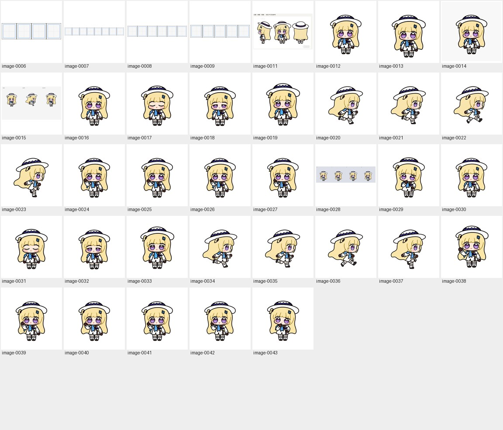
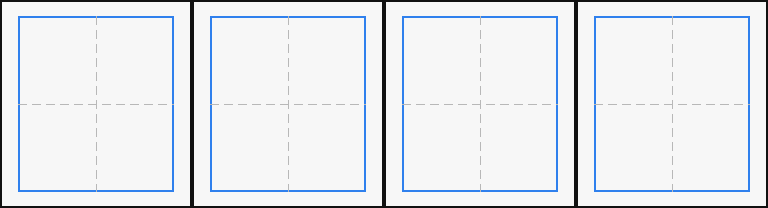
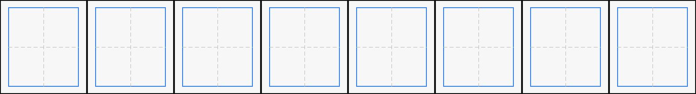
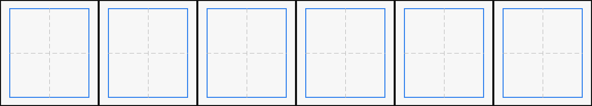
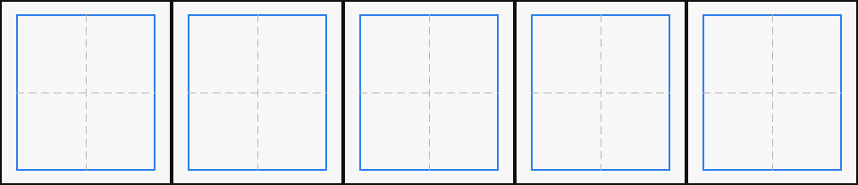
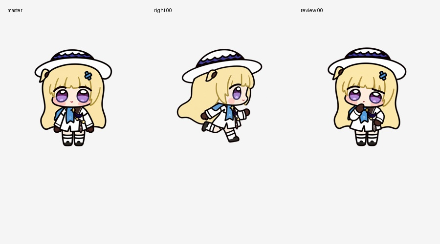
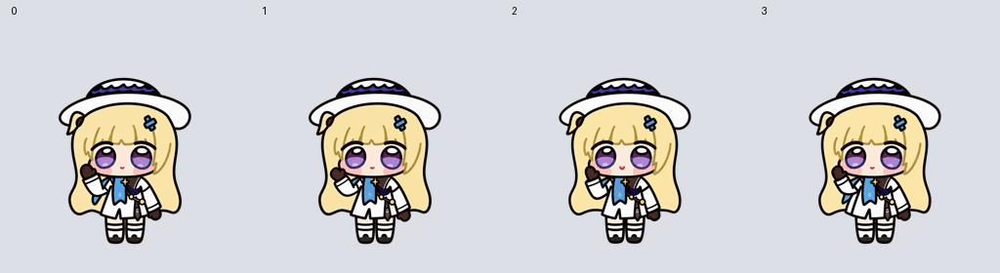

# Standing studies / 站姿研究 · 1

[Archive / 英文总览](../IMAGE-GALLERY.md) · [中文目录](../IMAGE-GALLERY.zh-CN.md)

> **Single-page collection / 单页完整分册** · **37 images on this page / 本页共收录 37 张源图**
>
> - **EN**: Community three-view turnaround reference, orthographic front/profile/back cutouts, standing identity masters, and early proportion checks.
> - **ZH**: 社区正/侧/背三视图参考及独立去背切图、站姿身份设定母本与早期头身比校准稿。

Click any thumbnail or **Full image / 查看原图** link to inspect the uncompressed source file. Image IDs (`image-XXXX`) map directly to [`art/index.json`](../../art/index.json).

点击任意缩略图或「**Full image / 查看原图**」即可查看未压缩原图；图片编号（`image-XXXX`）与 [`art/index.json`](../../art/index.json) 一一对应。

| Preview / 缩略预览 | Archive Record & Provenance / 档案记录与来源路径 |
| :---: | --- |
|  | **image-0006** · `768 × 208` · PNG (1 KB) Iterative production study — Seated wave (`waving`) / 制作过程迭代与候选稿 — 坐姿挥手（`waving`） Primary working path / 原始工作路径: `production-v2/references/layout-guides/look-cardinals.png` (+5 aliases / 处复用) [Full image / 查看原图](../../art/archive/early-concept/0006-waving.png) |
|  | **image-0007** · `1536 × 208` · PNG (2 KB) Iterative production study — Carry laptop right (`running-right`) / 制作过程迭代与候选稿 — 抱电脑向右走（`running-right`） Primary working path / 原始工作路径: `production-v2/references/layout-guides/failed.png` (+14 aliases / 处复用) [Full image / 查看原图](../../art/archive/early-concept/0007-failed.png) |
|  | **image-0008** · `1152 × 208` · PNG (2 KB) Iterative production study — Idle & blink (`idle`) / 制作过程迭代与候选稿 — 待机与眨眼（`idle`） Primary working path / 原始工作路径: `production-v2/references/layout-guides/idle.png` (+11 aliases / 处复用) [Full image / 查看原图](../../art/archive/early-concept/0008-review.png) |
|  | **image-0009** · `960 × 208` · PNG (2 KB) Iterative production study — Seated small hop (`jumping`) / 制作过程迭代与候选稿 — 坐姿小跳（`jumping`） Primary working path / 原始工作路径: `production-v2/references/layout-guides/jumping.png` (+2 aliases / 处复用) [Full image / 查看原图](../../art/archive/early-concept/0009-jumping.png) |
|  | **image-0011** · `1792 × 1084` · PNG (1003 KB) Community front/profile/back turnaround sheet (attributed to 蓝蓝铜离子) / 保留原署名的社区正侧背三视图参考 Primary working path / 原始工作路径: `production-v2/canonical/user-reference.png` (+4 aliases / 处复用) [Full image / 查看原图](../../art/canonical/user-reference.png) |
|  | **image-0012** · `1024 × 1024` · PNG (396 KB) Standing character identity master / 站姿角色身份设定母本 Primary working path / 原始工作路径: `production-v2/canonical/master.png` (+2 aliases / 处复用) [Full image / 查看原图](../../art/canonical/standing-identity.png) |
|  | **image-0013** · `1254 × 1254` · PNG (647 KB) Iterative production study / 制作过程迭代与候选稿 Primary working path / 原始工作路径: `production-v2/canonical/master-generated-original.png` [Full image / 查看原图](../../art/archive/standing-study/0001-master-generated-original.png) |
|  | **image-0014** · `1024 × 1024` · JPEG (119 KB) Iterative production study / 制作过程迭代与候选稿 Primary working path / 原始工作路径: `production-v2/canonical/master-review.jpg` [Full image / 查看原图](../../art/archive/standing-study/0002-master-review.jpg) |
|  | **image-0015** · `900 × 500` · JPEG (56 KB) Iterative production study (QA comparison & alignment check) / 制作过程迭代与候选稿（质量复查与对齐检验图） Primary working path / 原始工作路径: `production-v2/qa/first-frame-comparison.jpg` [Full image / 查看原图](../../art/archive/standing-study/0003-first-frame-comparison.jpg) |
|  | **image-0016** · `1024 × 1024` · PNG (415 KB) Generated frame study for Idle & blink (`idle`) / 待机与眨眼（`idle`） 单帧生成与迭代稿 Primary working path / 原始工作路径: `production-v2/raw-frames/idle/01.png` [Full image / 查看原图](../../art/archive/standing-study/0004-01.png) |
|  | **image-0017** · `1024 × 1024` · PNG (414 KB) Generated frame study for Idle & blink (`idle`) / 待机与眨眼（`idle`） 单帧生成与迭代稿 Primary working path / 原始工作路径: `production-v2/raw-frames/idle/03.png` [Full image / 查看原图](../../art/archive/standing-study/0005-03.png) |
|  | **image-0018** · `1024 × 1024` · PNG (408 KB) Generated frame study for Idle & blink (`idle`) / 待机与眨眼（`idle`） 单帧生成与迭代稿 Primary working path / 原始工作路径: `production-v2/generated-originals/idle/02-approved-reference.png` (+1 alias / 处复用) [Full image / 查看原图](../../art/archive/standing-study/0006-02.png) |
|  | **image-0019** · `1024 × 1024` · PNG (463 KB) Generated frame study for Idle & blink (`idle`) / 待机与眨眼（`idle`） 单帧生成与迭代稿 Primary working path / 原始工作路径: `production-v2/raw-frames/idle/04.png` [Full image / 查看原图](../../art/archive/standing-study/0007-04.png) |
|  | **image-0020** · `1024 × 1024` · PNG (389 KB) Generated frame study for Carry laptop right (`running-right`) / 抱电脑向右走（`running-right`） 单帧生成与迭代稿 Primary working path / 原始工作路径: `production-v2/raw-frames/running-right/00.png` [Full image / 查看原图](../../art/archive/standing-study/0008-00.png) |
|  | **image-0021** · `1024 × 1024` · PNG (392 KB) Generated frame study for Carry laptop right (`running-right`) / 抱电脑向右走（`running-right`） 单帧生成与迭代稿 Primary working path / 原始工作路径: `production-v2/raw-frames/running-right/01.png` [Full image / 查看原图](../../art/archive/standing-study/0009-01.png) |
|  | **image-0022** · `1024 × 1024` · PNG (392 KB) Generated frame study for Carry laptop right (`running-right`) / 抱电脑向右走（`running-right`） 单帧生成与迭代稿 Primary working path / 原始工作路径: `production-v2/raw-frames/running-right/03.png` [Full image / 查看原图](../../art/archive/standing-study/0010-03.png) |
|  | **image-0023** · `1024 × 1024` · PNG (384 KB) Generated frame study for Carry laptop right (`running-right`) / 抱电脑向右走（`running-right`） 单帧生成与迭代稿 Primary working path / 原始工作路径: `production-v2/raw-frames/running-right/02.png` [Full image / 查看原图](../../art/archive/standing-study/0011-02.png) |
|  | **image-0024** · `1024 × 1024` · PNG (421 KB) Generated frame study for Seated wave (`waving`) / 坐姿挥手（`waving`） 单帧生成与迭代稿 Primary working path / 原始工作路径: `production-v2/raw-frames/waving/00.png` [Full image / 查看原图](../../art/archive/standing-study/0012-00.png) |
|  | **image-0025** · `1024 × 1024` · PNG (421 KB) Generated frame study for Seated wave (`waving`) / 坐姿挥手（`waving`） 单帧生成与迭代稿 Primary working path / 原始工作路径: `production-v2/raw-frames/waving/01.png` [Full image / 查看原图](../../art/archive/standing-study/0013-01.png) |
|  | **image-0026** · `1024 × 1024` · PNG (423 KB) Generated frame study for Seated wave (`waving`) / 坐姿挥手（`waving`） 单帧生成与迭代稿 Primary working path / 原始工作路径: `production-v2/raw-frames/waving/03.png` [Full image / 查看原图](../../art/archive/standing-study/0014-03.png) |
|  | **image-0027** · `1024 × 1024` · PNG (414 KB) Generated frame study for Seated wave (`waving`) / 坐姿挥手（`waving`） 单帧生成与迭代稿 Primary working path / 原始工作路径: `production-v2/raw-frames/waving/02.png` [Full image / 查看原图](../../art/archive/standing-study/0015-02.png) |
|  | **image-0028** · `1024 × 280` · JPEG (32 KB) Generated frame study for Seated wave (`waving`) / 坐姿挥手（`waving`） 单帧生成与迭代稿 Primary working path / 原始工作路径: `production-v2/raw-frames/waving/contact.jpg` [Full image / 查看原图](../../art/archive/standing-study/0016-contact.jpg) |
|  | **image-0029** · `1024 × 1024` · PNG (405 KB) Generated frame study for Reviewing output (`review`) / 检查结果（`review`） 单帧生成与迭代稿 Primary working path / 原始工作路径: `production-v2/raw-frames/review/00.png` [Full image / 查看原图](../../art/archive/standing-study/0017-00.png) |
|  | **image-0030** · `1254 × 1254` · PNG (584 KB) Generated frame study for Idle & blink (`idle`) / 待机与眨眼（`idle`） 单帧生成与迭代稿 Primary working path / 原始工作路径: `production-v2/generated-originals/idle/01.png` [Full image / 查看原图](../../art/archive/standing-study/0018-01.png) |
|  | **image-0031** · `1254 × 1254` · PNG (585 KB) Generated frame study for Idle & blink (`idle`) / 待机与眨眼（`idle`） 单帧生成与迭代稿 Primary working path / 原始工作路径: `production-v2/generated-originals/idle/03.png` [Full image / 查看原图](../../art/archive/standing-study/0019-03.png) |
|  | **image-0032** · `1254 × 1254` · PNG (576 KB) Generated frame study for Idle & blink (`idle`) / 待机与眨眼（`idle`） 单帧生成与迭代稿 Primary working path / 原始工作路径: `production-v2/generated-originals/idle/02.png` [Full image / 查看原图](../../art/archive/standing-study/0020-02.png) |
|  | **image-0033** · `1254 × 1254` · PNG (648 KB) Generated frame study for Idle & blink (`idle`) / 待机与眨眼（`idle`） 单帧生成与迭代稿 Primary working path / 原始工作路径: `production-v2/generated-originals/idle/04.png` [Full image / 查看原图](../../art/archive/standing-study/0021-04.png) |
|  | **image-0034** · `1254 × 1254` · PNG (548 KB) Generated frame study for Carry laptop right (`running-right`) / 抱电脑向右走（`running-right`） 单帧生成与迭代稿 Primary working path / 原始工作路径: `production-v2/generated-originals/running-right/00.png` [Full image / 查看原图](../../art/archive/standing-study/0022-00.png) |
|  | **image-0035** · `1254 × 1254` · PNG (566 KB) Generated frame study for Carry laptop right (`running-right`) / 抱电脑向右走（`running-right`） 单帧生成与迭代稿 Primary working path / 原始工作路径: `production-v2/generated-originals/running-right/01.png` [Full image / 查看原图](../../art/archive/standing-study/0023-01.png) |
|  | **image-0036** · `1254 × 1254` · PNG (569 KB) Generated frame study for Carry laptop right (`running-right`) / 抱电脑向右走（`running-right`） 单帧生成与迭代稿 Primary working path / 原始工作路径: `production-v2/generated-originals/running-right/03.png` [Full image / 查看原图](../../art/archive/standing-study/0024-03.png) |
|  | **image-0037** · `1254 × 1254` · PNG (540 KB) Generated frame study for Carry laptop right (`running-right`) / 抱电脑向右走（`running-right`） 单帧生成与迭代稿 Primary working path / 原始工作路径: `production-v2/generated-originals/running-right/02.png` [Full image / 查看原图](../../art/archive/standing-study/0025-02.png) |
|  | **image-0038** · `1254 × 1254` · PNG (639 KB) Generated frame study for Seated wave (`waving`) / 坐姿挥手（`waving`） 单帧生成与迭代稿 Primary working path / 原始工作路径: `production-v2/generated-originals/waving/01-rejected-1.png` [Full image / 查看原图](../../art/archive/standing-study/0026-01-rejected-1.png) |
|  | **image-0039** · `1254 × 1254` · PNG (585 KB) Generated frame study for Seated wave (`waving`) / 坐姿挥手（`waving`） 单帧生成与迭代稿 Primary working path / 原始工作路径: `production-v2/generated-originals/waving/00.png` [Full image / 查看原图](../../art/archive/standing-study/0027-00.png) |
|  | **image-0040** · `1254 × 1254` · PNG (588 KB) Generated frame study for Seated wave (`waving`) / 坐姿挥手（`waving`） 单帧生成与迭代稿 Primary working path / 原始工作路径: `production-v2/generated-originals/waving/01.png` [Full image / 查看原图](../../art/archive/standing-study/0028-01.png) |
|  | **image-0041** · `1254 × 1254` · PNG (586 KB) Generated frame study for Seated wave (`waving`) / 坐姿挥手（`waving`） 单帧生成与迭代稿 Primary working path / 原始工作路径: `production-v2/generated-originals/waving/03.png` [Full image / 查看原图](../../art/archive/standing-study/0029-03.png) |
|  | **image-0042** · `1254 × 1254` · PNG (577 KB) Generated frame study for Seated wave (`waving`) / 坐姿挥手（`waving`） 单帧生成与迭代稿 Primary working path / 原始工作路径: `production-v2/generated-originals/waving/02.png` [Full image / 查看原图](../../art/archive/standing-study/0030-02.png) |
|  | **image-0043** · `1254 × 1254` · PNG (587 KB) Generated frame study for Reviewing output (`review`) / 检查结果（`review`） 单帧生成与迭代稿 Primary working path / 原始工作路径: `production-v2/generated-originals/review/00.png` [Full image / 查看原图](../../art/archive/standing-study/0031-00.png) |

---

[Archive / 英文总览](../IMAGE-GALLERY.md) · [中文目录](../IMAGE-GALLERY.zh-CN.md)
