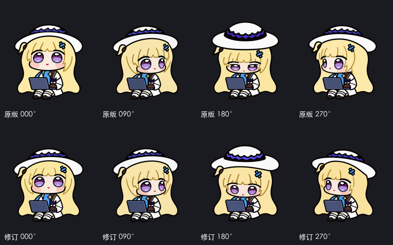
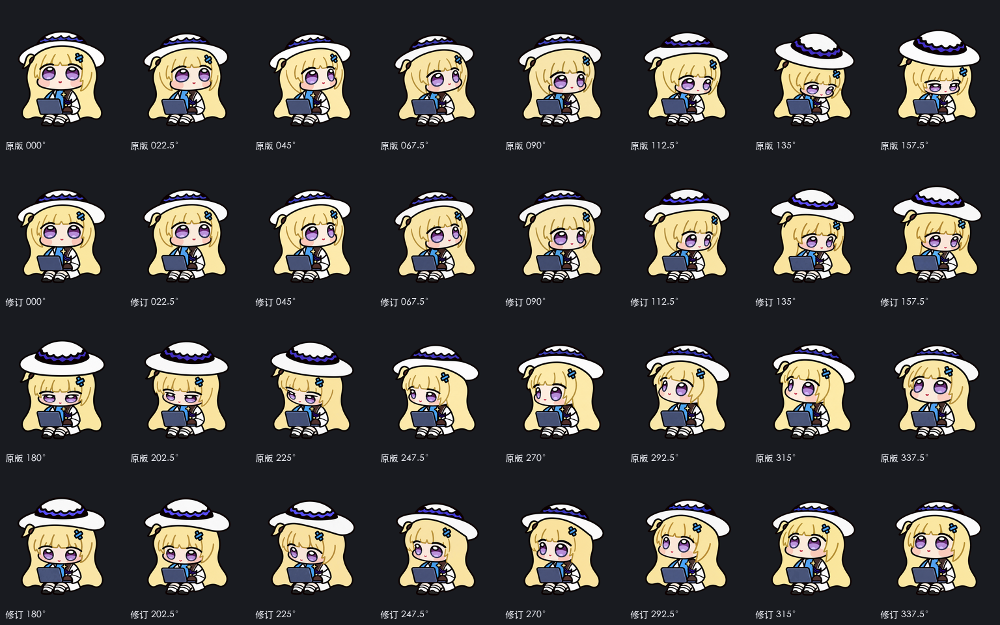
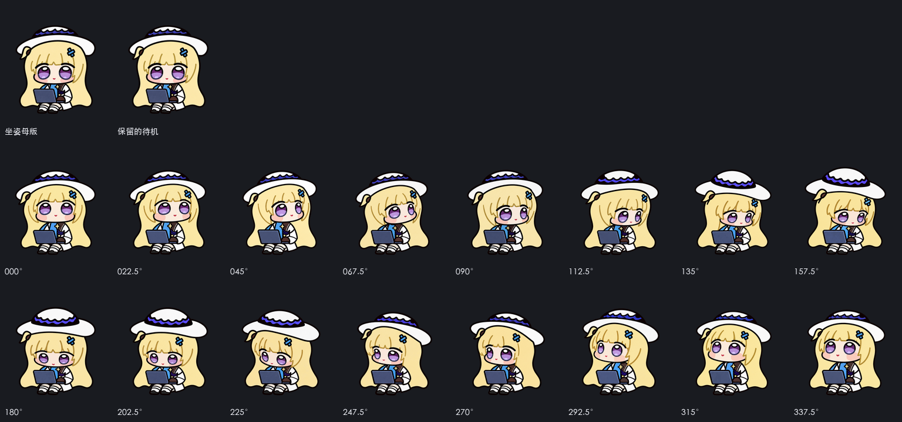
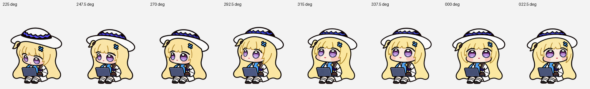
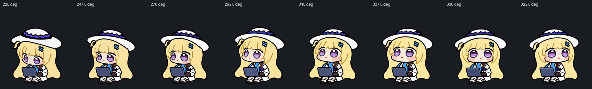
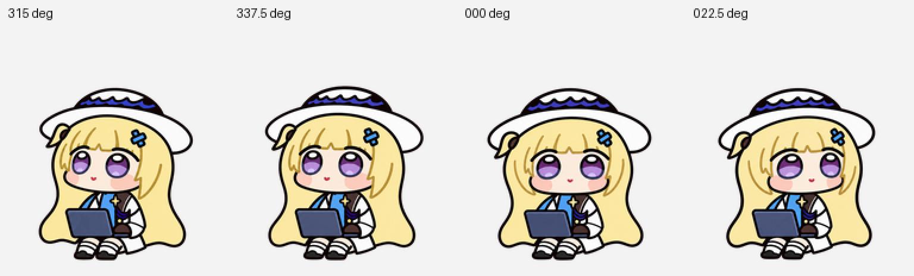
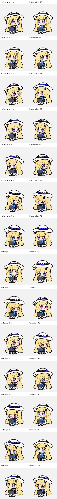

# v1.0.2 转头修订检查记录（Look Repair QA）

[English](README.md) · **简体中文** · [检查指南](../REVIEW.zh-CN.md)

本目录完整归档了 **v1.0.2** 针对 Codex Dot 16 向转头姿态（第 9、10 行）的视觉重绘、6 帧脸型精修、三方无标签盲审与像素守卫证据。

在 `v1.0.2` 中，我们重点修正了向左看、低头以及左上回正区段的头部透视：当头部从侧方转回正面时，脸颊保持紧凑圆润；抬头看向正上方（`000°`）时，收回了眼睛下方多余的脸部留白。与此同时，前 9 行共 **57 张标准动作帧（含待机眨眼）** 与 `v1.0.1` 的 RGBA 像素 **100% 逐字节一致**。

- **当前验证的发布文件**：`pets/phoebe-chupi/spritesheet.webp`（SHA-256：`c00941ef64ce87b76b60f84da2f5dd0045147ad82017cccf349d2a21330106c6`）
- **核心溯源三件套**：[批准基准源图 (`art/approved/v1.0.2/spritesheet.png`)](../../art/approved/v1.0.2/spritesheet.png) · [16 向源帧映射表 (`source-map.json`)](../../art/repair/v1.0.2/source-map.json) · [双层像素守卫配置 (`approved-runtime.json`)](../../art/approved-runtime.json)

---

## 视觉对比图板：修前 vs 修后

### 1. 十字四正方向（`000° / 090° / 180° / 270°`）修前修后对比

  

### 2. 全部 16 个转头方向修前修后完整对比

`022.5`、`045`、`067.5`、`090` 四个右上/正右方向沿用原画；其余 **12 个方向**均由内置图像生成工具生成完整连接的角色帧（保留帽子设计、不贴脸、不做局部变形），并对 `000`、`157.5`、`247.5`、`292.5`、`315`、`337.5` 完成了最新一轮脸颊与脸部比例细化：

  

### 3. 坐姿母本与 16 向原生尺寸（`192 × 208`）对齐总览

  

### 4. 左上回正关键链路（`270° → 292.5° → 315° → 337.5° → 000°`）浅深背景与放大复核

针对此前反馈“从左上转回正上时脸显得突然变大”的区段，我们在浅色、深色背景及 2× 诊断放大下逐格核对了头部相对于固定笔记本电脑的体积感：

<table>
  <tr>
    <td align="center" width="50%">
       
      <b>浅色背景</b>：左上回正连续链路
    </td>
    <td align="center" width="50%">
       
      <b>深色背景</b>：验证外轮廓抗锯齿无白边
    </td>
  </tr>
</table>

  

> 更多复查图板位于 [`art/repair/v1.0.2/review-boards/`](../../art/repair/v1.0.2/review-boards)，可配合[浅色转头动图](../../previews/look-loop.gif)、[深色转头动图](../../previews/look-dark.gif)与 [16 张精确 PNG 裁剪帧](../../art/frames/look) 一起对照。

---

## 检查内容

下表列出了本目录下全部机器可读验证报告及其核查目的（请注意：边界框与像素差异等测量数据仅用于辅助定位需肉眼观察的过渡帧，单看脸部边界框数字本身无法区分“正常的转头透视变化”与“不应有的脸部缩放”）：

| 报告文件 | 核查内容与结论摘要 |
| --- | --- |
| [`direction-semantics.json`](direction-semantics.json) | 逐格记录全部 16 个方向中头部朝向、脸颊饱满度、远近侧眼睛与帽顶俯仰的可见视觉线索。 |
| [`independent-final-art-review.json`](independent-final-art-review.json) | 独立审查整套 16 向转头及浅色、深色背景下的重点过渡衔接（低头链与左上回正链）。 |
| [`ui-visual-review.json`](ui-visual-review.json) | 浏览器原生 `192 × 208`（1×）尺寸下正反向逐帧单步查看，以及连续截图抽样检查运行中的转头循环。 |
| [`face-continuity-before-after.json`](face-continuity-before-after.json) | 在完全相同的坐标与阈值口径下，量化对比最新 6 处脸型修正（`000`、`157.5`、`247.5`、`292.5`、`315`、`337.5`）前后的变化。 |
| [`protected-standard-rows.json`](protected-standard-rows.json) | 核对前 9 行共 57 张标准动作帧（及 15 个透明格）与 `v1.0.1` 的 RGBA 像素 **0 差异**。 |
| [`installation-verification.json`](installation-verification.json) | 验证本机宠物文件与 Codex 应用内已启用的宠物条目均已更新至 `v1.0.2`，应用回读 PNG 的解码 RGBA 像素与发布版 WebP 完全一致。 |
| [`atlas-validation.json`](atlas-validation.json) · [`standard-frame-review.json`](standard-frame-review.json) | 检查 `1536 × 2288` 网格、73 个有效格与 15 个空格、透明度安全边距、连通分量与单帧几何属性。 |
| [`look-continuity.json`](look-continuity.json) · [`pet-quality.json`](pet-quality.json) | 检查相邻转头姿态轮廓连续性、头部横向中心稳定性（最大偏移 `3.0 px`）以及坐姿小跳起落（抬升 `21 px`，落地偏移 `0 px`）。 |
| [`chroma-native-alpha.json`](chroma-native-alpha.json) | 确认直接保留了生成画面的原生透明度与深色外描线，未做任何邻近浅色平均处理。 |
| [`archive-verification.json`](archive-verification.json) | 核对 832 张源图哈希、像素保留、干净元数据（无残留 EXIF/XMP）及选定源帧的完整归档覆盖。 |

---

## 方向盲审

为了检验新重绘的转头帧在剥离文字提示后是否依然方向明确，三位互相隔离的 AI 审查员在看到答案表之前，分别对随机打乱、不含任何文件名或角度标签的 14 组 `A / B` 对称方向图做出了独立判断：

  

- **盲审结果**：7 组水平方向对比 + 7 组垂直方向对比，**共 14 组严格多数结果全部通过（14 / 14 PASS）**。
- **原始盲审答卷与校验文件**：
  - 独立答卷：[`blind-review-a.json`](blind-review-a.json) · [`blind-review-b.json`](blind-review-b.json) · [`blind-review-c.json`](blind-review-c.json)
  - 多数汇总与答案核对：[`blind-majority.json`](blind-majority.json) · [`blind-axis-answer-key.json`](blind-axis-answer-key.json) · [`blind-validation.json`](blind-validation.json)

---

## 仍需了解的表现

- **离散 16 帧的角度步进**：Codex Dot 从 16 张离散静态图中按角度切换画面。在 `225 → 247.5` 的侧转和 `270 → 292.5` 的抬头过渡上，姿态步进幅度仍比紧邻的其他角度更明显。
- **浏览器抽查与实机验证边界**：修订后的左上方序列已在浏览器中对照固定的电脑和身体做过 1× 正反向逐帧检查及连续截图取样（此前明显的整张脸放大现象已消除）。本机安装和应用端图片回读已核对完毕；原生 Dot 实机画面与 Windows 桌面端画面检查仍待后续补充。
- **历史记录保留**：此前的 [`v1.0.1` 描线修复检查记录](../repair-qa/README.zh-CN.md)与 [`v1.0.1` 版本快照](../../art/releases/v1.0.1)继续完整保留在仓库中，便于跨版本对照。
