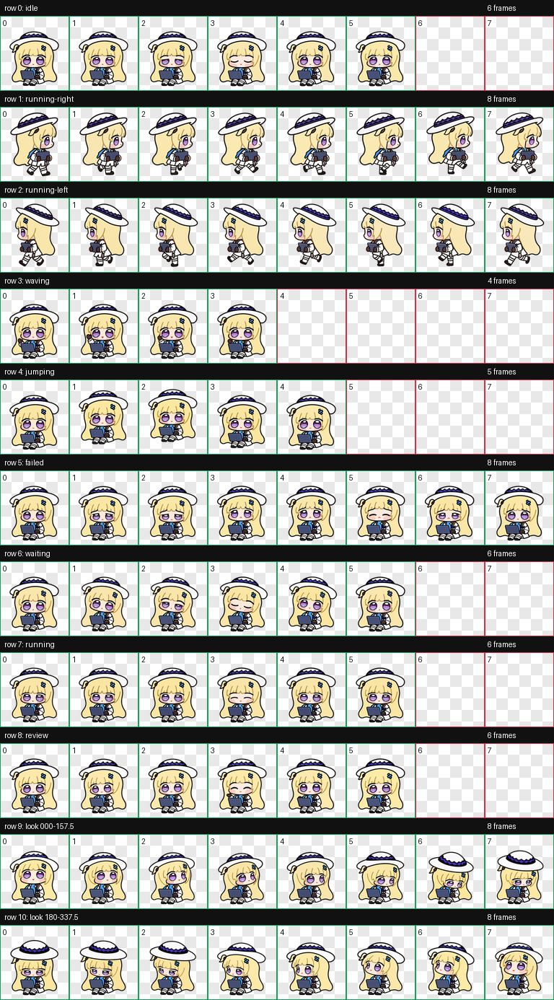
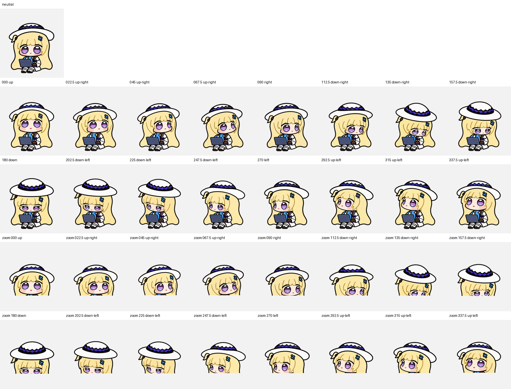
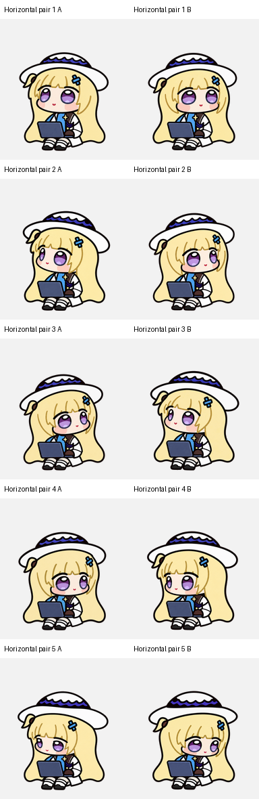

# v1.0.1 Outline-Repair Review Evidence (Outline Repair QA)

**English** · [简体中文](README.zh-CN.md) · [Review guide](../REVIEW.md)

This directory archives the automated file measurements, light/dark all-frame inspections, and three-reviewer unlabeled blind direction tests for the restored **v1.0.1** WebP ([`art/releases/v1.0.1/spritesheet.webp`](../../art/releases/v1.0.1/spritesheet.webp), SHA-256 `e1971a5c89d073739c4956e04292249385eb47298dd8ce873deb1be6aaf3bdf2`). All paths inside the JSON reports are relative to the repository root.

> **Relationship to v1.0.2**: The current `v1.0.2` release retains 100% of the restored `v1.0.1` RGBA pixels across the first nine rows (**all 57 standard animation frames**). For the `v1.0.2` Dot 16-angle head-turn redraw and six-pose face refinement evidence, see [`docs/look-repair-qa/`](../look-repair-qa/README.md).

---

## Visual Evidence Preview

### 1. Pixel-Level Outline Restoration (`v1.0.0` Pale Spill vs. `v1.0.1` Restored Dark Ink)

  

### 2. v1.0.1 Contact Sheet & Direction Snapshot

<table>
  <tr>
    <td align="center" width="50%">
       
      <b>9 Standard Rows (57 frames)</b>: Restored v1.0.1 contact sheet
    </td>
    <td align="center" width="50%">
       
      <b>v1.0.1 16-Angle Look Snapshot</b> (subsequently refined in v1.0.2)
    </td>
  </tr>
</table>

---

## File and Motion Measurements

| Report File | Scope & Key Metrics |
| --- | --- |
| [`atlas.json`](atlas.json) | Image SHA-256 identity, `1536 × 2288` (8×11) grid, 73 occupied cells and 15 empty cells, alpha margins, and chroma fringe checks. |
| [`frames.json`](frames.json) | Standard-frame geometry, bounding boxes, registration metrics, and pixel equality against final crops. |
| [`continuity.json`](continuity.json) | Neighboring look-pose silhouette continuity and the recorded local transition warning. |
| [`chroma-preservation.json`](chroma-preservation.json) | Verifies native alpha preservation without neighbor-color averaging (**88,948** visible RGB pixels restored; **263,885** dark-ink pixels verified with zero mismatches). |
| [`pet-quality.json`](pet-quality.json) | Final artifact identity, hop peak lift (`21 px`) and zero landing offset (`0 px`), and head horizontal registration. |

---

## Visual and Direction Reviews

  

| Evidence File | Description |
| --- | --- |
| [`direction-semantics.json`](direction-semantics.json) | Expected screen direction and visible anatomical/accessory landmarks for all 16 poses. |
| [Reviewer A (`blind-reviewer-a.json`)](blind-reviewer-a.json) · [B (`blind-reviewer-b.json`)](blind-reviewer-b.json) · [C (`blind-reviewer-c.json`)](blind-reviewer-c.json) | Independent unlabeled `A / B` gaze classifications saved before revealing the answer key. |
| [`blind-majority.json`](blind-majority.json) | Strict per-cell majority aggregation (requiring at least 2 of 3 reviewers to agree). |
| [`blind-answer-key.json`](blind-answer-key.json) | Intended directions and randomized pair mapping for all 14 opposite-axis comparisons. |
| [`blind-validation.json`](blind-validation.json) | Automated comparison of majority calls against the answer key (**14 / 14 passed**). |
| [`independent-all-frames.json`](independent-all-frames.json) | Separate visual inspection of all 73 occupied frames on both light and dark backgrounds. |

The blind reviewers were isolated AI agents; the primary review also inspected ordered frame boards, complete animated loops, and native `192 × 208` browser playback. See the [Review and Validation Guide](../REVIEW.md) for full acceptance criteria.

---

## Inspect the Archived Boards

- **Unlabeled blind-test pairs**: [`art/repair/v1.0.1/`](../../art/repair/v1.0.1) (`blind-part-1.png`, `blind-part-2.png`, `blind-part-3.png`)
- **Light/dark per-row review boards**: [`art/repair/v1.0.1/review-boards/`](../../art/repair/v1.0.1/review-boards) (`row-00.png` through `row-10.png`)
- **Current direction sheet**: [`previews/directions.png`](../../previews/directions.png)
- **Per-frame restoration report**: [`docs/outline-restoration.json`](../outline-restoration.json)
- **Technical postmortem**: [Hair-Outline Repair Postmortem (v1.0.1)](../OUTLINE-REPAIR.md)
